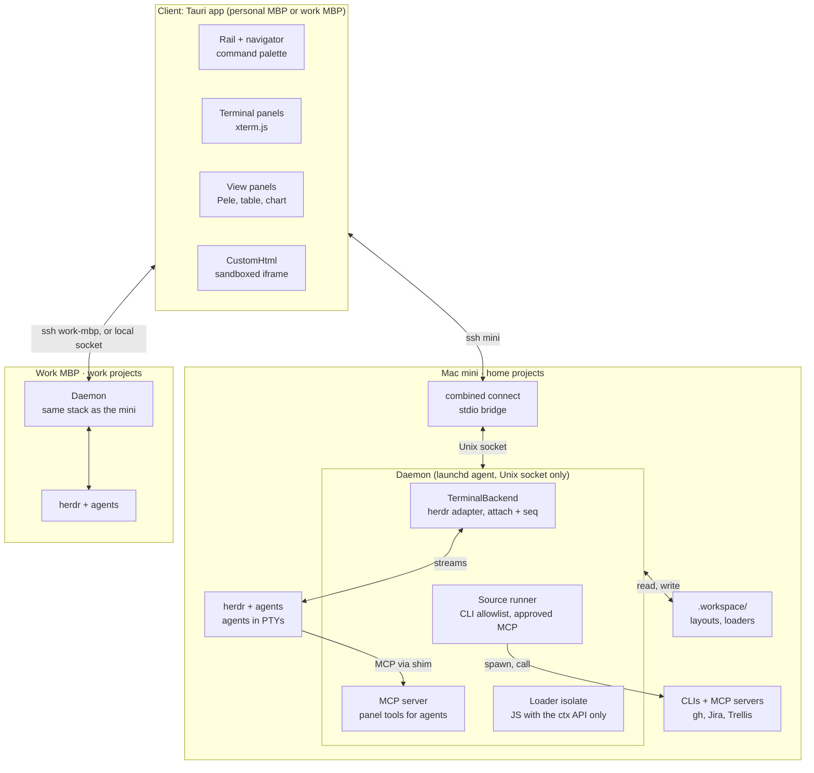

# Combine — Spec (rev 12)

Updated 2026-11-21

Combine is named for the combine harvester and for the verb: it combines every agent terminal, and the views agents build around them, into one window.

One Tauri window shows one herdr or Rex space at a time: its agent terminals plus the panels agents build. A small daemon on each agent host (the home Mac mini, the work MBP) owns terminals, the agents' MCP server and panel loaders; the app is a client that reaches each daemon over SSH, or directly over a Unix socket on the same machine.

**Changes from rev 1:** workspaces follow herdr/Rex spaces; one window; a daemon per host with remote clients; terminal streaming from the first milestone; panels can run JS loaders on the agent's host; panel groups; state stays in files, no database.

**Changes from rev 2:** `attach` joins snapshot and stream with sequence numbers; an M0 fidelity spike; render-feedback states, revisions and idempotency; a file conflict policy; per-tool MCP allowlist; cache keys include host and project; explicit threat model and limits; macOS-only v1.

**Changes from rev 3:** SSH transport instead of Tailscale, with no network listener; stable host IDs; spaces keyed by the backend's own space ID; per-client focus and selection; stream epochs, emulator bootstrap and an input-ownership protocol; MCP server launch definitions need approval; repo trust covers the whole execution dependency set and starts in M1; loader run generations and cache freshness rules; aggregate limits; v1 is herdr-only behind a backend-neutral trait.

**Changes from rev 4:** named Combine; exact terminal attach is an M0 go/no-go gate; request generations per (space, panel, client); background refresh rules for client-dependent panels; separate loader and source pools; approval of a full execution manifest; SSH and wire-protocol contracts; per-client active tabs; one file store per shared project; corrected the work-data statement.

**Changes from rev 5:** checked against herdr-core's API (`hc schema`, 0.1.21): `terminal.attach` already gives an ordered first paint plus live bytes, answers terminal queries, arbitrates viewer size and has flow control, so Combine relays those instead of rebuilding them; spaces are derived from terminal `cwd` because herdr-core has no workspace object; repository layout and `.trellis/rules.toml` added.

**Changes from rev 6 (review):** the backend trait is per attachment, not per terminal; each attachment's stream is relayed as opaque bytes with an `(attachment, epoch, seq)` cursor instead of a structured per-terminal snapshot; herdr-core's `inexact` screen flag passes through; other machines' terminals are filtered out; the architecture table now says what each rule is checked by, and names the gaps `rules.toml` can't cover.

**Changes from rev 11 (S2, daemon core):** the backend trait's types are defined (`Capabilities`, `AttachEvent` payloads paired with their backend generation, `TermInfo`, `TermEvent`, `SpawnSpec`, `BackendError`), with a `GitProbe` port for a terminal's git root and a minimal `FileStore`; the daemon forwards size, display and focus for the owner only; an epoch counts an attachment's generations and seqs restart in each, while attachment IDs and ownership generations never repeat across daemon restarts; unsent output coalesces, so output within the credit granted never ends a stream with a `Gap`; the log's bounds, credit, grace and disconnect policies have numbers; the contract suite lives in `crates/combined/tests/contract/`, takes its runtime and faults from a per-backend target, measures output from a marker the test writes, and records the SPEC and source revision of every result. Review fixes (opencode review 10): `write`, `resize`, `focus` and `set_display` carry the ownership generation core authorized them under, and the adapter fences a deferred request by it: one issued under a generation older than the newest the terminal has received can't take the terminal back from the current owner, but still updates its attachment's latest requested size and display (typed bytes are still written, once, without activating it); an automatic reply carries the backend generation core authorized and the adapter drops it if the pair was rebuilt first; a backend refusal of input, resize, focus or display is reported to the attachment's client as `internal`, in Combine's words, instead of being lost; the fake's exited-but-draining state finishes an exited terminal whose output was waiting for credit; core has no `unwrap` or `expect`; a hand-off skips members on connections already marked for an overflow disconnect.

**Changes from rev 10 (S1, wire protocol):** the wire protocol is pinned down: big-endian frames capped at 1 MiB with four frame kinds, so typed input and automatic replies are binary, never JSON; memory per decoded control frame bounded by a constant factor of the cap; a `hello`/`welcome` handshake with an integer version; every control message and its fields; which messages travel in an attachment's ordered stream; `gap` answers a resume that can't be served; `replay_through` is `null` when there's nothing to replay; ownership notifications; error codes; and the client's `ack` is its only flow-control signal.

**Changes from rev 9 (review 5):** every backend generation of an attachment starts with a `Started` event, and the daemon starts a new epoch on it; automatic query replies have their own port method, fenced by epoch and ownership generation and never sent from replay; the attachment lifecycle is defined in terms of ownership (watch-only attachments have no input half, a non-owner's input half never takes the PTY size); output history can also have holes at resize boundaries; the replay log always has room for its final `Gap`.

**Changes from rev 8 (M0 findings):** each Combine attachment is a pair of herdr-core viewers, because only watch-only viewers get ordered resize boundaries; a `Resized` event is only ever the backend's own boundary; herdr-core's framed protocol, credit and resync behavior are recorded; withheld credit leads to an in-band resync, not a `Gap`; the first-paint losses Combine accepts are listed, and two are requested from herdr-core; the PTY returns to herdr-core's headless size when the last active viewer leaves; xterm.js uses Unicode 11 widths; every replay log append is bounded; M1's contract tests inherit M0's stricter checks. Details and evidence: `spike/m0/FINDINGS.md`.

**Changes from rev 7 (review 2):** each attachment's events (data, resizes, facts) form one ordered, replayable log, and the client acknowledges the last event it applied; the replay buffer is per attachment; the listener and PTY check is described as a conservative list of spellings, not proof; `tools/arch-guard` tokenizes instead of matching text, and reports what it can't analyze.

## Goals and non-goals

The app is one window over every space on every host you use, with agent-built panels around the terminals.

**Goals**

- One window. Picking a space swaps the whole screen to that space's terminals and panels, restored exactly as left.
- Spaces group a host's herdr-core terminals by project folder. Example: the `trellis` space holds a claude and two prime-agents; the `mimir` space holds a claude and an opencode.
- Several hosts: home projects run on the Mac mini, work projects on the work MBP. Either personal MBP, or the work MBP itself, can be the client.
- No dependency on a particular network: anything that carries SSH works (local network, VPN, Tailscale).
- Terminals stream from the first milestone; no polling phase.
- The coding agent in a terminal can create panels: persistent views of live data and one-off views such as "show me the class diagram for these related classes".
- Panels can carry JS loaders that run allowlisted CLIs and MCP tools on the agent's host and correlate the results.
- Panel groups (GitHub, Jira, Trellis) hold several related views of one service, linked by a shared selection.
- Mermaid diagrams rendered with [Pele](https://pele.run).

**Non-goals for v1**

- Replacing herdr or Rex. They keep owning PTYs, scrollback and session lifetime.
- Multi-user sharing or a hosted web version.
- Agent-written HTML as the main panel type. It stays a sandboxed fallback.
- A database. All state is files (see Persistence).
- Platforms other than macOS. Shortcuts, launchd and Unix sockets assume it.
- A network listener in the daemon. Remote access goes through SSH only.
- Backends other than herdr-core. v1 ships the herdr-core adapter only; the `TerminalBackend` trait stays backend-neutral so Rex or others plug in later without changes outside their adapter.

## Hosts and connections

Every machine that runs agents runs a daemon that listens only on a local Unix socket; clients reach remote daemons by running a small bridge over SSH.

| Machine | Runs | Role |
| --- | --- | --- |
| Mac mini (home) | herdr, agents, builds, daemon | Host for home projects |
| Work MBP | herdr, agents, daemon, app | Host for work projects; usually its own client |
| Personal MBP x2 | app | Client for the mini; can reach the work MBP over SSH, rarely used |

**Daemon** (`combined`, a launchd agent running as the user)

- Listens only on a Unix socket with user-only permissions. No TCP port, no WebSocket server.
- Talks to the local herdr or Rex over its local socket.
- Hosts the MCP server the local agents call, runs panel loaders, and is the authority for the space's files.
- Keeps working with no client attached: loaders refresh, agents get render feedback, state is saved.
- Generates a stable host ID (a UUID in `<daemon data>/host.json`) on first start. Clients key everything about a host by this ID, never by its address.

**Client** (the Tauri app)

- Holds a list of hosts, each with an SSH destination (e.g. `mini`, `jcarreira@work-mbp.local`, or an `~/.ssh/config` alias). The local daemon is reached over its Unix socket directly.
- Shows every connected host's spaces in one rail. A host that drops shows its spaces dimmed and reconnects in the background; its terminals keep running.

**Transport**

- The client runs the system `ssh` with `combined connect`, a stdio bridge to the daemon's Unix socket (like the MCP shim). One SSH session per host carries everything.
- The protocol over the bridge, and over a local socket, is the same: length-prefixed frames, JSON for control messages, and binary for terminal output, typed input and automatic query replies (see Wire protocol).
- **Handshake:** the client's first frame is `hello` with its protocol version; the daemon answers `welcome` with its version and host ID. A version mismatch closes the connection with a message naming both versions (`protocol version mismatch: client 2, daemon 1`).
- **Frames:** at most 1 MiB (2^20 bytes) each, counting the kind byte and the payload; larger terminal output is split. Replies and control messages are queued ahead of terminal output, and output from several attachments is interleaved round-robin, so a noisy terminal can't delay control messages or other terminals. Priority never reorders one attachment's events relative to each other: its data, resizes and other events, and the in-order `gap` that ends them, travel in one ordered stream (see Attach, sequence and epoch). Within one pull of a connection's output, all queued control messages go before stream messages.
- SSH provides authentication (the user's keys and agent), encryption, and server identity (`known_hosts`). Using the system `ssh` means `~/.ssh/config`, `ProxyJump`, and Tailscale SSH all work without app support.
- The client checks that the host ID reported over the bridge matches the one it stored for that host, so a changed address can't silently point the rail at a different machine.
- **SSH invocation:** `ssh -T -o BatchMode=yes <dest> <path>/combined connect`. No PTY is allocated; stdout carries only protocol frames; stderr is captured and shown in the client.
- **Failures are reported, never worked around:** an unknown or changed host key, a key whose passphrase isn't in the agent, or failed authentication each stop the connection with a message saying what to run in a terminal (`ssh <dest>` once, or `ssh-add`). Host-key checking is never disabled.
- **Remote binary:** non-interactive SSH often lacks Homebrew's `PATH`, so each host entry stores the absolute path to `combined` (default `/opt/homebrew/bin/combined`). A missing binary shows an install hint. M0 confirmed it: a bare command name fails over `ssh -T` (exit 127), and `~/.local/bin`, where `hc` lives, isn't on that `PATH` either.
- **Finding herdr-core:** the daemon connects to herdr-core's local socket directly, never through `hc`. As a launchd agent it starts with a minimal environment, so the socket path (herdr-core's default `~/.local/state/herdr-core/default/default.sock`, or what `HC_SESSION`, `HC_SOCKET` and the XDG paths select) is daemon configuration, checked at start.
- Reconnect: if the SSH session drops, the client starts a new one with backoff and resumes each attachment from its last applied cursor (see Attach, sequence and epoch).
- Latency budget: keystroke echo should stay under about 30 ms on a local network. M0 measured p99 at 0.5 ms or less locally, through the daemon and over ssh to localhost (input to echo received, before xterm.js applies it). The local-network measurement is part of M1.

**Wire protocol** (`crates/combine-protocol`, protocol version 1)

- **Scope:** version 1 covers the handshake and terminal attachments. Terminal lists and state events, spawning and panels arrive as new message types, with a version bump, in the work that needs them.
- **Frames:** `u32 length | u8 kind | payload`. Every integer on the wire is big-endian. The length counts the kind byte and the payload, and is between 1 and 2^20 (1 MiB). So a frame is at most 1 MiB plus its 4-byte prefix. A reader checks the length before allocating. Memory per decoded control frame is bounded by a constant factor of the 1 MiB cap: within the 32 MiB bound; the frame buffer for unknown values and unescaped keys. Unknown fields are skipped, never stored. There is one message per frame; batching (see Streaming) writes several frames per flush.
- **Kinds:**

  | Kind | Direction | Payload |
  | --- | --- | --- |
  | 1, control | both | one JSON object |
  | 2, data | daemon to client | `u64 attachment, u64 epoch, u64 seq`, then up to 1,048,551 bytes: one `Data` event |
  | 3, input | client to daemon | `u64 attachment`, then what the user typed |
  | 4, automatic reply | client to daemon | `u64 attachment, u64 epoch, u64 ownership generation`, then an emulator's query reply |

  Typed input and automatic replies are binary frames of different kinds: never JSON, and never one kind with a flag. Each data frame is its own event with its own `seq`. Output larger than a frame is split across consecutive seqs, and nothing reassembles it.
- **JSON:**
  - `type` names the message. Type names and fields are snake_case.
  - Receivers ignore fields they don't know, and a missing optional field reads as `null`.
  - Attachment IDs, epochs, seqs, ownership and backend generations, and request IDs are unsigned 64-bit integers.
  - The host ID is the daemon's UUID as a lowercase string, and a terminal is its opaque `TermId` string.
  - A `cursor` is `{ attachment, epoch, seq }`.
  - A `display` is `{ foreground, background, cursor_color, cell_width, cell_height }`: `#rrggbb` colours and the cell size in pixels.
  - Nested `cursor`, `options` and `display` values also decode from JSON array form (`"cursor":[7,4,9]`), as serde does by default. A decoder accepts it; senders never produce it. The message itself must be an object.
- **Version:** one integer, starting at 1.
  - Any change an older peer can't safely ignore bumps it: a new message type, frame kind or enum value, or a changed or removed field. A new optional field doesn't.
  - The daemon accepts only its own version, with no negotiation.
  - The frame header, `hello`, `welcome` and the `version_mismatch` error never change, so any two versions can tell each other they differ.
- **Handshake:** the client's first frame is `hello { protocol_version }`. The daemon answers `welcome { protocol_version, host_id }`. If the versions differ, it instead sends `error` with code `version_mismatch` and the message `protocol version mismatch: client <c>, daemon <d>`, then closes.
- **Client to daemon:**
  - `attach { request, terminal, options }` is a fresh attach. Its options are `cols`, `rows`, `display`, `observe` and `history`; `resume` takes the place of the trait's `resumed`.
  - `resume { request, cursor }`
  - `detach { attachment }`
  - `ack { cursor }`
  - `resize { attachment, cols, rows, ownership_generation }`
  - `focus { attachment }`
  - `set_display { attachment, display }`
  - `request_ownership { attachment }`
  - input and automatic-reply frames.

  `request` is chosen by the client and echoed in the reply.
- **Daemon to client:**
  - `welcome`.
  - `attached { request, attachment }`, sent before the attachment's first `started`.
  - `resumed { request, attachment, replay_through }` and `gap { attachment, request }`.
  - `ownership { attachment, ownership_generation, owner }`, where `owner` is an attachment ID, or `null` for no owner.
  - `error { code, message, request, attachment }`.
  - The attachment events, each with its `cursor`:
    - `started { backend_generation, cols, rows, fidelity, ordered_resizes }`, with `fidelity` `exact` or `inexact`;
    - data frames;
    - `resized { cols, rows }`;
    - `facts { display }`;
    - `resynced`;
    - `closed { reason }`, with reason `detached` or `exited`;
    - `lost`.

  `detach` is answered by the attachment's final `closed` with reason `detached`.

  An attachment's ordered stream carries its attachment events. If the stream ends with an in-order `gap` (`request: null`), that gap comes after the last event. Everything else here is control traffic, queued ahead of output (see Transport): `welcome`, `attached`, `resumed`, a `gap` that answers a resume, `ownership` and `error`.
- **Flow control:** no credit message crosses the wire. The client's `ack` of the last event it applied is its only flow-control signal; the daemon's credit to the backend stays inside the daemon.
- **Errors:**
  - `code` is one of `version_mismatch`, `malformed`, `unknown_terminal`, `attach_failed`, `unknown_attachment`, `stale_generation`, `watch_only`, `invalid_request` (including a `hello` after the handshake) and `internal`. `message` is for people. `request` or `attachment` names what the error answers.
  - A frame that can't be decoded is a protocol error: truncated, over the cap, an unknown kind or message type, or bad JSON. The receiver closes the connection, and the daemon sends `malformed` first. The codec returns each of these as a typed error and never panics.
- **Neutrality:** protocol types name nothing from a particular backend:
  - no backend name;
  - none of herdr-core's frame-kind spellings (`AUTOMATIC_INPUT`, `CREDIT` and the rest) or kind numbers;
  - no channel or credit message.

  The names SPEC gives the trait and its events (`attach`, `resize`, `focus`, `Data`, `Resized`, `Facts`, `Closed`) are neutral, even where herdr-core uses the same word.

## Core concepts and data model

A space is one project folder on one host: the herdr-core terminals started in it. herdr-core has no workspace object, so Combine derives spaces from each terminal's `cwd`.

| Concept | What it is | Key | Owned by |
| --- | --- | --- | --- |
| Host | A machine running a daemon | Host ID (UUID from the daemon) | Daemon |
| Space | The terminals started in one project folder | Host ID + project path | Derived from herdr-core terminal `cwd` |
| Terminal | One live PTY: shell or agent | `TermId`, e.g. `hc:t8` | herdr-core |
| Panel | A tab in a tile: terminal view or data/diagram view | Panel ID | App (files) |
| Panel group | Several panels for one service, sharing a loader library and selection | Group instance ID | App (files) |
| Layout | Split tree of tiles; each tile is a stack of panels shown as tabs | Per space | App (files) |

- A terminal joins the space of the git root containing its starting `cwd` (or that folder itself outside git), and stays there: a program that later changes directory doesn't move it. The navigator can reassign a terminal explicitly; the assignment is daemon runtime state. The daemon finds the git root through a `GitProbe` port: the nearest ancestor of the starting `cwd` holding `.git` (a directory: a repository; a file: a worktree or submodule) is the space's folder; with none, the `cwd` itself. A space's ID is that folder's path.
- A git worktree has its own root, so it is its own space.
- Only the host's own terminals count. herdr-core also lists terminals on machines it has linked (`work/t7`); those never join a space here (see Terminal backends).
- The daemon keeps one in-memory file store per project path, with a single revision counter, so every reader of a `.workspace/` sees one copy (the `FileStore` port: read, write and the revision).

Three models, never one serialized and then stripped: a portable spec, daemon runtime state, and per-client state.

```
// Portable spec: <project>/.workspace/
SpaceLayout   { version, root: SplitNode, groups: [GroupInstance] }       // layout.json
SplitNode   = Split { dir: H | V, ratio, a, b } | Tile { id: TileId, panels: [PanelId], active: PanelId }

PanelSpec     { version, id, title, lifetime: Persistent | Scratch, group?: GroupInstanceId,
                content: Terminal { slot: String, template: SpawnSpec, follow_active }
                       | View { renderer, loader?: "loader.js", sources: [Source],
                                refresh, params: Map<String, Value | GroupRef> },
                created_by: User | Agent { slot } }

GroupInstance { id, group: "github", params: { repo: "SquashMerge/trellis" } }

// Daemon runtime state: <daemon data>/state.json
SpaceBinding  { space_id, slots: Map<slot, TermId>, trust: TrustRecord, file_hashes: Map<path, hash> }

// Per-client state: <client data>/hosts/<host-id>.json
ClientSpaceState { space_id, focused_tile: TileId, active_terminal: slot,
                   active_tabs: Map<TileId, PanelId>,                     // overrides Tile.active
                   group_state: Map<GroupInstanceId, { selected_pr?: 123, ... }> }
```

**Who owns which state**

| State | Scope |
| --- | --- |
| Panel definitions and saved layout | Shared per space (files) |
| Terminal slot bindings, trust approvals | Daemon |
| Focused tile, active terminal, last active space | Per client |
| Active tab in each tile | Saved default (`Tile.active`) in the layout; per-client override |
| Group selection (e.g. selected PR) | Per client |
| PTY size and input ownership | Daemon-arbitrated per terminal |

- Two clients can look at the same space differently: switching terminals or selecting a PR on one laptop doesn't change the other. Shared live selection would be an explicit later feature.
- Tiles and panels have stable IDs, so focus and bindings survive reloads.
- A terminal panel refers to a logical `slot` (e.g. `claude`, `prime-1`); the daemon maps the slot to a live `TermId`. If the terminal is gone, the panel shows "exited" with options to respawn from the template or close.
- `follow_active: true` shows the client's active terminal; `false` pins the panel to its slot, so two agents can sit side by side.
- Repo files never hold a `TermId`; `created_by` and terminal sources refer to slots.

## Persistence

No database: every panel is a directory of plain files on the space's host, so agents can create and edit panels with their ordinary file tools and changes are diffable.

```
<project>/.workspace/                 per project, on the host that has it
  layout.json                         split tree, tile stacks, group instances, version
  panels/<panel-id>/
    panel.json                        PanelSpec: renderer, refresh, params, group
    loader.js                         optional; runs in the daemon
    view.html                         optional; CustomHtml only

<daemon config>/                      per host, e.g. ~/.config/combine/
  settings.json                       CLI allowlist, approved MCP servers and tools, limits
  groups/<group>/                     group library: github, jira, trellis, ...
    group.json                        name, params schema, panel templates
    lib.js                            helpers shared by the group's loaders
    panels/<name>/{panel.json, loader.js}

<daemon data>/
  host.json                           stable host ID
  state.json                          SpaceBinding per space, pins and recents
  scratch/<space-id>/<panel-id>/      scratch panels until pinned or closed

<daemon cache>/sources/               last good data per source key

<client data>/
  hosts.json                          host IDs, SSH destinations, rail order
  hosts/<host-id>.json                ClientSpaceState per space, last active space
```

- **Authority:** the daemon is the sole authority for mutations made through the API (clients and MCP tools). The files stay editable by agents, editors and `git`; the daemon treats those as outside edits.
- **Watching:** the daemon watches `.workspace/` and the group library and reloads on change.
- **Self-write detection:** the daemon records the hash of every file it writes, and ignores watcher events whose content matches.
- **Conflicts:** if an outside edit lands while the daemon holds an unsaved change to the same file, the outside edit wins. The daemon re-applies its pending change on top only if it touches different fields; otherwise it drops it and reports that in `list_panels`.
- **Invalid files:** invalid JSON or an unsupported `version` leaves that panel showing the error and its last good spec; the daemon never overwrites a file it can't parse.
- **Read-only projects:** if `.workspace/` can't be written, the space's layout lives in `<daemon data>` and the rail marks it.
- **Safe writes:** temp file and rename, debounced about 500 ms on layout changes, immediate on space switch and quit.
- **Scratch panels** survive space switches and daemon restarts; they are deleted when closed, or after 7 days unopened.
- **Versioning:** every JSON file has a `version` field for later migrations.

## Navigation

A rail of spaces grouped by host swaps the whole screen; a terminal navigator swaps which terminal a panel shows; one command palette reaches both.

**Space rail (left edge)**

- One section per host (`mini`, `work-mbp`), listing that host's spaces by folder name. Pinned spaces first, then by recent activity.
- Spaces with no live terminals stay listed, dimmed, if pinned or recent. Opening one starts a shell there.
- Each entry shows a badge for terminals needing attention: agent waiting for input, command finished, process exited.
- A terminal started in a new folder on any connected host makes its space appear automatically. "Open folder" starts a shell there through herdr-core, with a single terminal panel.

**Terminal navigator (sidebar section, collapsible)**

- Lists the selected space's terminals: name, command, state, last output line. In the `trellis` space that is the claude and the two prime-agents.
- An "All spaces" toggle lists every terminal on every host, grouped by host and space.
- Clicking a terminal shows it in the focused terminal panel if that panel follows the active terminal; otherwise it opens a new terminal panel beside it.
- Actions: new terminal (shell or agent template), rename, kill, open in a new panel, open in herdr or Rex natively.

| Shortcut | Action |
| --- | --- |
| Cmd+K | Command palette: spaces, terminals, panels, groups, actions, fuzzy matched |
| Cmd+P | Switch space |
| Cmd+T | Switch terminal in the focused panel |
| Cmd+1 to Cmd+9 | Go to space 1 to 9 on the rail |
| Cmd+[ / Cmd+] | Previous / next terminal in this space |
| Cmd+Shift+N | New terminal in this space |
| Cmd+Option+arrows | Move focus between tiles |

**Switching rules**

- Switching spaces never kills terminals; the client only detaches the old space's terminal panels.
- Three kinds of subscription, kept separate: high-volume terminal output (visible panels only), lightweight state events for every terminal on every host (badges, navigator), and space discovery (new or removed spaces).
- Client-independent persistent panels keep refreshing in the daemon on their own policy; the client just stops drawing them (see Background refresh).
- Each client remembers, per space, its focused tile and active terminal, so returning restores exactly where you were on that machine.

## Terminal backends

The daemon talks to herdr-core or Rex through one `TerminalBackend` trait over their socket APIs from the start; there is no CLI-polling phase.

```rust
#[async_trait]
pub trait TerminalBackend: Send + Sync {
    fn id(&self) -> &'static str;                                       // "herdr-core" | "rex"
    fn capabilities(&self) -> Capabilities;                             // agent_state, ordered_attach, ...
    async fn list(&self) -> Result<Vec<TermInfo>>;                      // this host's terminals only: cwd, argv, state
    async fn watch(&self) -> Result<BoxStream<'static, TermEvent>>;     // created, changed, exited, lost, restarted
    async fn spawn(&self, spec: SpawnSpec) -> Result<TermId>;           // cmd, cwd, env, labels, initial size
    async fn attach(&self, id: &TermId, opts: AttachOptions) -> Result<Box<dyn Attachment>>;
    async fn kill(&self, id: &TermId) -> Result<()>;
}

pub struct AttachOptions { pub cols: u16, pub rows: u16,
                           pub display: Display,      // the viewer's colors and cell size
                           pub observe: bool,         // watch only: never types or resizes
                           pub resumed: bool,         // back after a dropped line
                           pub history: u32 }         // scrollback lines to paint first

pub struct Capabilities {
    pub ordered_attach: bool,   // attach gives an ordered first paint, then live bytes
    pub byte_credit: bool,      // credit() meters Data bytes; false: credit() is a no-op
    pub initial_credit: u32,    // Data bytes a new display stream may send before any credit()
    pub display_queries: bool,  // set_display feeds query answers and yields Facts; false: no-op
    pub automatic_replies: bool, // write_automatic reaches the program; false: no-op
    pub resync_signal: bool,    // emits Resynced when it drops output
    pub agent_state: bool,      // reports agent status
}

pub enum AttachEvent {
    Started { cols: u16, rows: u16, fidelity: Fidelity, ordered_resizes: bool },
    Data(Vec<u8>), Resized { cols: u16, rows: u16 }, Facts(Display),
    Resynced, Closed(CloseReason), Lost,
}

/// One viewer of one terminal. Two panels on one terminal are two attachments.
#[async_trait]
pub trait Attachment: Send {
    fn fidelity(&self) -> Fidelity;                         // Exact | Inexact, as the backend reports it
    fn ordered_resizes(&self) -> bool;                      // Resized events are the backend's own boundaries
    fn events(&mut self) -> BoxStream<'static, (BackendGeneration, AttachEvent)>; // once; a second call gets an empty stream
    async fn write(&mut self, bytes: &[u8]) -> Result<()>;   // what the user typed
    async fn write_automatic(&mut self, generation: BackendGeneration, bytes: &[u8]) -> Result<()>; // the emulator's own query replies: never takes ownership; dropped unless the pair is at `generation`
    async fn resize(&mut self, cols: u16, rows: u16) -> Result<()>; // a request: Ok means stored, not that the PTY changed
    async fn focus(&mut self) -> Result<()>;
    async fn set_display(&mut self, display: Display) -> Result<()>;
    async fn credit(&mut self, bytes: u32) -> Result<()>;
    async fn detach(self: Box<Self>) -> Result<()>;
}
```

The trait's types live in `crates/combined/src/ports/` and `src/model/` and name nothing backend-specific. `Result<T>` is `Result<T, BackendError>`: `UnknownTerminal(TermId)`, `RemoteTerminal(TermId)` (another machine's terminal, rejected in any call; the daemon reports it as `unknown_terminal`), `InvalidRequest(String)`, `Closed` or `Failed(String)`. `TermInfo { id, cwd, argv, state: Running | Exited { exit_code }, labels, cols, rows }`; `SpawnSpec { argv, cwd, env, labels, cols, rows }`; `TermEvent` is `Created`, `Changed`, `Exited`, `Lost` or `Restarted`, and a watch stream carries changes after the call, so the daemon watches first, then lists. `initial_credit` is what a new display stream may send before any `credit` (herdr-core: 262,144 bytes). Every event is paired with the backend generation that produced it; an attachment's generations strictly increase, and `Started` opens each. Methods other than `attach` complete once the request is queued. In M1 the daemon always passes `resumed: false`; adapters rebuild pairs on their own.

- Every operation on a viewer goes through its attachment. Terminal identity (`TermId`) and attachment identity are separate, so two panels on one terminal can ask for different sizes and displays and have their own focus.
- **A terminal has one size.** Each attachment *requests* a size, but the PTY has one, set by the panel that holds input ownership. A panel that isn't the owner shows the PTY's size (letterboxed), and learns it from its `Resized` events. An attachment keeps its latest requested size and display separately from the PTY size it observes, and reapplies them when it is re-created.
- **The daemon forwards size, display and focus for the owner only.** It calls `resize`, `set_display` and `focus` on an attachment only while it holds ownership, and keeps a non-owner's latest requests itself. On a grant it sends the stored display (with `display_queries`), the stored size, then `focus`, then any input that asked for ownership. `focus` makes the attachment the active one, and a backend that arbitrates size gives the PTY that attachment's latest requested size. When an owner's pair is rebuilt, the daemon sends `focus` once the new `Started` arrives; the rebuilt pair reapplies the latest size and display it was given.
- **`Resized` is the backend's boundary, never Combine's.** It marks the point in the stream where bytes switch from the old size to the new one. An adapter never emits one when it *sends* a resize: output the backend already produced at the old size may still be on its way, and would land after it (M0 reproduced a wrong screen this way). A backend that can't report ordered resizes says so with `ordered_resizes() == false`.
- `Resynced` means the backend dropped output it couldn't deliver and a fresh paint **begins** here, so the screen will be right but history has a hole. Only backends that signal it emit it; herdr-core 0.1.21 doesn't yet (see below).
- **`Started` opens every backend generation of an attachment:** the first attach, and every time the adapter replaces what's behind it (a reconnect, a restart, a pair rebuilt after one half failed). It carries the new generation, the actual size and the fidelity, and comes before any of that generation's `Resized` or `Data`. The daemon starts a new wire epoch on each `Started`, and drops any late event or command from an older generation. `Closed` after an intentional detach or the program's exit is final: no new generation follows. Any other event from a generation that isn't current, or before the first `Started`, is dropped silently, and so is a `Started` that isn't newer. After `detach()` the stream ends, and the daemon writes the final `closed { reason: detached }` itself. A stream that ends without `Closed` or `Lost` counts as `Lost`.
- **Capabilities say what's a no-op.** A backend without byte credit or display queries says so in `capabilities()`, and `credit` or `set_display` then do nothing. A successful `resize` means the request was stored; a same-size request, or one from an attachment that doesn't own the terminal, changes nothing and produces no `Resized`. `Facts` follows a `set_display` once the backend has applied it; without `display_queries`, none comes. Without `automatic_replies`, `write_automatic` does nothing.
- `Data` is opaque: the first paint and live bytes, in order. The daemon never parses or emulates it, but it never reorders `Data` relative to the attachment's other events either: bytes painted at 80 columns must reach xterm.js before the `Resized` to 120 and the replacement paint that follows it.
- Spaces aren't a backend concept: the daemon derives them from `TermInfo.cwd` (see Core concepts).

**What herdr-core provides** (checked against `hc schema`, herdr-core 0.1.21, protocol generation 1)

| Need | herdr-core primitive |
| --- | --- |
| Transport | JSON-RPC 2.0 on the local hc socket; `hello` with `framed: true` switches the connection to framed mode |
| Terminals | `terminal.list` / `terminal.get` (address, `cwd`, `argv`, size, labels, foreground). `events.subscribe` returns a snapshot with a `seq`, then every fact change in order; after `missed`, take a fresh snapshot. Both include every connected machine's terminals (`machine/t7`), which the adapter drops |
| Attach | `terminal.attach` opens a channel: first paint, then live bytes, in order. Input goes back as DATA; RESIZE, FOCUS, FACTS, CREDIT and CLOSE frames control it. No output sequence or structured screen fields are exposed. A paint's start is marked in the stream (`CAN`, then `ESC [ ! p`); its end isn't, and paints aren't wrapped in synchronized output |
| Size | The last *active* viewer to attach, focus, type or resize sets the PTY size. `observe` viewers never type or resize; `resumed` viewers set size only once active again. **Only `observe` viewers get `resize_notifications`:** RESIZE, then a replacement paint, ahead of the program's redraw. An active viewer isn't told when another viewer changes the size. When the last active viewer leaves, the PTY returns to the core's headless size (default 200x120) |
| Screen fidelity | `Terminal.screen` is `exact`, or `inexact` after a core crash when older history may be missing. `exact` is herdr-core's recovery status, not a promise that the paint loses nothing (see the first paint, below) |
| Terminal queries | herdr-core answers most queries itself, even with no viewer: DA1–3, DSR, CPR, OSC 10/11/12 and 4, `CSI 14/16/18/19 t`, XTVERSION, DECRQM, kitty keyboard, DECRQSS. Display answers come from the **most recently active** viewer's `display`. Seven reach the viewer unanswered: DECXCPR, `CSI 21 t`, XTGETTCAP, OSC 52 read, ENQ, DECREQTPARM, kitty graphics `a=q` |
| Flow control | CREDIT counts bytes of DATA. The initial allowance is 256 KiB, first paint included. Credit never blocks the program: herdr-core queues about 4 MiB per viewer, then drops that viewer's backlog and sends a fresh paint in-band, with no other signal |
| Agent state | OSC 7501 status reports: `Terminal.status`, `status_ms`, `turn` (`reported` only says whether one was ever sent; `records` holds secondary ids); `terminal.wait` |
| Loss and restart | Loss ends the stream. `restarted` applies to kept terminals that were recovered; reattach after it. `server.restart` saves screens and the next core adopts running programs; the stream ends with EOF and no CLOSE, and a re-attach about 1 s later gets a byte-identical paint. The stream alone can't tell a restart from a crash, so the adapter checks `events.subscribe` or `terminal.get` |
| Caller identity | `HC_TERMINAL_ID` in each terminal's environment; `caller` param on calls |
| Remote | `hc connect` speaks the API over stdio (`ssh box <absolute path>/hc connect`); a core can add other machines (`machine.add`, addresses like `mini/t7`) |

**Framed protocol** (documented in herdr-core's `schema/README.md`, "Framed mode", not in `hc schema`; M0 confirmed it, evidence in `spike/m0/FINDINGS.md` section 1): `hello` and its reply are newline-terminated JSON, and framing starts with the next byte. Each frame is `u32 LE channel | u8 kind | u32 LE length | payload`; channel 0 carries JSON-RPC. Kinds: 0 DATA, 1 CREDIT (u32 LE bytes), 2 CLOSE (JSON exit detail from the core), 3 RESIZE (u16 LE cols, rows), 4 FOCUS (u8), 5 FACTS (JSON display), 6 AUTOMATIC_INPUT. Core-to-viewer DATA frames are at most 16 KiB. These are observations of 0.1.21; the adapter checks the protocol generation in `hello` and refuses one it doesn't know.

**How the herdr-core adapter builds an attachment: a pair of viewers.**

- **A display viewer** (`observe`, `resize_notifications` requested *and confirmed* in the attach reply). Its stream is the attachment's `Data`, and its RESIZE frames become `Resized` events, each followed by the replacement paint. These are the only correct resize boundaries herdr-core offers. If the reply doesn't confirm `resize_notifications`, the attachment reports `ordered_resizes() == false` and the panel shows a warning.
- **An input viewer** (active), only for attachments that may type: a watch-only attachment (`observe`) has no input half at all. It carries `write`, `write_automatic` (AUTOMATIC_INPUT, when both `hello` and the attach reply confirm `automatic_input`), `resize`, `focus` and `set_display`. Its own output is credited on its own budget as it arrives and discarded; it never enters the replay log, and the credit the daemon grants for the display stream (see Backpressure, under Attach, sequence and epoch) never reaches it. Credit passes between the daemon and herdr-core only; no credit message crosses the wire.
- **Opening a pair never moves ownership.** The input viewer always opens with `resumed: true`, so attaching takes no size, whether the attachment is new or re-created. The adapter opens the display half first, then the input half, and emits `Started` only when both are ready. A failure halfway tears down whatever opened. Size and display updates requested while a pair is opening are applied once it's ready, in order. Only after that, and only if the daemon confirms the attachment holds the current ownership generation, does it send FOCUS or RESIZE. A non-owner's size and display requests are stored, not forwarded. Typed input requested while a pair is opening is applied once it is ready too, in the same order; automatic replies and credit for the old pair are dropped. What an adapter holds while a pair reopens is bounded (the fake: 1,024 requests and 64 KiB of input); a request beyond the bound fails and is not applied. `write`, `resize`, `focus` and `set_display` carry the `OwnershipGeneration` core authorized them under. Per terminal, the adapter keeps the highest generation it has received in any of them, queued ones included. A request applied (live, or from a reopen queue) under a lower generation is superseded: it doesn't activate its attachment or change the terminal's size or display, but it still updates that attachment's latest requested size and display, and a superseded `write` still writes its bytes, once. A request at the highest generation applies normally. Core sends nothing extra for a rebuild: when the new `Started` arrives it re-asserts the current owner's focus under the current generation, and `focus` applies the size and display the owner last requested, which a superseded request never discards. A backend call that refuses a client's input, resize, focus or display change (a full reopen queue, say) is reported: the attachment's client gets an `error` with code `internal`, naming the attachment, with Combine's own text and none of the backend's. Nothing else changes, and a `Closed` refusal is not reported because the attachment's stream says so.
- **Both halves are supervised together.** If either fails, the adapter replaces both, re-created from the latest requested size and display, and emits a new `Started`. An attachment that owned the terminal gets ownership back deliberately, once the new pair is ready, not by whichever panel happens to type or reconnect first.
- **Cost:** two core connections per attached panel that may type; one for a watch-only panel.

The pair goes back to one viewer if herdr-core grants ordered resizes to active viewers too.

The daemon talks only to its own host's herdr-core, and uses only that host's terminals. herdr-core's lists, snapshots and events also carry every connected machine's terminals, so the adapter drops machine-qualified addresses (`work/t7`) from all of them and rejects one in any call. Otherwise a mini that had `machine.add`ed the work MBP would show work terminals under a mini space, run their loaders on the wrong host, and duplicate them when the work daemon is connected too. A Rex adapter (after v1) would map its own primitives behind `capabilities()`.

**Attach, sequence and epoch**

Each client panel gets its own backend attachment, and the daemon relays that attachment's stream as opaque bytes. There is no shared per-terminal stream: each viewer gets its own first paint and replacement paints, so one viewer's bytes are never replay history for another.

- **One ordered event log per attachment.** The daemon relays every `AttachEvent` (`Started`, `Data`, `Resized`, `Facts`, `Resynced`, `Closed`, `Lost`) in one sequence, each carrying a cursor `(attachment ID, epoch, seq)`. A `Data` chunk split across frames keeps one `seq` per frame, in order. The epoch counts the attachment's backend generations: 1 for its first `Started`, then one more for each, so a reset is never mistaken for a continuation. Seqs restart at 0 in every epoch, and `Started` is seq 0. Attachment IDs and ownership generations come from one counter that never repeats, even across daemon restarts (each incarnation starts above every value an earlier one issued), so after a restart every attachment is new and a cursor from before it never matches. Consecutive output the client hasn't been sent yet is coalesced into one `Data` event, up to a frame (1,048,551 bytes); output already sent is never changed. The first event of every epoch tells the client to discard its xterm.js and start a new instance with that epoch's size.
- The client acknowledges the last event it has **applied** to xterm.js (bytes written, resize done), not the last frame received. Replay starts after that event. The client resizes its xterm.js when it applies a `Resized` event from the log, never ahead of it, so replay matches what the live client did.
- **Replay is marked.** The daemon's reply to a resume names `replay_through`: the cursor of the last event it is replaying. Events up to and including it are replay, and everything after it is live. Cursors keep their original values. `replay_through` is `null` when there's nothing to replay, and everything after `resumed` is live. `resumed` comes before the first replayed event. A valid same-epoch resume keeps the client's xterm.js instance, but the client never forwards automatic query replies produced while applying replayed events. Replay is every event the log still holds after the resume cursor, and `replay_through` is the last of them. A resume cursor must be the last acknowledged event or a later event the daemon has sent, and a log that is still live must have room for its Data margin (below); anything else is answered with `gap`.
- If the client's connection drops, it reconnects and resumes from its last applied cursor. The daemon keeps the attachment open for a grace period (about 30 s) and replays the event log from a bounded per-attachment buffer (about 4 MB), or answers `Gap`. Replay carries resizes and facts in their original places, never bytes alone. On `Gap` the client discards its xterm.js parser and screen state (a new instance, not `clear()`) and attaches again, getting a fresh first paint. A resume the daemon can't serve exactly (the log hit its bound, the grace period ended, or the daemon restarted and doesn't know the attachment) is answered with `gap`, carrying the resume's `request`. The in-order `Gap` that ends a live stream travels in the attachment's stream after its last event, with no `request`. After either, the attachment ID is finished, and the client attaches fresh. During the grace period the attachment stays attached to the backend, and its log keeps appending within its bounds. `Lost` is final, like `Closed`. An attachment is finished once its client acknowledges its final event or receives its `Gap`. A `detach` before the first `Started` ends the stream with the in-order `gap`, since there is no epoch to close.
- **The resume cursor belongs to the client's xterm state.** The client resumes from its own last-applied cursor, kept with that xterm.js instance, not from the last acknowledgement the daemon happened to receive (an acknowledgement can be lost). A client that has lost its xterm state (a webview reload, a restarted app) has no cursor to resume from, and attaches fresh.
- Two guarantees, kept separate. **State fidelity:** a fresh attach shows the current screen as the backend has it. The attachment carries the backend's fidelity (`Exact`, or `Inexact` when herdr-core reports `screen: "inexact"`); Combine never upgrades `Inexact`, and the panel header shows it. **Output history:** bytes are delivered in order only while the client stays within the replay buffer and the backend hasn't superseded output. herdr-core supersedes it in two places: a resync after a viewer falls behind, and a resize, where output still pending for the display viewer is replaced by the RESIZE and its paint. After a `Gap`, a resync, or a resize, only state is guaranteed. Continuous Combine sequence numbers don't prove continuous backend output.
- **Backpressure:** the daemon grants herdr-core CREDIT only while the attachment's log has room, so a slow client never makes the daemon buffer without bound. herdr-core doesn't stall the program in return: past its own ~4 MiB per viewer it drops the backlog and repaints in-band. Combine accepts that as the slow-client path (the screen ends right; the skipped output is gone). It shows "output skipped" only when the backend reports `Resynced`; matching `CAN ESC [ ! p` in the bytes would be a guess, since program output can contain it and frames can split it. M0's 50 MB burst into an xterm.js client hit this 11 times. On the wire, the client's `ack` is its only flow-control signal; there is no client credit message.
- **Every append is bounded**, whatever its kind: the log caps retained bytes and event count, so a client that stops reading while resizes keep coming still hits the cap. Control and input queues per connection are bounded too. Overflow is a `Gap` in order, never a dropped or reordered event. The log always keeps room for that final `Gap`; after it the attachment's stream stops, and resuming from before it fails rather than replaying a partial log. A peer too blocked to receive even the `Gap` is disconnected under a bounded policy. The bound counts credit already granted to the backend and bytes in flight, not only what the log holds. Defaults: 4 MiB and 16,384 events per log; each event costs its payload plus 64 bytes; the final `Gap`'s 64 bytes and one event are always reserved; 64 KiB is never granted as credit, and credit goes out in grants of at least 64 KiB; the grace period is 30 s. The bound is retained events plus credit granted but not yet received. Output within that credit never overflows the log: events other than output must leave a small Data margin (room for the few output events the outstanding credit can still create), and while the log is live, the newest output is held back from a client that has stopped acknowledging once half the 64 KiB reserve is in use. When the log ends (a final event or the `Gap`), everything it holds is sent. A new `Started` is checked against its fresh allowance. Only other events (a resize flood), output beyond credit, or a new generation that can't fit end a stream with the final `Gap`. A connection that hasn't received an attachment's final `Gap` within 10 s is disconnected, and that attachment is finished. A connection's queue of control messages holds 1,024, and overflowing it disconnects the connection. The disconnect takes effect when the step that caused it finishes, never in the middle of it, and the message that caused it is still applied. While a connection is marked, a hand-off skips its members. The newest output is held back for a client that has stopped acknowledging on either condition: less than half the 64 KiB reserve free, or fewer than half of the log's event slots free.

**Where the first paint comes from (M0 go/no-go)**

herdr-core keeps each terminal's screen and sends it as the first paint of every attach, ordered before live bytes on the same channel. So the daemon needs no emulator, and attaching can't race the stream. The schema doesn't define the frame encodings, the end of the first paint or credit units; M0 pinned those down (Framed protocol, above).

**M0 result (2026-11-20): passed, with recorded losses.** A fresh attach restored the screen, cursor, alternate screen and input modes (mouse 1000/1002/1003 with SGR 1006, focus 1004, bracketed paste, application cursor keys and keypad) for a terminal started before the daemon, after a daemon restart, and after a herdr-core `server.restart`. It also restored the scroll region, SGR pen, charset, insert, origin and autowrap modes, and the title. Tested with vim, less and two fixture programs.

**Lost in the first paint**, decided:

| State | Effect after a fresh attach | Decision |
| --- | --- | --- |
| DECSC saved cursor | A program that restores its cursor before its next full redraw writes at the top-left and overwrites text there | Requested from herdr-core; until then, known limitation |
| DECSCUSR cursor shape | The default cursor shape instead of the program's (M0: a steady underline came back as the default), until the program sets it again | Accepted |
| Soft-wrap flags | Copying a long wrapped line gives line breaks; reflow on resize treats wrapped rows as separate lines | Accepted |
| OSC 8 links on cells already written | Existing links stop being links; a link still open keeps applying to new text | Accepted |
| OSC 4 palette and OSC 10/11 colours set by the program | The panel shows its own colours | Accepted |
| `?1007` alternate scroll | The wheel scrolls xterm.js's buffer instead of sending arrow keys | Accepted |
| End of the first paint | Not marked, so the client can't wait for a complete screen; it draws the paint as it arrives | Accepted |

- **Requested from herdr-core** (`docs/herdr-core-requests.md`): the saved cursor in the first paint, and an out-of-band signal when it drops a viewer's backlog and repaints (`Resynced`).
- **Unicode widths:** herdr-core lays out text with Ghostty's widths. xterm.js must use Unicode 11 widths (`@xterm/addon-unicode11`); with its default Unicode 6 tables, emoji rows came out one column off after a fresh attach.
- **Not a failure:** a terminal herdr-core reports as `inexact` after a core crash attaches with fidelity `Inexact`. Crash recovery is tested in M1, separately from planned restarts.
- **A backend without an ordered attach** (a future one) can only use the subscribe, read, nudge-a-repaint fallback. That is experimental and always `Inexact`.

**Input ownership protocol**

herdr-core already arbitrates between viewers: the last active viewer to attach, focus, type or resize sets the size. With herdr-core, focusing or typing in a panel sends FOCUS through that attachment's input viewer, herdr-core sets the size, and every attachment's display viewer gets the RESIZE and a replacement paint. The protocol below is what the daemon enforces among Combine's own attachments, and the full arbitration for a backend without it.

- Each attached panel gets an attachment ID; two panels in one client are separate attachments.
- The daemon decides ownership per terminal and keeps an ownership generation. A keystroke from a non-owner first asks for ownership; the daemon grants it, bumps the generation, notifies all attachments, and only then forwards the input. Typed input (frame kind 3) from a non-owner is that request, and `request_ownership` asks without typing. The daemon sends `ownership` (the generation and the owning attachment, or `null`) to an attachment after `attached` and `resumed`, and to every attachment of the terminal whenever it changes. Opening an attachment changes nothing. A non-owner's `focus` is recorded, not forwarded. A watch-only attachment's input, `request_ownership` and `resize` get `watch_only`; its `focus` and `set_display` are recorded silently, and it is never handed ownership.
- `resize` messages carry the sender's generation; the daemon rejects any from an older generation, so stale resizes can't fight the owner (`error` code `stale_generation`). A resize carrying any generation other than the current one, newer included, gets `stale_generation`.
- When the owner detaches or its connection drops, ownership passes to the attachment that most recently had focus, or none. With no active viewer left, herdr-core returns the PTY to its headless size (default 200x120), and the program redraws for it; the next owner's size applies when it becomes active. The candidates are the terminal's other attachments that may type, are on a live connection, and have had focus at least once; with none, the owner is `null`. Every change, including to `null`, bumps the generation.
- **Terminal query replies:** herdr-core answers most queries itself, using the display of the most recently active viewer, and strips them from the stream. Clients report their xterm.js colours and cell size through `set_display`. For the queries herdr-core leaves to viewers, its protocol has AUTOMATIC_INPUT (kind 6): reply bytes that reach the program without taking size or ownership. Only the **owner's** client forwards xterm.js's automatic replies, through `write_automatic` (AUTOMATIC_INPUT in herdr-core), never as typed input, so a reply never takes ownership or size. Core authorizes a reply for the backend generation of the `Started` that opened its epoch, and passes that generation to `write_automatic`; the adapter drops the reply when the pair's actual generation differs, even if core hasn't yet consumed the new `Started`. Each reply carries the epoch and ownership generation it was produced under, and the daemon drops one that doesn't match the current ones (frame kind 4; a dropped reply gets no error). The daemon forwards a reply only when its attachment is live and is the owner, its epoch and ownership generation are current, and the backend reports `automatic_replies`. A client never forwards replies produced while it applies replayed events. Other attachments drop theirs, since herdr-core passes duplicates from several viewers straight to the program. An `hc attach` outside Combine may answer too; a duplicate reply in that case is accepted. If a backend reports that it answers a query itself, clients don't. In practice that covers DECXCPR (`CSI ? 6 n`); xterm.js doesn't answer the other six, which stay a known limitation: a program that waits for one stalls until its own timeout. OSC 52 clipboard reads stay unanswered on purpose.
- `hc attach` from an ordinary terminal is another herdr-core viewer, outside Combine; herdr-core arbitrates between it and Combine's attachments. M0 tested both working together.

**Rules for adapters**

- The trait and its types carry nothing herdr-specific. Anything only one backend can do is a flag in `capabilities()`, not a method or field.
- Besides herdr-core, v1 ships an in-memory fake backend that implements the trait for tests. Every daemon and client test that doesn't need a real PTY runs against it. That helps keep the trait backend-neutral, but it can't prove a second real backend needs no trait changes. It lives in `crates/combined/src/testing/` behind the `test-support` feature.
- `TermId` is `<prefix>:<address>`: a fixed prefix naming the backend (`hc` for herdr-core, `fake` for the fake) and the backend's own address. Outside the adapter it is opaque; the daemon never parses it.
- Adapters hide reconnects and emit `Lost` only after giving up.
- Missing features are reported through `capabilities()`, and the UI hides what isn't supported.
- Every adapter passes one contract test suite:
  - spawn and attach, write and read back, resize, kill; a full-screen TUI (vim, htop); entering and leaving the alternate screen;
  - wide Unicode, emoji and grapheme clusters, with xterm.js on Unicode 11 widths;
  - a 50 MB output burst; hide/show and reconnect during heavy output, checked **byte for byte** (expected length and hash, from the end of the first paint), with drops timed so they hit while output is still flowing;
  - a disconnect and replay on each side of a resize's applied-event boundary, with unique old-size and new-size markers and an assertion that the resize happened at the right place, ending with the same screen as a client that never dropped;
  - **old-size output still in flight when a resize is requested** (delayed between backend and daemon), which must land before the `Resized` boundary;
  - two attachments on one terminal asking for different sizes and displays: each operation is routed to the attachment that sent it, both end showing the PTY's size, and a reconnected attachment reapplies its latest requested size, not its original one;
  - attaching to a full-screen program started before the daemon; restarting the daemon while it runs and attaching again; a backend restart; a backend crash (`Inexact`);
  - a slow client: the daemon's memory stays bounded for data **and** events (a resize flood while not reading); a program that exits while its output waits for credit still delivers all of it, then exactly one `Closed(Exited)`. Either the client gets the final `Gap` in order once it drains, or it is disconnected within the bound and its next resume is answered with `Gap`. Test both;
  - pair lifecycle: only the input half fails, only the display half fails, a pair fails halfway through opening; each ends in exactly one new `Started` and epoch, with no late event from the old generation;
  - ownership: a second panel that merely opens doesn't change the PTY size; a watch-only panel never does; ownership changes while a pair is reopening, and requests an owner queued before it lost ownership don't take it back when its pair reopens, even when the new owner's pair is reopening too and its latest size and display must still land;
  - query replies: one reply per query from the owner only; a replayed query followed immediately by a live one in the same epoch and ownership generation produces exactly one reply, for the live one; a stale-generation reply is dropped, and so is an old-epoch reply that reaches a pair rebuilt before core saw its new `Started`;
  - a mutation check: a variant that drops or moves a `Resized` event, or a byte, must fail the suite.

  Each test exits non-zero on failure and records the revision it ran against: a line naming the case, the target, the SPEC revision the suite implements and the source revision (`COMBINE_REVISION`, else `git rev-parse HEAD`), printed and appended to `contract-results.log` in Cargo's test scratch directory. The suite lives in `crates/combined/tests/contract/`, written against a `Target` that supplies its runtime, settle strategy, scratch directories, test program, marker and faults; an adapter's run skips, with the reason recorded, only cases needing a fault it can't inject. Byte-exact and screen checks measure from a marker the test program writes after the first paint (by default an OSC sequence no terminal displays; a target whose backend doesn't pass it through uses a printable marker), since a backend may not mark where its paint ends. The fake covers the items that need no real PTY, with synthetic output (the 50 MB burst included); the full-screen TUI and alternate screen, wide Unicode with xterm.js, a real-PTY burst, a full-screen program started before the daemon, and the crash and delayed-output cases against a real core run in the adapter's own run.
- The fake backend also injects what real runs rarely show: an `Inexact` terminal, and a local `t7` beside a remote `work/t7` with the same `cwd`, which must not appear. It also injects delayed old-size output across a resize, `Resynced` and silent in-band repaints, a backend restart and crash, pair failures (input half only, display half only, halfway through opening) with late events from the old generation, and has mutated variants (a dropped `Resized`, a moved `Resized`, a dropped byte) that the suite must fail.

## Panels, loaders and groups

A panel is a loader (optional JS, run in the daemon) that produces data, plus a built-in renderer that draws it in the client; groups bundle related panels for one service around a shared selection.

**Renderers** (in the client)

| Renderer | Shows | Input | Notes |
| --- | --- | --- | --- |
| Terminal | A live herdr/Rex terminal | Terminal slot | xterm.js with WebGL; follows the active terminal or is pinned |
| Mermaid | Class, sequence, flow, ER, state diagrams | Mermaid source | Pele `render()`; Mermaid 12.1.0 syntax; themed with `--pele-*` variables |
| Markdown | Notes, summaries, agent reports | Markdown text | Sanitized; code blocks highlighted |
| Table | Lists of records | JSON rows + column hints | Sort, filter, copy; a row click can set group state |
| Chart | Metrics over time or across items | JSON rows + chart spec | Line, bar, area |
| Log | Streaming text | Text stream | Tail with pause |
| CustomHtml | Anything else | HTML/JS + JSON | Sandboxed iframe, data only through `postMessage` |

**Loaders** (in the daemon, on the agent's host)

```js
// .workspace/panels/open-prs/loader.js
export default async function load(ctx) {
  const prs = await ctx.cli.run("gh-prs", { repo: ctx.params.repo });
  const checks = await ctx.cli.run("gh-checks", { repo: ctx.params.repo });
  const issues = await ctx.mcp.call("jira", "search", { jql: `key in (${keysFrom(prs)})` });
  return prs.map(pr => ({ ...pr, ci: checks[pr.number]?.state, jira: issues[pr.headRefName] }));
}
```

- The loader's only I/O is `ctx`: `cli.run(id, args)`, `mcp.call(server, tool, args)`, `files.read(path)` inside the project, `terminal.read(slot)`, `params`, and the group's `state` and `lib`.
- It runs in an embedded JS isolate in the daemon with no filesystem, network or process access, a time limit and a memory cap. Engine choice is open (deno_core or QuickJS).
- Its return value is validated against the renderer's input before it reaches a client.
- A panel with no loader uses a single declared source or static content.

**Loader runs**

- A run's **effective input** is the panel revision plus its resolved params, including the requesting client's group state. Effective inputs key the cache and shared computation.
- Each request gets a monotonically increasing **request generation** per (space, panel, client), and records its effective input and panel revision.
- A result is published to a client only if its request is still that client's current generation and revision. If PR 456 is selected after PR 123, a late result for 123 can still fill the cache, but never replaces the client's PR 456 view.
- A newer request asks older ones for the same (space, panel, client) to cancel. The generation check, not cancellation, is what guarantees correctness.

**Background refresh**

| Panel inputs | Behavior |
| --- | --- |
| Client-independent (no group state in its params) | Refreshes on its policy, with or without clients |
| Client-dependent, client connected | Runs for that client's effective input |
| Client-dependent, client disconnected | Selection-specific refreshes stop; the last results stay in the bounded cache |
| Agent asks for a client-dependent run | The agent must pass the input explicitly (e.g. `selected_pr`) |

- `panel_status` reports spec validation separately from results, and results per client or explicit input.

**Panel groups**

- A group definition lives in the host's group library (`groups/github/`): a params schema (e.g. `repo`), a shared `lib.js`, and panel templates such as PR list, PR detail, checks and diff.
- A space instantiates a group with params; the instance is one entry in `layout.json` plus its panels. The `trellis` space might hold a GitHub group for `SquashMerge/trellis` and a Trellis group for its index.
- Group state holds the selection and is per client. Clicking a row in the PR list sets `selected_pr` for that client; every panel whose params bind to it reloads for that client.
- By default a group opens as one tile with its panels as tabs; panels can be split out and stay in the group.
- Agents can create group definitions and instances through MCP tools or by writing the files directly.

**Panel lifetime**

Lifetime is separate from content: a pinned diagram is persistent static content; a live PR list is persistent loader content.

- **Persistent** panels live in `.workspace/` and survive restarts; their content is static or produced by a loader or source.
- **Scratch** panels (a one-off class diagram) live in the daemon's scratch area and open in a scratch tab stack. They are deleted when closed unless pinned; pinning moves them into `.workspace/`.

**Terminal panel behavior**

- The header shows terminal name, state, host and backend, and marks whether this panel holds input ownership; a dropdown switches terminals without leaving the panel.
- Output streams only while visible. On show, the panel either resumes into the xterm.js instance it kept (a valid resume within the grace period), or creates a new instance and attaches fresh: the first paint, then live bytes. Every new epoch gets a new instance, never a `clear()` of the old one.
- Keyboard input goes straight to the terminal when focused; app shortcuts use Cmd so they don't clash with the shell.
- Resizing the tile resizes the PTY only when this attachment holds ownership; otherwise the panel letterboxes at the owner's size.

## Data sources

The daemon runs every source on the agent's host, so CLIs use that host's credentials and approved MCP servers run where the agents' copies do.

| Source | Spec | How it runs |
| --- | --- | --- |
| `Cli` | Allowlisted command ID + typed args | Spawned with args as an array, a fixed cwd (the project) and env, a timeout and an output cap; stdout parsed as JSON or text |
| `Mcp` | Approved server + tool + args | Daemon's MCP client (`rmcp`); only approved servers and tools |
| `File` | Path inside the project | Read by the daemon within the containment rules; `OnEvent` refresh uses a file watcher |
| `Terminal` | Slot + optional regex | Snapshot or followed output from the backend |
| `Static` | Inline content | Stored in the panel |
| `Pushed` | Data sent by an agent | Last value from `push_panel_data` |

**The agents' MCP servers**

The daemon discovers the MCP servers the host's agents have, but treats each one as a proposal: launching a stdio server is running a program, so nothing launches until its launch definition is approved.

| Server kind | How the daemon uses it |
| --- | --- |
| stdio servers in `.mcp.json`, `~/.claude.json`, opencode config | Proposed with its executable, args, env, cwd; launched only after approval |
| Remote HTTP servers with OAuth | Proposed by URL; the daemon signs in itself after approval and does not borrow the agents' tokens |
| claude.ai connectors | Not reachable; an agent fetches the data and calls `push_panel_data` (a snapshot, not live) |

- An approved server is stored in `settings.json` with a hash of its launch definition (executable path, args, env, cwd, URL). Tool approvals are bound to that server identity.
- If the discovered definition changes (for example a repo's `.mcp.json` changes the command behind the same name), the approval and its tool approvals are suspended until re-approved.
- Tools are callable only when approved one by one. `readOnlyHint` is the server's own claim, so it only pre-fills the suggested list; it is never trusted on its own.

**CLI allowlist**

- Stored in the host's `settings.json`, optionally narrowed per project. It never lives in the repo, so a repo can't widen its own allowlist.
- Each entry names a command, fixed args, the args a loader may set with a type or pattern each, the output format, and the env it runs with. Example: `gh-prs = gh pr list --json number,title,author,state --repo {repo}` with `repo` matching `owner/name`.

**Refresh and cache**

- `Manual`: refresh button or agent call; always fetches.
- `Interval(secs)`: minimum 10 s; the interval is also the cache freshness window. Client-independent panels run whether or not a client shows them (see Background refresh); hidden panels back off to a slower rate.
- `OnEvent`: file change, terminal output match, backend event, or group state change; invalidates the affected cache entries.
- Cache key: host, project path, source spec and the allowlist or server approval version. Identical calls from different projects never share results.
- An entry is fresh until the shortest interval among the panels using it has passed, or an event invalidates it. A stale entry is still shown, greyed, while a fetch runs.
- In-flight deduplication: a request for a key that is already being fetched waits on that fetch instead of starting another. A shared fetch is cancelled only when no request still waits on it.
- A failing source shows its error with the last good data greyed out; agents see the error through `list_panels`.

## Agent integration

The coding agent already running in the space builds panels through the local daemon's MCP server, and gets validation feedback even when no client is attached.

**Connection**

- A stdio shim (`combine mcp`) connects to the daemon's Unix socket on the same host. Register it once per agent, e.g. `claude mcp add combine -- combine mcp`.
- The shim identifies its caller from the terminal's environment (herdr-core sets `HC_TERMINAL_ID` and `HC_TERMINAL_SOCKET`), so panels land in the right space and record which slot made them. Fallback for Rex: match the shim's cwd to a space. This is attribution, not authentication (see Security model).

**Tools**

| Tool | Purpose | Returns |
| --- | --- | --- |
| `list_panels` | Panels and groups in the caller's space, with specs, revisions, states and last errors | Panel list |
| `create_panel` | New panel: title, lifetime, renderer, loader code or sources, params, group, placement hint, idempotency key | Panel ID + revision + state |
| `update_panel` | Change a panel's spec, loader or content | New revision + state |
| `panel_status` | State of a panel at a revision | State + errors |
| `remove_panel` | Close a panel | OK |
| `show_diagram` | Shortcut for a scratch Mermaid panel | Panel ID + revision + state |
| `run_loader` | Run a loader once without saving it | Output sample or error with stack |
| `list_sources` | Approved CLIs, MCP servers and tools a loader may call | Source catalog |
| `list_groups` / `create_group` | Read or add group definitions in the host's library | Group list / group ID |
| `push_panel_data` | Send data the daemon can't fetch itself | OK |

**Feedback**

1. `create_panel` returns the panel ID as soon as the spec is accepted, so a timeout never leaves the agent guessing whether the panel exists. A repeated call with the same idempotency key returns the same panel.
2. Every create or update gets a revision number. A result for an older revision never overwrites a newer one.
3. Daemon states: `validating`, `fetching`, `validated`, `failed`, `untrusted` (waiting for the user's trust approval).
4. Client render status is separate: `rendered` or `render_failed`, reported per client against the revision. `validated` means the spec, loader output and diagram source passed the daemon's checks; it does not prove a client drew it.
5. Mermaid is validated in the daemon with the same Pele code the client uses, run headless if `render()` works without a DOM. If it doesn't, the daemon uses a Mermaid parser and reports its result as `validated (parser only)`.
6. The tool waits up to about 5 s for `validated` or `failed` and returns that state with the error (parse message, loader stack trace), plus any client render status already in. Otherwise it returns the current state, and the agent polls `panel_status`.
7. Closing a panel while it's pending cancels its work; later calls for it return `removed`.

Tool descriptions state the rules: Mermaid 12.1.0 syntax, the renderer list and row formats, the loader `ctx` API, the limits, and that CustomHtml is a last resort.

## Architecture

The daemon on each host holds every outside connection and listens on nothing but a Unix socket; the client only draws, so agent-made panels can't reach any machine.



Agents call their own host's daemon through the MCP shim; the client sees their panels through the same daemon connection it uses for terminals.

**Streaming**

- Control calls (attaching, resizing, ownership requests, spawning, panel CRUD) are JSON control frames on the host connection, and typed input (`write`) and automatic query replies (`write_automatic`) are binary frames, never JSON (see Wire protocol). Inside the client, control calls and input become Tauri commands.
- Terminal output is batched in the daemon and flushed about once per display frame (16 ms) as sequence-numbered data frames, one event per wire frame, then handed to xterm.js over Tauri 2 `Channel`s, not `emit` events.
- Only visible terminal panels are attached. Hidden ones detach and `attach` again on show.
- The client renders Mermaid with Pele and draws xterm.js; daemons send Mermaid source, loader output and raw bytes, never rendered output.

**Suggested stack:** daemon in Rust with `tokio`, `serde_json`, `notify`, `rmcp`, and deno_core or `rquickjs` for loaders. Client: Tauri 2, TypeScript with React (as in mimir and trellis), xterm.js (WebGL and Unicode 11 addons), Pele, DOMPurify, and uPlot or ECharts. Remote transport: the system `ssh` binary.

## Security model

Agent-made panels and anything that arrives from a repo are untrusted: they can show data, but only the daemon acts on a machine, and only within that host's approvals.

**Threat model**

- Trusted: the user, and any process running as the user's OS account on a host. Such a process can already read SSH keys and run `gh`, so the app does not try to defend against it. The `TermId` from a shim's environment is attribution, not proof of identity.
- Trusted for remote access: whoever can log in to the host over SSH as the user. That is the same trust the user already places in SSH; the app adds no second credential.
- Untrusted: other machines and users on the network, repo contents (including a pulled `.workspace/` and project `.mcp.json`), agent-written panel content and loaders, MCP server output, and CLI output.

**Rules**

- **Network:** the daemon opens no network port. Remote clients come in through SSH, which handles authentication, encryption and server identity. There is no WebSocket or HTTP endpoint for a browser page to reach. Never start Rex's TCP listener with `--allow-anonymous`.
- **Host identity:** the client stores each host's ID and refuses a connection whose daemon reports a different one, on top of SSH's `known_hosts` check.
- **MCP server (for agents):** a Unix socket with user-only permissions. Its tools change panels and run loaders in the sandbox. Through loaders and `run_loader` they can cause approved CLIs and MCP tools to run, never anything else.
- **Loaders:** an isolate with no filesystem, network or process access. All I/O goes through `ctx`, which enforces the CLI allowlist, approved MCP servers and tools, and file containment. Time and memory limits apply.
- **Authorization per source:** every CLI entry, MCP server launch definition and MCP tool is approved individually in `settings.json`, with typed args, a fixed cwd and env. Avoiding shell interpolation prevents injection; approval is what keeps commands safe.
- **Repo-origin trust:** nothing from a repo runs until the user approves it. The daemon builds a normalized **execution manifest** per panel: its spawn spec, declared sources, loader bytes, every group `lib.js` and definition it imports, its params and group params, and which group state its params may bind. Approval is a hash of that manifest.
    - Any change to the manifest suspends that panel until re-approved, so a changed `lib.js` suspends every loader that imports it. Moving a tile, renaming a panel or editing a title is outside the manifest and needs no approval.
    - Interactive selection within approved bindings (choosing PR 456 instead of 123) needs no approval; a change that widens access (a different repo param, a new source) does.
    - The daemon runs the exact bytes it approved: it keeps the approved copy in memory and refuses to run if the file on disk no longer matches.
    - Changes written through the MCP tools by a local agent need no prompt.
- **File containment:** `files.read` and `File` sources resolve paths with symlinks followed and refuse anything outside the project root, plus `.git/` and files over 10 MB.
- **Webview:** Tauri capabilities limit IPC to the app's own commands; no shell or filesystem plugin is exposed to the frontend.
- **CustomHtml:** `<iframe sandbox="allow-scripts">` without `allow-same-origin`, a strict CSP with no network, data only via `postMessage`.
- **SVG and Markdown:** always sanitized with DOMPurify before insertion, whatever Pele escapes itself.
- **Audit:** every panel records which slot created it, and the panel header shows it.

**Limits** (defaults, set in `settings.json`)

| What | Default |
| --- | --- |
| Panels per space | 100 |
| Loader run time / memory | 10 s / 64 MB |
| Concurrent loader runs per host | 8 |
| Concurrent source executions (CLI, MCP) per host | 8, a separate pool |
| Concurrent loader runs per space | 3, so one busy space can't starve others |
| Queued runs per host | 64; beyond that, the oldest queued refresh is dropped |
| Backoff after a timeout or failure | Doubles per failure, up to 10 min |
| CLI output cap | 10 MB |
| Table rows sent to a client | 10,000 |
| Log panel retention | 5,000 lines |
| Mermaid source size | 200 KB |
| Terminal replay buffer | 4 MiB and 16,384 events per attachment |

- Scheduling is round-robin across spaces. Manual refreshes and agent calls jump the queue; interval refreshes of hidden panels go last.
- A loader waiting on `ctx.cli.run` or `ctx.mcp.call` holds only its loader permit; the call takes a permit from the separate source pool, so loaders can't deadlock waiting on their own children.
- Cancelled runs (removed panel, superseded generation, timeout) free their loader permit immediately. A source fetch they started stops only when no other run still waits on it.

## Repository layout and architecture rules

`.trellis/rules.toml` records the layering below, and `trellis rules check` reports any reference that breaks it. The rules exist before the code, so a deviation shows up in the commit that makes it.

```
Cargo.toml                          workspace
crates/
  combine-protocol/                 wire frames and messages (library, shared by every Rust app)
  combined/                         daemon binary
    src/main.rs, src/wiring/        entry: builds the adapters and hands them to core
    src/rpc/                        entry: client connections, the `combined connect` bridge
    src/mcp_server/                 entry: the agents' MCP tools
    src/adapters/herdr_core/        TerminalBackend for herdr-core
    src/adapters/sources/           CLI runner, MCP client
    src/adapters/loader/            JS isolate
    src/adapters/fs/                file store, watcher, safe writes
    src/core/                       spaces, attachment logs, ownership, panels, layout, trust, scheduler, cache, generations
    src/ports/                      traits core needs: TerminalBackend, GitProbe, SourceRunner, LoaderEngine, FileStore
    src/model/                      plain data shared by core, ports and adapters
    src/testing/                    in-memory fake backend (test-support feature)
    tests/
  combine/                          `combine` CLI: the `combine mcp` shim
app/
  src-tauri/                        Tauri backend
    src/main.rs, src/commands/      entry: Tauri commands
    src/hosts/                      SSH bridge, local socket, reconnect, host ID check
    src/state/                      per-client state files
  web/                              TypeScript frontend (package.json)
    src/main.ts, src/shell/         rail, navigator, palette, layout
    src/panels/                     panel host: lifetime, attach, data delivery
    src/renderers/                  terminal, Mermaid, Markdown, table, chart, log, CustomHtml
    src/ipc/                        the only code that calls Tauri
    src/model/                      shared types
    test/
spike/                              M0 code: disposable, outside the workspace
tools/                              developer scripts
```

Each rule says what checks it today. `rules.toml` checks layer direction between mapped first-party files, and package use where trellis can prove the package. It can't check everything this table needs (verified with fixtures in review 2026-11-20):

- trellis maps Rust packages only from the root manifest, and Combine's root is a virtual workspace, so Rust package selectors and bans in member crates come back `unknown`;
- standard-library modules (`std::fs`, `std::net`, `tokio::process`) aren't packages, so layers can't ban them;
- assigning a package to a layer lets every higher layer use it too;
- references between apps are `unknown` (`cross_app`), and `display = "hidden"` is presentation only;
- `unknown` and unassigned references don't fail a check.

| Architectural rule | Checked by |
| --- | --- |
| Core never references an adapter | `rules.toml`: adapters sit above core (order 2 vs 3); core to adapter is upward and deviates |
| Adapters don't call each other | `rules.toml`: each adapter is its own layer at the same order; peers are forbidden |
| Ports and model never reach into core or adapters | `rules.toml`: shared layer; shared to ordered deviates |
| Renderers never import `ipc/` or a Tauri package | `rules.toml`: renderers and `ipc/` are peers, and the Tauri packages (TypeScript and JavaScript) are assigned to `ipc/` |
| Core, ports and model do no I/O (`std::fs`, `std::process`, `std::net`, their tokio versions) | `tools/arch-guard` |
| Only the loader adapter uses a JS engine; only `ipc/` imports Tauri packages | `tools/arch-guard` (`rules.toml` alone allows higher layers too) |
| No network listener, no PTY, no Tauri shell or fs plugin, in any production code | `rules.toml` bans the TypeScript and JavaScript plugin packages. `tools/arch-guard` bans the Rust crates and reserves a list of listener and PTY spellings (`TcpListener`, `TcpSocket`, `UdpSocket`, `openpty`, `libc::listen`, ...). The list is conservative, not proof: any other way to open a socket or PTY needs review |
| No production code depends on the spike, tests or the fake backend, in any app | `rules.toml` within one app; across apps, the `tools/arch-guard` |
| Frontend sources are TypeScript | `tools/arch-guard` |

**`tools/arch-guard`** is a supplemental checker for what `rules.toml` can't express: member-crate dependencies, source-scoped package and API use, cross-app path imports and the frontend's source language. Its rules are in `tools/arch-guard/guard.toml`, and its tests cover every case the review found trellis letting through. It tokenizes Rust and TypeScript and reads every workspace manifest, but it is not a compiler: it removes test-gated items, expands `use` trees, decodes literals and maps dependency renames, but doesn't expand macros or follow re-exports (limits are listed in `check.py`). Text it can't tokenize, and a `skip` glob that would hide production source, are reported, never passed as clean. A non-literal frontend `import()` is a violation. It is a stopgap: each rule retires as trellis milestone 0.3 lands (SquashMerge/trellis #1263–#1272); `docs/trellis-feature-request.md` maps each guard rule to its issue, and lists the parts that stay in the guard.

Before finishing a change, run both checks:

```sh
trellis rules check
python3 -I tools/arch-guard/check.py
```

Review new `unknown` and unassigned references from trellis on these boundaries, not only new deviations.

The app names in `rules.toml` (`combined`, `combine`, `combine-app`, `combine-web`) are the package names the manifests must use; `combine-protocol` is a library, mapped as a shared layer.

## Milestones

An M0 spike proves terminal fidelity first; M2 is where the idea is proven. Each milestone after M0 is usable on its own. M0 is disposable code; only its findings carry forward. v1 is M1 to M4 plus the herdr parts of M6; the Rex adapter (M5) comes after v1.

0. **M0: Terminal fidelity spike. Done 2026-11-20** (`spike/m0/FINDINGS.md`): go for the opaque relay with paired viewers; first-paint losses decided above. Moved to M1: local-network latency, a visual xterm.js client, the crash path. The `show_diagram` repair loop is M2's done criterion. Original scope: one daemon, one herdr-core terminal, one xterm.js client over SSH on the local network. Prove: `attach` with no lost or duplicated output across hide/show and reconnect during heavy output; a full-screen TUI and alternate screen; resize; two clients attached; attaching to a full-screen program started before the daemon; a daemon restart and a herdr-core `server.restart` while it runs; an `hc attach` alongside; keystroke latency. Then a real agent calls a minimal `show_diagram`, gets a validation error, and repairs the same panel; a restart restores layout and binding. Go/no-go: a fresh attach must restore screen, cursor, alternate screen and input modes from herdr-core's first paint (see Where the first paint comes from); a result that usually looks right doesn't pass. M0 also pins down herdr-core's frame encodings, credit units and whether the end of the first paint is visible, and confirms that no terminal query reaches xterm.js unanswered.
1. **M1: Daemon, streaming terminals, hosts.** Daemon with the herdr-core adapter (paired viewers) over `terminal.attach` and `events.subscribe`, the fake backend and the contract test suite, a clean `trellis rules check`, the wire protocol (`combine-protocol`) with output batched per display frame, SSH bridge and host IDs, client with a rail across hosts, terminal panels, navigator, palette, per-client state, ownership protocol, layouts in `.workspace/` with the conflict policy, and the minimum trust gate: a layout's spawn templates don't run until approved. Done when a personal MBP switches between `mini` and `work-mbp` spaces with live terminals and restored layouts, and keystroke echo over the local network stays within the latency budget.
2. **M2: Agent-built diagrams.** MCP server and shim, `create_panel` / `update_panel` / `show_diagram` / `panel_status` with revisions and states, Mermaid with Pele and Markdown renderers, headless validation. Done when an agent creates a class diagram panel and fixes its own Mermaid errors with no client attached.
3. **M3: Loaders and data panels.** JS isolate with the `ctx` API, CLI allowlist, MCP server proposals and approvals, Table / Chart / Log renderers, refresh policies, cache freshness and deduplication, run generations, full dependency-set trust, limits and scheduling. Done when a loader correlating `gh` and Jira data shows live and survives a daemon restart.
4. **M4: Panel groups.** Group library, params, per-client selection, a GitHub group as the first template. Done when clicking a PR in the list updates its detail, checks and diff panels.
5. **M5: Rex adapter (after v1).** Passes the shared contract tests. The goal is no changes outside the adapter; any trait change it needs is reviewed as a design change. Rex spaces appear on the rail. Requires the `rex` CLI.
6. **M6: Polish.** CustomHtml sandbox, `push_panel_data`, and after M5, attention badges from Rex output heuristics.

## Open questions

**From M0**

- [ ] herdr-core requests (`docs/herdr-core-requests.md`): the saved cursor in the first paint (herdrdev/herdr-core#354), and a resync signal (#355). When they land, drop the saved-cursor limitation and emit `Resynced`.
- [ ] If herdr-core grants ordered resizes to active viewers, should the adapter drop back to one viewer per attachment?

**New in rev 4**

- [x] Does herdr-core answer terminal queries itself? Mostly: 21 of 28 tested, from the most recently active viewer's display. Seven aren't answered; xterm.js answers DECXCPR, and the rest are a known limitation.
- [x] herdr-core arbitrates size between viewers. Does that behave with two Combine clients and an `hc attach` open? Yes, with paired viewers: only watch-only viewers learn of size changes, so each attachment has one of each.
- [x] The architecture guard. Decided: `tools/arch-guard` now; trellis milestone 0.3 (#1263–#1272) replaces it rule by rule as the issues land. Some checks stay in the guard for good (see `docs/trellis-feature-request.md`).
- [ ] Should remote terminals use herdr-core's own machine links (`machine.add`, `mini/t7`) instead of Combine's SSH bridge? A daemon is still needed on each host for loaders and panel files, so v1 keeps one bridge for everything.
- [x] Work MBP access. Decided: the work MBP is usually its own client. A personal MBP can reach it over SSH but rarely does. Commands and credential storage stay on the work MBP. A remote client receives terminal output and panel results, which may contain source code, file contents, secrets or other work data, so remote access to the work MBP must comply with work policy. Keeping computation remote is not a data-loss boundary.

**From rev 3**

- [x] Does herdr-core give an ordered first paint? Yes: `terminal.attach` sends a first paint, then live bytes, on one channel. M0 confirmed it for terminals that predate the daemon and across planned restarts.
- [ ] Should panels live in each project's `.workspace/`, or in the daemon's data directory, out of the repo?

**From rev 2**

- [ ] JS engine for loaders: deno_core or QuickJS (`rquickjs`)?
- [ ] Should a group library be per host, or synced between hosts (e.g. a dotfiles repo)?
- [x] Is Rex in v1 scope? Decided: no. v1 is herdr-only behind the backend-neutral trait; the Rex adapter (M5) comes after v1.

**From rev 1**

- [ ] Does Pele's `render()` work without a DOM? Needed for headless validation in the daemon.
- [ ] Should `.workspace/` be committed or gitignored by default?
- [ ] Where should agent-created views go by default: a new tile, a tab in the focused tile, or the scratch stack?
- [x] Product name. Decided: Combine.

**For the Rex adapter (after v1)**

- [ ] Does Rex expose the current terminal's ID in its environment? herdr-core does (`HC_TERMINAL_ID`).
- [ ] Does Rex report each session's working directory? herdr-core does (`hc ls --json`).
- [ ] How stable is Rex's API between beta versions?
