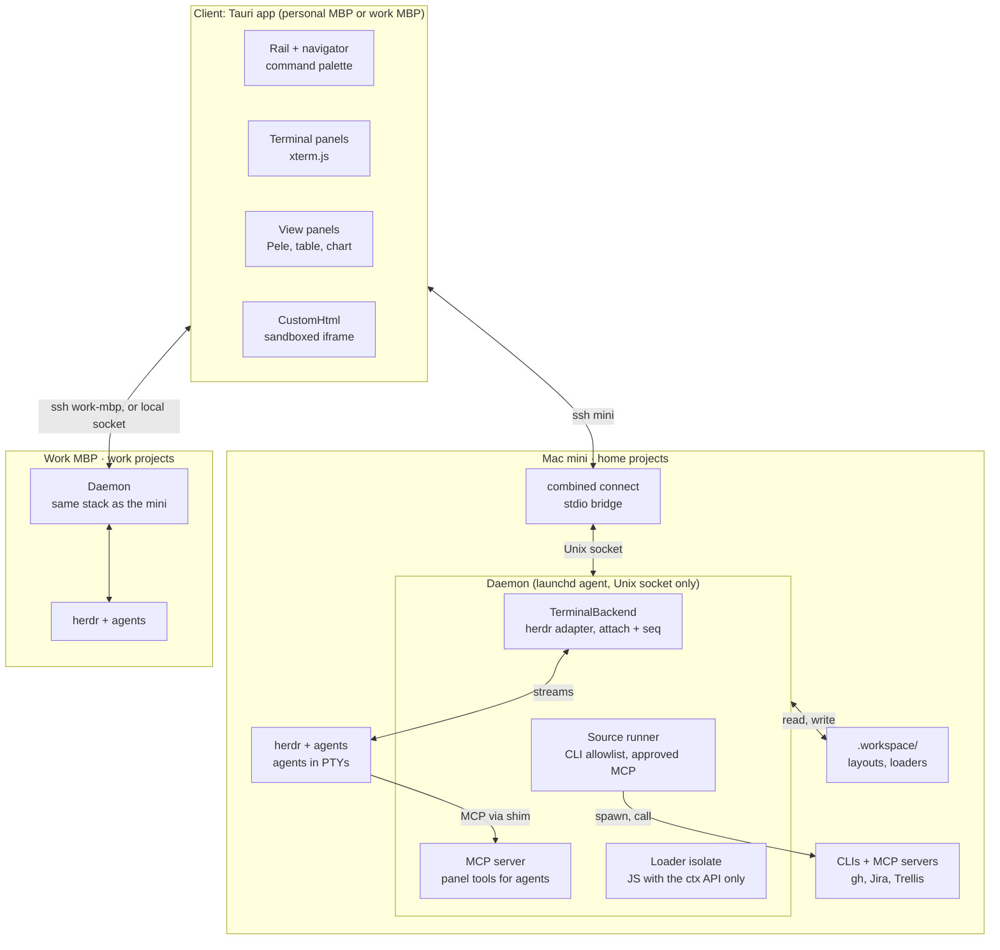

# Combine — Spec (rev 26)

Updated 2026-11-24

Combine is named for the combine harvester and for the verb: it combines every agent terminal, and the views agents build around them, into one window.

One Tauri window shows one herdr or Rex space at a time: its agent terminals plus the panels agents build. A small daemon on each agent host (the home Mac mini, the work MBP) owns terminals, the agents' MCP server and panel loaders; the app is a client that reaches each daemon over SSH, or directly over a Unix socket on the same machine.

**Changes from rev 1:** workspaces follow herdr/Rex spaces; one window; a daemon per host with remote clients; terminal streaming from the first milestone; panels can run JS loaders on the agent's host; panel groups; state stays in files, no database.

**Changes from rev 2:** `attach` joins snapshot and stream with sequence numbers; an M0 fidelity spike; render-feedback states, revisions and idempotency; a file conflict policy; per-tool MCP allowlist; cache keys include host and project; explicit threat model and limits; macOS-only v1.

**Changes from rev 3:** SSH transport instead of Tailscale, with no network listener; stable host IDs; spaces keyed by the backend's own space ID; per-client focus and selection; stream epochs, emulator bootstrap and an input-ownership protocol; MCP server launch definitions need approval; repo trust covers the whole execution dependency set and starts in M1; loader run generations and cache freshness rules; aggregate limits; v1 is herdr-only behind a backend-neutral trait.

**Changes from rev 4:** named Combine; exact terminal attach is an M0 go/no-go gate; request generations per (space, panel, client); background refresh rules for client-dependent panels; separate loader and source pools; approval of a full execution manifest; SSH and wire-protocol contracts; per-client active tabs; one file store per shared project; corrected the work-data statement.

**Changes from rev 5:** checked against herdr-core's API (`hc schema`, 0.1.21): `terminal.attach` already gives an ordered first paint plus live bytes, answers terminal queries, arbitrates viewer size and has flow control, so Combine relays those instead of rebuilding them; spaces are derived from terminal `cwd` because herdr-core has no workspace object; repository layout and `.trellis/rules.toml` added.

**Changes from rev 6 (review):** the backend trait is per attachment, not per terminal; each attachment's stream is relayed as opaque bytes with an `(attachment, epoch, seq)` cursor instead of a structured per-terminal snapshot; herdr-core's `inexact` screen flag passes through; other machines' terminals are filtered out; the architecture table now says what each rule is checked by, and names the gaps `rules.toml` can't cover.

**Changes from rev 25 (#46, M2-S3, panels in the daemon):** the daemon keeps view panels, with no client connected. A view panel is a folder `.workspace/panels/<id>/` with a `panel.json` (`renderer` `mermaid` or `markdown`, optional `title`, `idempotency_key`, `created_by`) and one content file, `diagram.mmd` or `content.md`; the new View panels paragraph has the shape and its checks. A panel's revision is never persisted: it is new at load and comes from the `ids.json` counter, so panel revisions, attachment IDs, ownership generations and daemon-made panel IDs (`panel-<n>`) share one reservation. A panel is `validating`, `validated`, `validated_parser_only`, `failed` or `removed` (a closed, removed or expired panel), never `untrusted` (D21: static Mermaid and Markdown run no code, whether agent-made or from a repo). Its error codes are the seven `DiagramCheck` codes plus `no_verdict`, `unavailable` (retried at 1 s, 5 s and 30 s) and `invalid_utf8`, and a column counts UTF-16 code units. A create with an idempotency key already in use returns that panel; when two live panels share a key, the one whose ID sorts first in byte order. An invalid `panel.json` keeps the last good spec and shows `file_error`, a failed read keeps the last good revision and is retried after 5 s and on a change, and neither is ever rewritten. The daemon now watches panel files with no client: every space from the backend's terminal list, every space with a panel created through the panel API and every space a valid `scratch.json` names, with `<space>/.workspace` watched recursively; a panel folder event, a rescan or a re-arm re-reads every known panel folder of the space and relists it. Every write of `layout.json` or a panel file is preceded by a hash check, and a changed file is not overwritten but read as an outside edit; the window is the time between the comparing read and the rename or unlink, and, at create and pin, between the check that `panel.json` is missing and the content write. A panel file read from the fallback copy makes its panel read-only: `update`, `remove` and `pin` are refused, and the daemon writes panel files only to the project. Scratch panels live in `<daemon data>/scratch/<sha256 of space ID>/<id>/` with a `scratch.json` stamp, expire 7 days after their last change (a sweep at start and hourly), are deleted by close, and are moved into `.workspace/panels/<id>/` by pin; the scratch area is not watched and its files are not hash-checked. A space holds at most 100 panels, counted as the folders holding a `panel.json` of either kind plus its scratch panels. A space's panels are loaded before create is accepted, and create is refused while they are being read or after a failed listing. Diagram checks run off the server loop, at most 2 in flight on a host, one per panel ID, coalesced to the newest revision, with stale results dropped. A panel reply that can't fit in one frame is refused (AC12), with the text in Sizes. New ports: `ScratchStore`, `WallClock`, and `FileStore` gains `write_project`, `remove_file` and `remove_dir`.

**Changes from rev 24 (#49, M2-S6, Mermaid and Markdown renderers):** the client renders Mermaid and Markdown panels, and `open_url` opens their links. The contract is in the new Renderer contract paragraph. `renderSource` in `src/renderers/lazy.ts` is the only `import()` of the renderers, and it and both renderers never reject. Their outcome is `RenderOutcome`: a fragment, or an error `{ message, line?, column? }` with 1-based positions, and a source over 204,800 bytes is refused with a message and no render. Pele 1.13.0 `render()` gets the same `limit`, `maxEdges` and `outputLimit` as the daemon's check, `https` and `http` links, `data` images and a fresh `idPrefix` per render. Markdown uses markdown-it 15.0.3 (which ships its own typings) with `html: false`, and highlight.js 11.12.0 core with nine languages. Everything goes through DOMPurify 3.5.0 before insertion, with two profiles (SVG and HTML) and shared hooks: `on*` attributes, unsafe CSS values and every URL attribute but an allowed `data:` image are dropped, an image left without a source is removed, and a link becomes a marker (`data-combine-open-url`, `role="link"`, `tabindex="0"`) instead of keeping its `href`. `open_url { url }` is a host command in `app/src-tauri`: it refuses an empty URL, edge whitespace and C0 control characters, parses with the WHATWG parser (`url` 2.5.9), allows only `https` and `http`, and passes the serialized URL as the single argument of `/usr/bin/open`, with no shell. The webview calls it from a click or an Enter press on a marked link only, and a refusal is a silent no-op. The CSP is unchanged. A policy test checks every fixture's sanitized output against it, because jsdom never applies the CSP; the packaged-app check moved to S5 (#48). Limits gain a Markdown source size row. `rules.toml` gains the renderers' npm externals (D18). The daemon's vendored Pele (`PELE_VERSION` in `crates/combined/src/adapters/loader/pele.rs`, 1.13.0) and the webview's `pele` pin in `app/web/package.json` (1.13.0) are the same release.

**Changes from rev 23 (#45, M2-S2, headless Mermaid validation):** the daemon validates Mermaid with no client through a `DiagramCheck` port, implemented in `adapters/loader/` on QuickJS (`rquickjs` 0.14.0, pinned exactly), which closes the engine question; M3's loaders use the same engine. Upstream npm Pele 1.13.0 is vendored unpatched as `adapters/loader/vendor/pele-1.13.0.global.js`, with its LICENSE and a provenance README, and a test checks its SHA-256 against the npm artifact's. Pele's full `render()` runs headless, so a check answers `validated` or `failed { code, message, line, column, snippet }`; `validated_parser_only`, from `parse()`, stays in the port as the fallback. A check that gets no verdict is either unavailable (the engine is down) or "no verdict" (Pele threw something that isn't a verdict on this source). The failure codes are Pele's `unsupported_diagram`, `syntax`, `semantic` and `limit`, and Combine's `too_large`, `time_limit` and `memory_limit`; Combine's codes carry no position. Where Pele gives no position for an unknown diagram type or a front-matter error, the daemon points at the diagram's first line or at the opening `---`. The Mermaid source cap is 200 KiB (204,800 bytes), and a larger source is refused with `too_large` before the engine runs. Pele is given `limit` equal to the cap, `maxEdges` 51,200 and `outputLimit` 4,000,000, and the web renderer must pass the same. For validation, the 10 s cap applies to each check and the 64 MiB cap to the engine heap (QuickJS `set_memory_limit`), Pele included. A run that hits a cap is stopped, its runtime discarded and a new one built before the next validation, and the daemon keeps running. One warm runtime, with Pele evaluated once, starts building on a dedicated thread at daemon start. An engine that can't start is logged once and leaves validation unavailable; the daemon starts anyway. Pele 1.13.0's README says it targets Mermaid 12.1.0 syntax, so that line stands; the bundle itself doesn't carry the claim. `docs/m2-s2-spike.md` records the spike, and `docs/m2-s2-bench.md` the `heavy.sh` benchmark (`tools/diagram-bench`): cold load 44.4 ms (p50 of 5); warm p50/p95 of 5.1/5.3 ms for 50 classes and 144.3/154.4 ms for 200 KiB; and 19 MiB of engine heap needed for 200 KiB.

**Changes from rev 22 (#44, M2-S1, wire protocol v5):** Wire protocol is version 5: panels and the agents' MCP channel (see Version 5 messages). `panels` rides on `watch_layout`, after the `layout` that answers it; `get_panel` is answered by `panel`, which carries the whole source; `report_render` reports a client's render status and gets no reply; `close_panel` and `pin_panel` are answered by `panel_closed` and `panel_pinned`, replies of their own. The reasons: a close changes both the layout and the panel list, so an answer by either push would be ambiguous; pushes are coalesced and carry `request: null`; and the reply arrives whether or not the connection watches the space. The layout ops `add_panel`, with an optional tile hint, and `remove_panel` put a panel ID into a layout and take one out, which `move_panel` can't; the op `remove_panel` isn't the MCP tool of that name. `mcp_open { request, caller }`, answered by `mcp_opened { request, space }`, opens the MCP channel on the daemon's socket, and then each `mcp { message }` frame carries one JSON-RPC message either way. The error codes `unknown_panel`, `unknown_caller` and `panel_limit` are added. A panel's `state` is a closed list that already holds `validated_parser_only`, `untrusted` and `removed`, and its `renderer` is `mermaid` or `markdown`. `mcp`'s `message` must be a JSON object, and the codec keeps it as its exact JSON text: decoded into a tree, a message of small objects can hold far more memory than its text, past the 32 MiB bound per decoded frame, so two messages are equal when their text is, and a message round-trips byte for byte. The field sets proposed in `docs/m2-plan.md` are kept, except that a `panels` entry's `title` may be `null`, as in `templates`, `created_by` can name the user as well as an agent, and `mcp_open` and `mcp_opened` carry a `request`, which the proposal (`mcp_open { caller }`, `mcp_opened { space }`) left out: every request carries a `request` that its answer echoes (Client to daemon), so a client can match an `mcp_opened`, or an `unknown_caller` or `invalid_request` error, to its `mcp_open`. "200 KB" in Limits is 204,800 bytes (200 KiB): such a source fits one `panel` frame even at 2 bytes a byte once escaped (409,600), and one made only of control characters escaped at 6 bytes (1,228,800) fails to encode with `FrameTooLarge`. Until the slices that build them land, the daemon answers the new requests and ops with `invalid_request` and ignores `report_render` and `mcp`.

**Changes from rev 21 (S9, M1 acceptance):** M1 is done (`docs/m1-acceptance.md`). The MBP switched between `mini` and `work-mbp` spaces with live terminals and restored layouts, and a demo-core crash showed `Inexact` in the panel header. Keystroke echo at typing speed over Tailscale SSH had p99 37 ms, over the 30 ms budget; the owner accepted M1 with that as follow-up #42. The webview's CSP adds `connect-src ipc: http://ipc.localhost`, Tauri's own IPC. Without it the webview falls back to `postMessage`, which carries only JSON, so the raw-byte commands (typed input and automatic replies) were dropped. The app is packaged as `Combine.app` by `tauri build` (`bundle.active`, target `app`), with `@tauri-apps/cli` pinned as a dev dependency. `tools/m1demo/m1demo.sh` runs an isolated herdr-core demo session per host, and `tools/latency/echo_latency.py` measures keystroke echo through `combined connect`.

**Changes from rev 20 (#23, M1 integration):** `combined` runs on the herdr-core adapter: `wiring::backend::HERDR_CORE` is `Some`, a start connects and sends `hello`, and a core that doesn't answer exits 3 with `cannot start the herdr-core backend on <socket>`. Start-up is cancellable: one shutdown future, from the SIGTERM and SIGINT handlers registered before the backend is built, races connecting to herdr-core and the first terminal watch and list, which now come before the socket is bound, so a signal during start-up exits 0 and leaves no socket. The daemon runs each attachment's backend calls in order and off its server loop: a call that doesn't complete holds back only that attachment, with at most 256 writes, automatic replies, resizes, focus and display changes queued behind it (a credit and a detach always queue), and a queued automatic reply is checked again when it starts and dropped if it is no longer the live owner's under the ownership generation core authorized it under; driver tests hold each kind of call in flight. The herdr-core run gains two daemon tests, `combined connect` attach, replay and resume against the lane core, and two panels on one terminal across a `server.restart` in a segment of its own, so the audit is 48 lines and the lane makes eight runs. They end their `combined serve` child with `/bin/kill -TERM`, a third signal site. A herdr-core restart gives each attachment one new epoch, not a `gap`; the Tauri router and the web panel controllers are covered by their own unit tests, not by the lane. `./tools/verify` gains a two-host loopback test in `app/src-tauri/tests/`: two in-process daemons on the fake backend, the hosts service on local sockets, spaces from both, a dropped host that dims and reconnects, and a refused host-ID mismatch. `app/src-tauri/tests/` is the hidden `app-tests` layer in `rules.toml` and non-production in the architecture guard, and `combine-app` has a `combined` dev-dependency with `test-support`. Known and harmless: a start that fails or is cancelled after its ID reservation spends a 2^20 block, and the 16 ms flush timer re-arms while a connection's writer is blocked, until the 10 s write timeout. The default herdr-core socket is spelled in the daemon's resolver and in the client's refusal guard, each naming the other. The manual ssh check is in `docs/daemon.md`. The rev 14 question about the inferred non-default-session socket stays open.

**Changes from rev 19 (S8, add terminal):** the user's click is M1's trust gate: the daemon starts a terminal only in answer to a client's `spawn_terminal`, and nothing from a repo spawns on its own. Wire protocol is version 4: `list_templates` and `templates`, `spawn_terminal` and `spawned`, and the error codes `unknown_template`, `template_changed`, `cwd_refused` and `spawn_failed`. Each listed template carries the SHA-256 `hash` of the `panel.json` bytes it was read from, and a template's `spawn_terminal` sends that hash back: the daemon runs only a file that still has it, and refuses one that changed with `template_changed`. Terminal panel files (`.workspace/panels/<panel-id>/panel.json`) are read only on request, with an 8 KiB bound; other kinds, and invalid, oversized or unreadable files, are skipped with a reason. A file store read takes only a regular file: a FIFO or other non-regular file is refused without being opened for a blocking read. A template's `cwd` is relative to the project root, with no `..` or `.git` segment, and must resolve, symlinks followed, to a directory inside the project and outside `.git/`; it is checked when the templates are listed and again at spawn time. The plain shell is `argv: []`, herdr-core's default for `terminal.run`, which starts that machine's own shell, in the project root at 80x24; the adapter is unchanged. `FileStore` gains `list_dir`, and a new `ProjectDirs` port checks a project subfolder. A space's terminals, and the `terminals` list, keep the backend's list order, with terminals created later appended. The client opens the first terminal that hasn't exited when it selects a space with no active terminal, and offers Add terminal in the terminal navigator, which shows each template's exact command line with invisible characters escaped; picking an item is the approval of exactly the definition shown.

**Changes from rev 18 (S6, terminal panels):** the terminal panel's client behavior is written down. Hide detaches and drops the instance, so show attaches fresh; a resume is only for a visible panel whose connection returned, and the webview, which owns the applied cursor kept with its instance, issues it once its apply queue has drained. A webview reload attaches fresh. A panel being removed detaches through the webview and closes its stream once it is hidden, after the ack of the final event is accepted or rejected; Rust's orphan finish is the fallback for a gone owner. Request-carrying replies are matched to their pending request by Rust's router; the panel accepts a reply only while it has an attach or resume outstanding, and never compares request IDs. Rust may send the final ack and detach only for an attachment whose webview owner is gone (a reload, a closed window, or a closed panel stream), only to finish it, and never for an attachment on an open panel stream; that includes the final ack on stream close for an orphan whose final event was delivered but not acked, even if it was already detaching. Between a `Gap` and the new epoch the old screen stays, dimmed, under a "reconnecting" overlay; every new epoch gets a new instance, addon disposed first, and the new one created at the new `started`'s size, never a `clear()`. The status line shows `exited` (screen kept), `lost` (with Reattach, no automatic retry) or an error's code, a `not connected` rejection waits for the next connection, a resume rejected for any other reason attaches fresh, and `send_failed` shows only when an attach is rejected for a reason other than `not connected`; a rejected ack, input, resize or other command is ignored, and the daemon's message text is never shown. Nothing about ownership is sent on show; DOM focus sends `focus`; a non-owner's typing is `input`, never paired with `request_ownership`; "Take input" sends `request_ownership`; `stale_generation` is not a failure; focus reports (mode 1004) are forwarded as input by the owner only. Display facts come from the xterm theme and the measured cell, rounded to whole pixels, sent in `attach.options` and then by `set_display` on change, debounced 250 ms, never while not attached. The owner's resize is the fit size, debounced 100 ms, with the current generation; xterm resizes only when a `resized` is applied; `ordered_resizes: false` shows a header warning and changes nothing else; a non-owner letterboxes, centred on a muted background. A WebGL load failure or context loss disposes the addon and keeps the DOM renderer; only visible panels hold an instance. Acks are throttled to one every 16 ms carrying the latest applied cursor, final events are acked at once, a detaching panel acks only the final event, events are applied one at a time, and events from another epoch are dropped. The transport is one Tauri `Channel` per panel stream: `Data` events are a Raw body led by a 24-byte big-endian header (attachment, epoch, seq), the one exception to decimal-string u64s, and every other event is JSON with decimal-string u64s. The twelve commands are `terminal_open_stream`, `terminal_close_stream`, `terminal_attach`, `terminal_resume`, `terminal_detach`, `terminal_ack`, `terminal_resize`, `terminal_focus`, `terminal_set_display`, `terminal_request_ownership`, `terminal_input` and `terminal_automatic_reply`; the event shapes are pinned by `app/web/test/fixtures/terminal-events.json`. xterm.js 6.0.0 with `@xterm/addon-webgl` 0.19.0 and `@xterm/addon-unicode11` 0.9.0 are pinned exactly, with no fit addon (the fit size is computed from the measured cell). Cmd key combinations pass through xterm to the app, `attach.options.history` is 1000 lines, and the real-core checks (a herdr-core `server.restart`, vim, htop and an agent TUI in a panel) move to #23 and S9. In M1 the space's active terminal is shown in the focused tile, one terminal panel at a time (picking a terminal in the navigator, or auto-open, shows it there); terminal tabs inside tiles come with slot-based terminal panels in M2, and layout tabs stay opaque panel IDs. The terminal dropdown and the backend label are not yet built. The terminal panel controller is created once per mounted panel and must not run under React `StrictMode`.

**Changes from rev 17 (S7, layouts, client state and the palette):** the daemon owns a space's layout, `<project>/.workspace/layout.json`, and clients edit it over the wire. Wire protocol is version 3: `watch_layout`, `unwatch_layout`, `mutate_layout` and the `layout` message, with the error codes `unknown_space` and `stale_layout`. A layout change is a batch of 1 to 32 typed ops, made against a `layout_revision`. The daemon applies a batch whole or not at all, writes it after a debounce, and flushes on a space switch, an unwatch, a disconnect and shutdown. An outside edit is told from the daemon's own writes by content hash, and merged with pending ops by field or, on overlap, wins and drops them with a notice in the snapshot. An invalid file, or one whose read failed, is never overwritten; a project that can't be written falls back to `<daemon data>/spaces/` and the rail marks it read-only. `FileStore` gains hashes, a read-only outcome, a bounded read, `watch` and a change stream, and has an on-disk adapter. `combined` now handles SIGTERM and SIGINT: it flushes pending layouts and exits 0. The client stores `ClientSpaceState` and `last_space` per host in `<client data>/hosts/<host-id>.json`, restores them on start, sends `watch_terminals` on every connection and watches the selected space's layout. Cmd+K opens a command palette over spaces, terminals and failed hosts.

**Changes from rev 16 (prior art: OpenUI; streaming panel data):** the view language section gains a *Prior art* note on DivKit and OpenUI: what Combine takes from each and why neither is the view language. Streaming panel data is a planned requirement, not in v1: a `Stream` refresh policy is reserved, with the rules any design must keep (record updates keyed by the kind's `paging.key`, view state surviving updates, frame-batched delivery, the same approvals as other sources). Its mechanism is an open question. No behaviour changes in this revision.

**Changes from rev 15 (S3, herdr-core adapter):** the herdr-core adapter is built (`crates/combined/src/adapters/herdr_core/`) and the contract suite runs against a real core: the adapter's constructor takes the socket path explicitly and refuses a protocol generation it doesn't know; capabilities, the `hc:` ID, the request mapping with its fencing (a superseded write goes out as AUTOMATIC_INPUT, or as DATA on a core without it), reopen bounds and policy (40 attempts 250 ms apart, a 250 ms wait after a core-wide EOF), restart versus crash (`AttachResult.terminal.screen`, sticky per terminal), `list`, `spawn` (`no_parent`, never `on`), `kill`, `watch` (a `missed` or lost subscription is re-subscribed and diffed) and the display mapping are written down; event payload shapes come only from a committed capture of a real core (`sh tools/verify-herdr-core --capture`); the real-core run (`sh tools/verify-herdr-core`) starts an isolated core of its own, pins its id, never signals anything but that core and the run's own test binary, and has a 1,320 s deadline and a 46-line audit; case 11 is a recorded skip, because herdr-core itself would have to make the second connection, which the isolation rule can't check; the Silent-fake run of cases 10 and 22, a sentinel size for the late `Resized` of an old generation, and first-occurrence token order in the resize cases are recorded.

**Changes from rev 14 (panel kinds and the view language):** panel kinds are data, not code. A kind is a file in the host's kind library. It holds a record JSON Schema, a selection contract, optional paging, and a view written in Combine's view language. Any service's group fills a kind, so an issue list from GitHub, Jira or Linear is the same panel. The view language is a small declarative tree of built-in nodes, rendered by React. It supports actions on elements and on visibility, keyboard collection navigation with virtualized scrolling, pagination, named animations, timers and tooltips, and it runs no code. Kind content is part of a run's identity, and one validation pipeline covers loader, source and static data. Two fallbacks follow: sanitized logic-less templates, then a scripted sandbox behind trust approval. The GitHub group gains issue list and issue detail panels, and M4's done criterion covers issues and a second issue backend.

**Changes from rev 13 (S4, daemon entry):**

- `combined serve` runs the daemon and `combined connect` bridges stdio to its socket.
- `<daemon config>` is `~/.config/combine/`, with `daemon.json` for the start-up settings (backend, herdr-core socket, data directory, socket). `<daemon data>` is `~/Library/Application Support/com.squashmerge.combined/`, mode 0700, holding `host.json`, `ids.json`, `combined.lock` and the socket `combined.sock`. The default socket, `<daemon data>/combined.sock`, is the path a `hosts.json` `socket` entry gives for this machine.
- The socket is 0600 inside a directory only the user can open. A daemon serves it only while it holds `<socket>.lock`, and it replaces an existing socket file only while holding that lock and only if nothing answers on it, so a live daemon is never displaced.
- At most 64 client connections. A connection that is closing, such as after a malformed frame, still counts until its writer has closed the socket, so closing connections can't exceed the cap. A write stuck for 10 s closes its connection. A stop is handled like a crash.
- The 10 s for the `hello` runs from admission to the completed `hello`, so a client sending a byte at a time doesn't extend it.
- The file store on disk refuses a symlink at `<space>/.workspace`, at any folder under it or at the file, for reads and writes. The check isn't race-free against a process changing the folder during a call.
- `host.json` is identity only, and a corrupt one stops the start.
- Attachment IDs, ownership generations, panel revisions and daemon-made panel IDs never repeat across restarts, because each incarnation reserves them in blocks of 2^20 in `ids.json` before issuing them.
- The herdr-core socket comes from `daemon.json`, else from `HC_SOCKET`, `HC_SESSION` and the XDG paths, else from herdr-core's default. A missing one stops the start, and launchd retries.
- Output is flushed at most once per 16 ms, at once after an idle frame, up to 1 MiB per connection per flush.
- Protocol version 2 adds `watch_terminals` and the `terminals` snapshot of a host's terminals and spaces.
- A first frame that can't be decoded gets `malformed`, and a first message that isn't `hello` gets `invalid_request`, before the close.
- The protocol crate's `ErrorMessage::trimmed_message` cuts a peer's `error` message to 256 bytes (`MAX_ERROR_DETAIL`) on a character boundary. It is applied before a peer's error text is logged or put in the `Display` of `HandshakeError::Refused`. It is not the client's display rule (see Wire protocol, Handshake), which it neither replaces nor restates.
- The launchd plist ships in `crates/combined/launchd/` and is installed by hand (`docs/daemon.md`).

**Changes from rev 12 (S5, client shell):** the client's `hosts.json` schema and location; two entries never share a host ID; how the client trims daemon text and `ssh` stderr before showing them; reconnect backoff, and which failures stop reconnecting; host state reaches the webview as `hosts-changed` snapshots; every unsigned 64-bit value crosses the Tauri boundary as a decimal string.

**Changes from rev 11 (S2, daemon core):** the backend trait's types are defined (`Capabilities`, `AttachEvent` payloads paired with their backend generation, `TermInfo`, `TermEvent`, `SpawnSpec`, `BackendError`), with a `GitProbe` port for a terminal's git root and a minimal `FileStore`; the daemon forwards size, display and focus for the owner only; an epoch counts an attachment's generations and seqs restart in each, while attachment IDs and ownership generations never repeat across daemon restarts; unsent output coalesces, so output within the credit granted never ends a stream with a `Gap`; the log's bounds, credit, grace and disconnect policies have numbers; the contract suite lives in `crates/combined/tests/contract/`, takes its runtime and faults from a per-backend target, measures output from a marker the test writes, and records the SPEC and source revision of every result. Review fixes (opencode review 10): `write`, `resize`, `focus` and `set_display` carry the ownership generation core authorized them under, and the adapter fences a deferred request by it: one issued under a generation older than the newest the terminal has received can't take the terminal back from the current owner, but still updates its attachment's latest requested size and display (typed bytes are still written, once, without activating it); an automatic reply carries the backend generation core authorized and the adapter drops it if the pair was rebuilt first; a backend refusal of input, resize, focus or display is reported to the attachment's client as `internal`, in Combine's words, instead of being lost; the fake's exited-but-draining state finishes an exited terminal whose output was waiting for credit; core has no `unwrap` or `expect`; a hand-off skips members on connections already marked for an overflow disconnect.

**Changes from rev 10 (S1, wire protocol):** the wire protocol is pinned down: big-endian frames capped at 1 MiB with four frame kinds, so typed input and automatic replies are binary, never JSON; memory per decoded control frame bounded by a constant factor of the cap; a `hello`/`welcome` handshake with an integer version; every control message and its fields; which messages travel in an attachment's ordered stream; `gap` answers a resume that can't be served; `replay_through` is `null` when there's nothing to replay; ownership notifications; error codes; and the client's `ack` is its only flow-control signal.

**Changes from rev 9 (review 5):** every backend generation of an attachment starts with a `Started` event, and the daemon starts a new epoch on it; automatic query replies have their own port method, fenced by epoch and ownership generation and never sent from replay; the attachment lifecycle is defined in terms of ownership (watch-only attachments have no input half, a non-owner's input half never takes the PTY size); output history can also have holes at resize boundaries; the replay log always has room for its final `Gap`.

**Changes from rev 8 (M0 findings):** each Combine attachment is a pair of herdr-core viewers, because only watch-only viewers get ordered resize boundaries; a `Resized` event is only ever the backend's own boundary; herdr-core's framed protocol, credit and resync behavior are recorded; withheld credit leads to an in-band resync, not a `Gap`; the first-paint losses Combine accepts are listed, and two are requested from herdr-core; the PTY returns to herdr-core's headless size when the last active viewer leaves; xterm.js uses Unicode 11 widths; every replay log append is bounded; M1's contract tests inherit M0's stricter checks. Details and evidence: `spike/m0/FINDINGS.md`.

**Changes from rev 7 (review 2):** each attachment's events (data, resizes, facts) form one ordered, replayable log, and the client acknowledges the last event it applied; the replay buffer is per attachment; the listener and PTY check is described as a conservative list of spellings, not proof; `tools/arch-guard` tokenizes instead of matching text, and reports what it can't analyze.

## Goals and non-goals

The app is one window over every space on every host you use, with agent-built panels around the terminals.

**Goals**

- One window. Picking a space swaps the whole screen to that space's terminals and panels, restored exactly as left.
- Spaces group a host's herdr-core terminals by project folder. Example: the `trellis` space holds a claude and two prime-agents; the `mimir` space holds a claude and an opencode.
- Several hosts: home projects run on the Mac mini, work projects on the work MBP. Either personal MBP, or the work MBP itself, can be the client.
- No dependency on a particular network: anything that carries SSH works (local network, VPN, Tailscale).
- Terminals stream from the first milestone; no polling phase.
- The coding agent in a terminal can create panels: persistent views of live data and one-off views such as "show me the class diagram for these related classes".
- Panels can carry JS loaders that run allowlisted CLIs and MCP tools on the agent's host and correlate the results.
- Panel groups (GitHub, Jira, Linear, Trellis) hold several related views of one service, linked by a shared selection.
- Panel kinds: an issue list, an issue detail or a PR list looks and behaves the same whichever service its data comes from. A group for GitHub, Jira or Linear fills the same kinds, so the client draws them with the same panels.
- Kinds and groups are data in each host's libraries, so the product fits how each person works. A developer might use issue, PR and Trellis panels over Linear, GitHub and Trellis. A marketer might use design-file and doc-page panels over Figma and Notion. Neither needs a code change.
- Mermaid diagrams rendered with [Pele](https://pele.run).

**Non-goals for v1**

- Replacing herdr or Rex. They keep owning PTYs, scrollback and session lifetime.
- Multi-user sharing or a hosted web version.
- Agent-written HTML as the main panel type. It stays a sandboxed fallback.
- A database. All state is files (see Persistence).
- Platforms other than macOS. Shortcuts, launchd and Unix sockets assume it.
- A network listener in the daemon. Remote access goes through SSH only.
- Backends other than herdr-core. v1 ships the herdr-core adapter only; the `TerminalBackend` trait stays backend-neutral so Rex or others plug in later without changes outside their adapter.

## Hosts and connections

Every machine that runs agents runs a daemon that listens only on a local Unix socket; clients reach remote daemons by running a small bridge over SSH.

| Machine | Runs | Role |
| --- | --- | --- |
| Mac mini (home) | herdr, agents, builds, daemon | Host for home projects |
| Work MBP | herdr, agents, daemon, app | Host for work projects; usually its own client |
| Personal MBP x2 | app | Client for the mini; can reach the work MBP over SSH, rarely used |

**Daemon** (`combined`, a launchd agent running as the user)

- Listens only on a Unix socket with user-only permissions. No TCP port, no WebSocket server.
- Talks to the local herdr or Rex over its local socket.
- Hosts the MCP server the local agents call, runs panel loaders, and is the authority for the space's files.
- Keeps working with no client attached: loaders refresh, agents get render feedback, state is saved.
- Generates a stable host ID (a UUID in `<daemon data>/host.json`) on first start. Clients key everything about a host by this ID, never by its address.
- **Commands:** `combined serve [--config <path>]` runs the daemon, `combined connect [--socket <path>] [--config <path>]` is the stdio bridge, and `combined --version` prints the version.
- **Socket:** by default `<daemon data>/combined.sock`, mode 0600 in a parent directory with no group or other access (the daemon creates the parent 0700 if it is missing, and refuses an existing other parent that is open to group or other). A socket path is at most 103 bytes. A daemon serves its socket only while it holds `<socket>.lock`. It replaces an existing socket file only while holding that lock and only if nothing answers on it. The connect probe is a second check, not proof, because macOS refuses connections when a backlog is full. `<daemon data>/combined.lock` allows one daemon per data directory, so `host.json` and `ids.json` each have one writer.
- **Connections:** at most 64 client connections; another is closed without a reply. A connection closing after a malformed frame counts until its socket is closed. A write that makes no progress for 10 s closes the connection. While a connection's writer still holds a batch, flushes skip it, and the 16 ms flush timer re-arms each pass until the writer drains or the 10 s write timeout closes the connection; known and harmless.
- **Shutdown:** SIGTERM and SIGINT stop the daemon cleanly. Both handlers are registered inside the runtime before the daemon connects to herdr-core. Start-up (connecting, then the first terminal watch and list) races the same shutdown, and the socket is bound only after it, so a signal during start-up exits 0 and leaves no socket or `<socket>.lock`. On a signal the daemon stops serving, writes every pending layout that can be written (see Persistence), waits for those writes, closes its connections, releases both locks and exits 0. Any other stop, SIGKILL included, is handled like a crash: the OS releases both locks, the next start replaces the stale socket, a layout change still inside its debounce is lost, and clients reconnect and get `gap` for attachments the new incarnation doesn't know.
- **`host.json`** is `{ "version": 1, "host_id": "<uuid>" }`, mode 0600, written once with a safe write. The ID is a random (version 4) UUID read from `/dev/urandom`. A file that is unreadable, not valid JSON, another version, missing the field or holding something that isn't a lowercase UUID stops the start, and the daemon never rewrites it.
- **herdr-core down:** the daemon checks at start that the herdr-core socket path is absolute, at most 103 bytes and an existing socket. The daemon then connects and sends `hello` (2 s to connect, 5 s for the answer). A failed check exits 3 with the path, where the path came from and a hint. A failed connection or `hello` exits 3 with `cannot start the herdr-core backend on <socket>: <reason>`. launchd retries every 10 s. If the backend's watch ends while the daemon runs, it also exits 3; clients reconnect and get `gap`, and attach fresh. Exit codes: 0 for a `connect` that ends cleanly or a `serve` stopped by SIGTERM or SIGINT, 1 for a runtime failure or a `connect` that can't reach a daemon, 2 for a usage, configuration or lock error, 3 for herdr-core.
- **launchd:** the agent's label is `com.squashmerge.combined`. The plist ships in `crates/combined/launchd/` and is installed by hand (`docs/daemon.md`); Combine never writes `~/Library/LaunchAgents`.

**Client** (the Tauri app)

- Holds a list of hosts, each with an SSH destination (e.g. `mini`, `jcarreira@work-mbp.local`, or an `~/.ssh/config` alias). The local daemon is reached over its Unix socket directly.
- **Terminal list:** on every connection, right after the handshake, the client sends `watch_terminals` and builds the host's spaces and terminals from each `terminals` snapshot. A terminal's name is its `name` label, else the file name of `argv[0]`, else its ID.
- **Add terminal and the first terminal:** the terminal navigator offers Add terminal for the selected space (see Navigation). Choosing an item in its menu is the approval: the client sends `spawn_terminal`, and nothing else starts a terminal. Selecting a space with no active terminal makes the first terminal in the space's list that hasn't exited its active terminal (see Client state file); a stored active terminal that is still listed is kept, whatever its state.
- **Layout watch:** the client watches the selected space's layout and nothing else, one space per connection.
  - Selecting another space on the same host sends `watch_layout` for it; the daemon writes the old space's pending changes.
  - Selecting a space on another host first sends `unwatch_layout` to the previous host, then `watch_layout` to the new one. Clearing the selection sends `unwatch_layout`. An `unwatch_layout` to a host that is no longer connected is ignored: the daemon wrote on disconnect.
  - When a host reconnects, the client watches its selected space again.
  - A quitting app just closes its connections.
- **Layout changes:** the client keeps at most one `mutate_layout` in flight per space, made against the newest `layout_revision` it holds; later changes wait for the reply. On `stale_layout` it checks the change against the layout it holds (dropping it if its tile is gone) and resends once, at once if it already holds a newer snapshot than the base, else when one arrives. A second `stale_layout` drops the change with the notice "Layout changed elsewhere; your change wasn't applied." Any other error drops the change and shows the daemon's message. A disconnect clears the queue.
- Shows every connected host's spaces in one rail. A host that drops shows its spaces dimmed and reconnects in the background; its terminals keep running.

**Transport**

- The client runs the system `ssh` with `combined connect`, a stdio bridge to the daemon's Unix socket (like the MCP shim). One SSH session per host carries everything. `combined connect` finds the socket from `--socket`, else from `daemon.json` (its `socket`, else its `data_dir` plus `combined.sock`), else from the default; with no daemon it exits 1 and writes only to stderr.
- The protocol over the bridge, and over a local socket, is the same: length-prefixed frames, JSON for control messages, and binary for terminal output, typed input and automatic query replies (see Wire protocol).
- **Handshake:** the client's first frame is `hello` with its protocol version; the daemon answers `welcome` with its version and host ID. A version mismatch closes the connection with a message naming both versions (`protocol version mismatch: client 1, daemon 2`).
- **Frames:** at most 1 MiB (2^20 bytes) each, counting the kind byte and the payload; larger terminal output is split. Replies and control messages are queued ahead of terminal output, and output from several attachments is interleaved round-robin, so a noisy terminal can't delay control messages or other terminals. Priority never reorders one attachment's events relative to each other: its data, resizes and other events, and the in-order `gap` that ends them, travel in one ordered stream (see Attach, sequence and epoch). Within one pull of a connection's output, all queued control messages go before stream messages.
- SSH provides authentication (the user's keys and agent), encryption, and server identity (`known_hosts`). Using the system `ssh` means `~/.ssh/config`, `ProxyJump`, and Tailscale SSH all work without app support.
- The client checks that the host ID reported over the bridge matches the one it stored for that host, so a changed address can't silently point the rail at a different machine.
- **SSH invocation:** `ssh -T -o BatchMode=yes <dest> <path>/combined connect`. No PTY is allocated; stdout carries only protocol frames; stderr is captured and shown in the client, trimmed the same way as daemon text (see Wire protocol, Handshake).
- **Failures are reported, never worked around:** an unknown or changed host key, a key whose passphrase isn't in the agent, or failed authentication each stop the connection with a message saying what to run in a terminal (`ssh <dest>` once, or `ssh-add`). Host-key checking is never disabled.
- **Remote binary:** non-interactive SSH often lacks Homebrew's `PATH`, so each host entry stores the absolute path to `combined` (default `/opt/homebrew/bin/combined`). A missing binary shows an install hint. M0 confirmed it: a bare command name fails over `ssh -T` (exit 127), and `~/.local/bin`, where `hc` lives, isn't on that `PATH` either.
- **Finding herdr-core:** the daemon connects to herdr-core's local socket directly, never through `hc`. As a launchd agent it starts with a minimal environment, so the socket path is daemon configuration, checked at start. It comes, in order, from `herdr_core_socket` in `daemon.json`; else from `HC_SOCKET`; else, with the session taken from `HC_SESSION` or `default`, from `$XDG_RUNTIME_DIR/herdr-core/<session>.sock` when `XDG_RUNTIME_DIR` is set, or `${XDG_STATE_HOME:-$HOME/.local/state}/herdr-core/<session>/<session>.sock` (for the default session, `~/.local/state/herdr-core/default/default.sock`). Empty variables count as unset. Tests always pass explicit, isolated paths, and test helpers refuse herdr-core's default.
- Reconnect: if the SSH session drops, the client starts a new one with backoff and resumes each attachment from its last applied cursor (see Attach, sequence and epoch). The backoff starts at 1 s, doubles to at most 30 s, and resets after a successful handshake. The failures above (host key, passphrase, authentication, missing binary), a host ID mismatch or a host ID another entry already has, a refused or malformed handshake and a `version_mismatch` stop reconnecting: the host shows the message until the user retries it.
- Latency budget: keystroke echo should stay under about 30 ms on a local network. M0 measured p99 at 0.5 ms or less locally, through the daemon and over ssh to localhost (input to echo received, before xterm.js applies it). The local-network measurement is part of M1.

**Wire protocol** (`crates/combine-protocol`, protocol version 5)

- **Scope:** version 1 covered the handshake and terminal attachments; version 2 added the terminal list (`watch_terminals`, `terminals`); version 3 adds a space's layout (`watch_layout`, `unwatch_layout`, `mutate_layout`, `layout`) and the error codes `unknown_space` and `stale_layout`. Version 4 adds spawning (`list_templates`, `templates`, `spawn_terminal`, `spawned`) and the error codes `unknown_template`, `template_changed`, `cwd_refused` and `spawn_failed`. Version 5 adds panels (`panels`, `get_panel`, `panel`, `report_render`, `close_panel`, `panel_closed`, `pin_panel`, `panel_pinned`), the layout ops `add_panel` and `remove_panel`, the agents' MCP channel (`mcp_open`, `mcp_opened`, `mcp`) and the error codes `unknown_panel`, `unknown_caller` and `panel_limit`.
- **Frames:** `u32 length | u8 kind | payload`. Every integer on the wire is big-endian. The length counts the kind byte and the payload, and is between 1 and 2^20 (1 MiB). So a frame is at most 1 MiB plus its 4-byte prefix. A reader checks the length before allocating. Memory per decoded control frame is bounded by a constant factor of the 1 MiB cap: within the 32 MiB bound; the frame buffer for unknown values and unescaped keys. Unknown fields are skipped, never stored; an `mcp` frame's `message` is kept whole, as its JSON text (see Version 5 messages). There is one message per frame; batching (see Streaming) writes several frames per flush.
- **Kinds:**

  | Kind | Direction | Payload |
  | --- | --- | --- |
  | 1, control | both | one JSON object |
  | 2, data | daemon to client | `u64 attachment, u64 epoch, u64 seq`, then up to 1,048,551 bytes: one `Data` event |
  | 3, input | client to daemon | `u64 attachment`, then what the user typed |
  | 4, automatic reply | client to daemon | `u64 attachment, u64 epoch, u64 ownership generation`, then an emulator's query reply |

  Typed input and automatic replies are binary frames of different kinds: never JSON, and never one kind with a flag. Each data frame is its own event with its own `seq`. Output larger than a frame is split across consecutive seqs, and nothing reassembles it.
- **JSON:**
  - `type` names the message. Type names and fields are snake_case.
  - Receivers ignore fields they don't know, and a missing optional field reads as `null`.
  - Attachment IDs, epochs, seqs, ownership and backend generations, and request IDs are unsigned 64-bit integers.
  - The host ID is the daemon's UUID as a lowercase string, and a terminal is its opaque `TermId` string.
  - A `cursor` is `{ attachment, epoch, seq }`.
  - A `display` is `{ foreground, background, cursor_color, cell_width, cell_height }`: `#rrggbb` colours and the cell size in pixels.
  - Nested `cursor`, `options` and `display` values also decode from JSON array form (`"cursor":[7,4,9]`), as serde does by default. A decoder accepts it; senders never produce it. The message itself must be an object.
- **Version:** one integer, starting at 1.
  - Any change an older peer can't safely ignore bumps it: a new message type, frame kind or enum value, or a changed or removed field. A new optional field doesn't.
  - The daemon accepts only its own version, with no negotiation.
  - The frame header, `hello`, `welcome` and the `version_mismatch` error never change, so any two versions can tell each other they differ.
- **Handshake:** the client's first frame is `hello { protocol_version }`. The daemon answers `welcome { protocol_version, host_id }`. If the versions differ, it instead sends `error` with code `version_mismatch` and the message `protocol version mismatch: client <c>, daemon <d>`, then closes. A version 5 client meeting a version 4 daemon, for example, reads `protocol version mismatch: client 5, daemon 4`. A client never shows the daemon's text raw. Before showing daemon text, or captured `ssh` stderr, it turns control characters and the bidirectional formatting characters U+061C, U+200E, U+200F, U+202A–U+202E and U+2066–U+2069 into spaces, collapses each run of whitespace into one space, trims both ends, and cuts the result after 256 characters, marking the cut with `…`. The client's own message, which says what happened and what to do, is shown whole, with that trimmed text beside it. A `version_mismatch` error is shown as `protocol version mismatch: client <c>, daemon <d>`, with both numbers taken from its message; if they can't be read, the daemon's version shows as `unknown`.
- **Client to daemon:**
  - `attach { request, terminal, options }` is a fresh attach. Its options are `cols`, `rows`, `display`, `observe` and `history`; `resume` takes the place of the trait's `resumed`.
  - `resume { request, cursor }`
  - `watch_terminals { request }` subscribes the connection to the host's terminals and spaces. Asking again answers with a fresh snapshot carrying the new `request`; there is no unwatch. A connection that leaves more than 16 answers unflushed is disconnected.
  - `watch_layout { request, space }` subscribes the connection to one space's layout. The daemon answers `layout` with that `request` once it has read the file, then pushes the newest layout after each change. It also sends the space's `panels` after that `layout`, with the same `request`, and pushes them after each change (see Version 5 messages). A connection watches one space at most: watching another replaces the first and writes the first space's pending changes at once. A `space` the host doesn't list gets `unknown_space`. A connection that leaves more than 16 layout replies and errors unflushed is disconnected, as for `watch_terminals`.
  - `unwatch_layout {}` stops the watch. It has no `request` and gets no reply, and it writes the space's pending changes at once. A connection that closes does the same.
  - `mutate_layout { request, space, base_layout_revision, ops }` changes the watched space's layout. `ops` holds 1 to 32 ops, applied in order, whole or not at all, and the result must be valid (see `layout.json`). The daemon answers `layout` with this `request`. Errors, each carrying the `request`: `invalid_request` for a batch outside 1 to 32 ops, an invalid ID, a space the daemon holds a layout for that this connection isn't watching, an op whose precondition fails or a result that isn't valid, with nothing changed; `unknown_space` for a space the daemon holds no layout for, meaning no connection has watched it in this run, even if the host lists it; and `stale_layout` when `base_layout_revision` isn't the space's current revision, and also while the space's first read hasn't finished, whatever the base.
  - `list_templates { request, space }` asks for the terminal templates of a space's panels. The daemon answers `templates` with that `request`, or `unknown_space` for a space the host doesn't list.
  - `spawn_terminal { request, space, source }` starts a terminal in a space. `source` is `{ "type": "shell" }`, the plain shell in the project folder, or `{ "type": "template", "panel": "<panel id>", "hash": "<hash>" }`, the terminal template of that panel as the client listed it, where `hash` is that template's `hash` from `templates`; any other `type`, or a template without `panel` or `hash`, is a malformed frame. The client names a panel and the definition it showed, and never supplies a command. The daemon answers `spawned` with that `request`, or an error (see Version 4 messages).
  - A connection may have 4 `list_templates` and `spawn_terminal` requests unanswered; a fifth gets `invalid_request`, `too many template and spawn requests in flight; the limit is 4`. A connection that leaves more than 16 `templates`, `spawned` and error replies to these unflushed is disconnected, as for `watch_terminals`.
  - `get_panel { request, space, panel }` asks for one panel and its source. The daemon answers `panel` with that `request`, or an error (see Version 5 messages).
  - `report_render { space, panel, revision, status, error }` reports whether this client drew a panel's revision. It has no `request` and gets no reply.
  - `close_panel { request, space, panel }` closes a panel, and `pin_panel { request, space, panel }` keeps a scratch panel in the project. The daemon answers `panel_closed` or `panel_pinned` with that `request`, or an error.
  - `mcp_open { request, caller }` opens the agents' MCP channel on the connection. The daemon answers `mcp_opened` with that `request`, or an error.
  - `mcp { message }` carries one JSON-RPC message to the daemon's MCP server.
  - `detach { attachment }`
  - `ack { cursor }`
  - `resize { attachment, cols, rows, ownership_generation }`
  - `focus { attachment }`
  - `set_display { attachment, display }`
  - `request_ownership { attachment }`
  - input and automatic-reply frames.

  `request` is chosen by the client and echoed in the reply.
- **Daemon to client:**
  - `welcome`.
  - `attached { request, attachment }`, sent before the attachment's first `started`.
  - `resumed { request, attachment, replay_through }` and `gap { attachment, request }`.
  - `terminals { request, terminals, spaces }`, always a full snapshot, never a delta. The answer to `watch_terminals` carries its `request`; after any change, a snapshot is pushed with `request: null`, at most one per flush per watching connection. Each `terminals` entry is `{ id, cwd, argv, state, exit_code, labels, cols, rows }`, with `state` `running` or `exited` and `exit_code` `null` unless the terminal exited with a code; each `spaces` entry is `{ id, kind, terminals }`, where `id` is the space's folder path, `kind` is `repository`, `worktree` or `folder`, and `terminals` lists its terminal IDs. `terminals` keeps the backend's list order, with terminals created later appended; each space's `terminals` keeps that order; `spaces` is sorted by ID. A snapshot too large for one frame is answered with an `internal` error, `the terminal list is larger than one frame`, in its place. Example: `{"type":"terminals","request":7,"terminals":[{"id":"hc:t8","cwd":"/Users/me/src/trellis/crates","argv":["claude"],"state":"running","exit_code":null,"labels":{},"cols":120,"rows":40}],"spaces":[{"id":"/Users/me/src/trellis","kind":"repository","terminals":["hc:t8"]}]}`.
  - `layout { request, layout }`: the answer to `watch_layout` or `mutate_layout` carries its `request`; a push after a change has `request: null`, at most one per flush per watching connection. `layout` is `{ space, layout_revision, root, read_only, error, dropped }`. `root` is the tile tree as in `layout.json`, without `groups` or unknown keys. `layout_revision` is a `u64` the mutation's `base_layout_revision` must match. `read_only` is true when the layout lives in the fallback, and also while a write is refused and the store has no fallback; a later successful write to the project clears it. `error` is text, or `null`, shown while `layout.json` can't be used or saved; `root` is then the last good layout. `dropped` is `{ op_count, message }` or `null` (see Persistence). Ops are tagged by `op`: `set_active { tile, panel }`, `set_ratio { leaves, ratio }`, `move_panel { panel, to_tile, index }`, `split_tile { tile, dir, new_tile, ratio, panel }` (`panel` optional), `close_tile { tile }`, `add_panel { panel, tile }` (`tile` optional) and `remove_panel { panel }`; a split is addressed by `leaves`, the tile IDs under it in any order. `add_panel` puts a panel ID that isn't in the tree into it; `tile`, when given, is a hint naming the tile to add it to, and placement (M2, S7) decides what a hint naming no tile does. `remove_panel` takes a panel ID out of the tree. An `add_panel` for an ID already in the tree, or a `remove_panel` for one that isn't, fails its precondition. Neither creates or closes a panel: the op `remove_panel` only edits the tree, and isn't the MCP tool `remove_panel`, which closes a panel (see Agent integration).
  - `templates { request, space, templates, skipped, error }`: the answer to `list_templates`. `templates` holds `{ panel, title, slot, argv, env, cwd, hash }` for each usable terminal template, sorted by `panel`; `title` is a string or `null`, `cwd` is relative to the project root, with `""` for the root, and `hash` is the SHA-256 of the exact `panel.json` bytes the daemon read, as 64 lowercase hex digits. `skipped` holds `{ panel, reason }` for each panel folder that can't be used, sorted by `panel`, with a reason of at most 256 bytes. `error` is text, or `null`: it says the panels couldn't be listed, or that the listing was cut (see Terminal templates). A space with no `panels/` folder gets empty lists and no `error`.
  - `spawned { request, space, terminal }`: the answer to `spawn_terminal`, where `terminal` is the new terminal's ID, such as `t12`. The terminal also reaches every watching client through the next `terminals` push.
  - `panels { request, space, panels, skipped, error }`: a space's panels, for a connection watching its layout (see Version 5 messages).
  - `panel { request, space, id, revision, renderer, source, state, error }`: the answer to `get_panel`.
  - `panel_closed { request, space, panel }` and `panel_pinned { request, space, panel }`: the answers to `close_panel` and `pin_panel`.
  - `mcp_opened { request, space }`: the answer to `mcp_open`.
  - `mcp { message }`: one JSON-RPC message from the daemon's MCP server.
  - `ownership { attachment, ownership_generation, owner }`, where `owner` is an attachment ID, or `null` for no owner.
  - `error { code, message, request, attachment }`.
  - The attachment events, each with its `cursor`:
    - `started { backend_generation, cols, rows, fidelity, ordered_resizes }`, with `fidelity` `exact` or `inexact`;
    - data frames;
    - `resized { cols, rows }`;
    - `facts { display }`;
    - `resynced`;
    - `closed { reason }`, with reason `detached` or `exited`;
    - `lost`.

  `detach` is answered by the attachment's final `closed` with reason `detached`.

  An attachment's ordered stream carries its attachment events. If the stream ends with an in-order `gap` (`request: null`), that gap comes after the last event. Everything else here is control traffic, queued ahead of output (see Transport): `welcome`, `attached`, `resumed`, a `gap` that answers a resume, `terminals`, `layout`, `templates`, `spawned`, `panels`, `panel`, `panel_closed`, `panel_pinned`, `mcp_opened`, `mcp`, `ownership` and `error`.
- **Version 4 messages:** the daemon starts a terminal only for a `spawn_terminal` request.

  | Message | Direction | Fields | Answer |
  | --- | --- | --- | --- |
  | `list_templates` | client to daemon | `request`, `space` | `templates`, or `error` (`unknown_space`, `invalid_request`) |
  | `spawn_terminal` | client to daemon | `request`, `space`, `source` | `spawned`, or `error` (`unknown_space`, `invalid_request`, `unknown_template`, `template_changed`, `cwd_refused`, `spawn_failed`) |
  | `templates` | daemon to client | `request`, `space`, `templates`, `skipped`, `error` | none |
  | `spawned` | daemon to client | `request`, `space`, `terminal` | none |

  Examples:
  - `{"type":"list_templates","request":9,"space":"/Users/me/src/trellis"}`
  - `{"type":"spawn_terminal","request":10,"space":"/Users/me/src/trellis","source":{"type":"shell"}}`
  - `{"type":"spawn_terminal","request":11,"space":"/Users/me/src/trellis","source":{"type":"template","panel":"claude","hash":"9f86d081884c7d659a2feaa0c55ad015a3bf4f1b2b0b822cd15d6c15b0f00a08"}}`
  - `{"type":"templates","request":9,"space":"/Users/me/src/trellis","templates":[{"panel":"claude","title":"Claude","slot":"claude","argv":["claude","--resume"],"env":{"FOO":"bar"},"cwd":"src","hash":"9f86d081884c7d659a2feaa0c55ad015a3bf4f1b2b0b822cd15d6c15b0f00a08"}],"skipped":[{"panel":"notes","reason":"not a terminal panel"}],"error":null}`
  - `{"type":"spawned","request":11,"space":"/Users/me/src/trellis","terminal":"t12"}`
  - `{"type":"error","code":"template_changed","message":"the panel claude changed since it was listed; review it and choose again","request":11,"attachment":null}`

  Errors, each carrying the `request`:
  - `unknown_space`: the host's terminal list doesn't hold the space (`the host lists no such space`).
  - `invalid_request`: the panel ID isn't a valid folder name (`the panel ID isn't valid: <why>`), or the connection already has 4 requests in flight.
  - `unknown_template`: the named panel has no usable terminal template for any reason except a changed file or a refused `cwd` (`no usable terminal template in panels/<panel>: <reason>`).
  - `template_changed`: the panel's file, read again, doesn't have the request's `hash`, because it changed since the client listed it (`the panel <panel> changed since it was listed; review it and choose again`). Nothing is started, and the daemon doesn't run the new definition in its place.
  - `cwd_refused`: a template's `cwd` fails the check (`the template's cwd "<cwd>" <why>`), or, for the plain shell, the project folder does (`the project folder <root> <why>`).
  - `spawn_failed`: the backend couldn't start the terminal (`couldn't start the terminal: <reason>`).
  - `internal`: a `templates` answer too large for one frame (`the template list is larger than one frame`); it can't happen within the limits below.

  A `templates` answer holds at most 100 panel folders, so it stays under the frame cap.
- **Version 5 messages:** panels and the agents' MCP channel. No message here creates a panel: agents create panels through the MCP tools (see Agent integration).

  | Message | Direction | Fields | Answer |
  | --- | --- | --- | --- |
  | `get_panel` | client to daemon | `request`, `space`, `panel` | `panel`, or `error` (`unknown_space`, `unknown_panel`, `invalid_request`) |
  | `report_render` | client to daemon | `space`, `panel`, `revision`, `status`, `error` | none, not even an error |
  | `close_panel` | client to daemon | `request`, `space`, `panel` | `panel_closed`, or `error` (`unknown_space`, `unknown_panel`, `invalid_request`) |
  | `pin_panel` | client to daemon | `request`, `space`, `panel` | `panel_pinned`, or `error` (`unknown_space`, `unknown_panel`, `invalid_request`) |
  | `mcp_open` | client to daemon | `request`, `caller` | `mcp_opened`, or `error` (`unknown_caller`, `invalid_request`) |
  | `mcp` | both | `message` | none |
  | `panels` | daemon to client | `request`, `space`, `panels`, `skipped`, `error` | none |
  | `panel` | daemon to client | `request`, `space`, `id`, `revision`, `renderer`, `source`, `state`, `error` | none |
  | `panel_closed` | daemon to client | `request`, `space`, `panel` | none |
  | `panel_pinned` | daemon to client | `request`, `space`, `panel` | none |
  | `mcp_opened` | daemon to client | `request`, `space` | none |

  - **A panel's values:** `renderer` is `mermaid` or `markdown`. `state` is `validating`, `fetching`, `validated`, `validated_parser_only` (validated by a parser only, see Feedback), `failed`, `untrusted` or `removed`. The daemon produces `validating`, `validated`, `validated_parser_only`, `failed` and `removed` (a closed, removed or expired panel), and never `untrusted`, because static Mermaid and Markdown run no code (D21). `revision` is the panel's revision, a `u64`. A panel error is `{ code, message, line, column, snippet }`: `code` is a short machine-readable string from the check that failed, `message` is for people, `line` and `column` locate the error in the source, counted from 1, with the column in UTF-16 code units, and `snippet` is the source text there; each of the last three may be `null`. The code set is the seven `DiagramCheck` codes (`unsupported_diagram`, `syntax`, `semantic`, `limit`, `too_large`, `time_limit`, `memory_limit`), plus `no_verdict` (the thrown text, or `the diagram validator gave no verdict` if that is empty; no position), `unavailable` (`validation is unavailable: <reason>`, after retries at 1 s, 5 s and 30 s; until then the panel stays `validating`) and `invalid_utf8` (`the content is not valid UTF-8`). Any other `renderer`, `state` or `status` value is a malformed frame.
  - **`panels`** follows the `layout` that answers `watch_layout`, with the same `request`, and is pushed with `request: null` after a change, at most once per flush per watching connection. Each `panels` entry is `{ id, title, renderer, revision, state, error, created_by }`: `title` is a string or `null`, `error` a panel error or `null`, and `created_by` is `{ "type": "user" }`, `{ "type": "agent", "slot": <slot or null> }` or `null`. `panels` is sorted by `id`. `skipped` holds `{ panel, reason }` for each panel folder that offers no panel, sorted by `panel`, as in `templates`. `error` is text, or `null`, saying the panels couldn't be listed.
  - **`panel`** answers `get_panel` with the panel's current revision: `source` is its full text, and `error` its panel error while `state` is `failed`, else `null`.
  - **`report_render`:** `status` is `rendered` or `render_failed`, and `error` is a panel error for `render_failed`, else `null`. The daemon keeps it per connection and drops it on disconnect.
  - **`close_panel` and `pin_panel`** each get their own reply, `panel_closed` or `panel_pinned`, with the `request`, `space` and `panel`, whether or not the connection watches that space. The layout and panel changes reach watching connections as `layout` and `panels` pushes.
  - **The MCP channel:** `caller` is `{ terminal_id, terminal_socket, cwd }`, each a string or `null`: the terminal ID and the backend socket the agent's environment names, and the shim's working directory. `mcp_opened` names the `space` the caller's panels go to. After it, each `mcp { message }` frame carries exactly one JSON-RPC message (a request, a response or a notification) in either direction. `message` must be a JSON object: an array (a batch), `null` or any other value is a malformed frame. It is opaque: the codec keeps it as the exact JSON text it arrived as, unknown and nested fields included, writes it back byte for byte, and treats two messages as equal when their text is. It is never decoded into a tree, so an `mcp` frame stays within the memory bound per decoded frame. A message too large for one frame fails to encode with `FrameTooLarge`, and nothing splits it. `mcp` has no `request` and is never answered by an `error`: JSON-RPC errors travel inside `mcp` frames.
  - **Sizes:** `panel` carries the whole source in one frame. JSON writes `"`, `\` and the control characters `\b`, `\f`, `\n`, `\r` and `\t` as 2 bytes, every other control character as 6 (`\u0001`), and other characters, non-ASCII included, as they are. So a 200 KiB (204,800-byte) source fits even at 2 bytes a byte (409,600 bytes), and one made only of 6-byte control characters (1,228,800 bytes) fails to encode with `FrameTooLarge`: it is refused whole, never cut. The daemon enforces the source limit (see Limits). It also refuses a create or an update whose panel reply wouldn't fit in one frame, with `the source can't be sent in one frame: its panel reply would be <n> bytes; the limit is 1048576`. The check encodes the reply with the worst-case request ID and revision (`u64::MAX`) and a worst-case error (a 1,024-byte message and snippet). Content that arrives by outside edit with that property is `failed` with `too_large` and an empty served source.

  Examples (`code` values are illustrative):
  - `{"type":"get_panel","request":12,"space":"/Users/me/src/trellis","panel":"classes"}`
  - `{"type":"panel","request":12,"space":"/Users/me/src/trellis","id":"classes","revision":7,"renderer":"mermaid","source":"classDiagram\n  Animal <|-- Duck\n","state":"validated","error":null}`
  - `{"type":"panels","request":5,"space":"/Users/me/src/trellis","panels":[{"id":"classes","title":"Class diagram","renderer":"mermaid","revision":7,"state":"validated","error":null,"created_by":{"type":"agent","slot":"claude"}},{"id":"flow","title":null,"renderer":"mermaid","revision":9,"state":"failed","error":{"code":"parse_error","message":"unexpected token","line":2,"column":11,"snippet":"  A -> B"},"created_by":{"type":"user"}}],"skipped":[],"error":null}`
  - `{"type":"report_render","space":"/Users/me/src/trellis","panel":"classes","revision":7,"status":"rendered","error":null}`
  - `{"type":"report_render","space":"/Users/me/src/trellis","panel":"classes","revision":8,"status":"render_failed","error":{"code":"render_error","message":"the diagram couldn't be drawn","line":null,"column":null,"snippet":null}}`
  - `{"type":"close_panel","request":13,"space":"/Users/me/src/trellis","panel":"scratch-1"}`
  - `{"type":"panel_closed","request":13,"space":"/Users/me/src/trellis","panel":"scratch-1"}`
  - `{"type":"pin_panel","request":14,"space":"/Users/me/src/trellis","panel":"classes"}`
  - `{"type":"panel_pinned","request":14,"space":"/Users/me/src/trellis","panel":"classes"}`
  - `{"type":"mutate_layout","request":15,"space":"/Users/me/src/trellis","base_layout_revision":4,"ops":[{"op":"add_panel","panel":"classes","tile":"main"},{"op":"add_panel","panel":"notes","tile":null},{"op":"remove_panel","panel":"scratch-1"}]}`
  - `{"type":"mcp_open","request":1,"caller":{"terminal_id":"t8","terminal_socket":"/tmp/core/demo.sock","cwd":"/Users/me/src/trellis/crates"}}`
  - `{"type":"mcp_opened","request":1,"space":"/Users/me/src/trellis"}`
  - `{"type":"mcp","message":{"jsonrpc":"2.0","id":1,"method":"tools/call","params":{"name":"show_diagram","arguments":{"source":"classDiagram\n  Animal <|-- Duck\n"}}}}`
  - `{"type":"mcp","message":{"jsonrpc":"2.0","id":1,"result":{"content":[{"type":"text","text":"classes: validated at revision 7"}],"isError":false}}}`
  - `{"type":"error","code":"unknown_panel","message":"the space has no panel classes","request":12,"attachment":null}`
  - `{"type":"error","code":"unknown_caller","message":"no terminal or space matches the caller","request":1,"attachment":null}`

  Errors, each carrying the `request`:
  - `unknown_space`: as in version 4 (`the host lists no such space`).
  - `unknown_panel`: the space has no panel with that ID (`the space has no panel <panel>`). It answers `get_panel`, `close_panel` and `pin_panel`.
  - `unknown_caller`: no terminal or space matches the caller (`no terminal or space matches the caller`). It answers `mcp_open`.
  - `panel_limit`: creating a panel would take the space past its limit (`the space already has <n> panels; the limit is <n>`; see Limits); the daemon's panel API refuses the 101st with this text. No request in this table creates a panel; the MCP tools that do report the limit with this code's spelling (see Agent integration).
  - `invalid_request`: an ID isn't valid (`the panel ID isn't valid: <why>`). Until the slices that build them land, the daemon answers `get_panel`, `close_panel` and `pin_panel` with `invalid_request` (`panel requests are not supported by this daemon yet`) and `mcp_open` with `invalid_request` (`the MCP channel is not supported by this daemon yet`). It refuses a `mutate_layout` holding `add_panel` or `remove_panel` with `invalid_request` (`the add_panel op is not supported by this daemon yet`, `the remove_panel op is not supported by this daemon yet`), and ignores `report_render` and `mcp`.

  `report_render` gets no error. A `mutate_layout` holding `add_panel` or `remove_panel` gets the errors of any `mutate_layout`.
- **Flow control:** no credit message crosses the wire. The client's `ack` of the last event it applied is its only flow-control signal; the daemon's credit to the backend stays inside the daemon.
- **Errors:**
  - `code` is one of `version_mismatch`, `malformed`, `unknown_terminal`, `attach_failed`, `unknown_attachment`, `stale_generation`, `watch_only`, `invalid_request` (including a `hello` after the handshake), `unknown_space`, `stale_layout`, `unknown_template`, `template_changed`, `cwd_refused`, `spawn_failed`, `unknown_panel`, `unknown_caller`, `panel_limit` and `internal`. `message` is for people. `request` or `attachment` names what the error answers.
  - A frame that can't be decoded is a protocol error: truncated, over the cap, an unknown kind or message type, or bad JSON. The receiver closes the connection, and the daemon sends `malformed` first. The codec returns each of these as a typed error and never panics.
  - The daemon answers a first frame that can't be decoded with `malformed`, and a first message that isn't `hello` with `invalid_request`, before it closes. It waits 10 s in total, from admission, for the `hello` to arrive in full, and closes without a reply when the time runs out.
  - `ErrorMessage::trimmed_message` cuts a peer's `error` message to 256 bytes (`MAX_ERROR_DETAIL`) on a character boundary. It is applied before a peer's error text is logged or put in the `Display` of `HandshakeError::Refused`. It is not the client's display rule (see Handshake), which it neither replaces nor restates.
- **Neutrality:** protocol types name nothing from a particular backend:
  - no backend name;
  - none of herdr-core's frame-kind spellings (`AUTOMATIC_INPUT`, `CREDIT` and the rest) or kind numbers;
  - no channel or credit message.

  The names SPEC gives the trait and its events (`attach`, `resize`, `focus`, `Data`, `Resized`, `Facts`, `Closed`) are neutral, even where herdr-core uses the same word.

## Core concepts and data model

A space is one project folder on one host: the herdr-core terminals started in it. herdr-core has no workspace object, so Combine derives spaces from each terminal's `cwd`.

| Concept | What it is | Key | Owned by |
| --- | --- | --- | --- |
| Host | A machine running a daemon | Host ID (UUID from the daemon) | Daemon |
| Space | The terminals started in one project folder | Host ID + project path | Derived from herdr-core terminal `cwd` |
| Terminal | One live PTY: shell or agent | `TermId`, e.g. `hc:t8` | herdr-core |
| Panel | A tab in a tile: terminal view or data/diagram view | Panel ID | App (files) |
| Panel group | Several panels for one service, sharing a loader library and selection | Group instance ID | App (files) |
| Layout | Split tree of tiles; each tile is a stack of panels shown as tabs | Per space | Daemon (`.workspace/layout.json`) |

- A terminal joins the space of the git root containing its starting `cwd` (or that folder itself outside git), and stays there: a program that later changes directory doesn't move it. The navigator can reassign a terminal explicitly; the assignment is daemon runtime state. The daemon finds the git root through a `GitProbe` port: the nearest ancestor of the starting `cwd` holding `.git` (a directory: a repository; a file: a worktree or submodule) is the space's folder; with none, the `cwd` itself. A space's ID is that folder's path.
- A git worktree has its own root, so it is its own space.
- The daemon watches the backend's terminals, then lists them, and keeps them with their spaces in core's `TerminalList`; `terminals` snapshots report it, in the backend's list order.
- Only the host's own terminals count. herdr-core also lists terminals on machines it has linked (`work/t7`); those never join a space here (see Terminal backends).
- **`FileStore` port:** the daemon reaches a project's `.workspace/` only through it: `read`, `write`, `revision`, `list_dir`, `watch` and `changes`. A read looks at the fallback copy first, then at the project's file, and takes the most bytes the caller accepts and returns the bytes, their content hash (SHA-256) and whether they came from the fallback. A file larger than that bound fails the read with `TooLarge`, carrying its size and whether it is the fallback copy; the store never holds more than the bound plus one byte of it, even if the file grows during the read. A read takes only a regular file: a FIFO, device, socket or directory at the file's path, in the project or as the fallback copy, fails the read (`.workspace/<path> is not a regular file`, or `the fallback copy of <path> is not a regular file`) and is never opened for a blocking read, since the daemon reads on its one server loop and a FIFO with no writer would stall every client. `FsFileStore` checks the type, opens the file with `O_NONBLOCK` and `O_NOFOLLOW`, and checks the type again on the opened file before reading. A write returns the revision, the hash and whether it went to the fallback; `watch` starts reporting a space's changes and `changes` is the stream of them, taken once. `list_dir` lists one folder under `.workspace/`, sorted by name in byte order, and holds at most the entries the caller accepts: it says whether there were more, and the entries kept are then whichever the store saw first. Each entry's kind is its own (file, directory or symlink); names that aren't UTF-8 are left out; it answers `None` when the folder, or one on the way, doesn't exist; it never reads the fallback copy; and a symlink at `.workspace`, on the way or at the folder itself is refused like any other. A write to a project that can't be written fails with `ReadOnly` when the store has no fallback. The in-memory store (tests) keeps one copy per project path with a single revision counter; the on-disk store (`FsFileStore`) is what `combined serve` runs on, and refuses a symlink at `.workspace`, under it or at the file itself. `write_project` writes to the project only and never to the fallback copy; it is required of every store, and panel files are written through it. `remove_file` deletes one file under `.workspace/` (a missing file is not an error), and `remove_dir` deletes a folder only when it is empty (a missing or non-empty folder is not an error); both refuse by default. The `ScratchStore` port is the daemon's own scratch area: it lists, reads, writes and removes the folders under `<daemon data>/scratch/`, and is never watched. The `WallClock` port gives the current Unix time in milliseconds, which scratch expiry counts from. The daemon checks a project subfolder, such as a template's `cwd`, through the `ProjectDirs` port: a synchronous check that, with symlinks followed, the folder is a directory inside the project and not inside `.git`.

Three models, never one serialized and then stripped: a portable spec, daemon runtime state, and per-client state.

```
// Portable spec: <project>/.workspace/
SpaceLayout   { version, root: SplitNode, groups: [GroupInstance] }       // layout.json
SplitNode   = Split { dir: H | V, ratio, a, b } | Tile { id: TileId, panels: [PanelId], active: PanelId | null }

// M2 view panels store the static subset (see View panels); the daemon's parsed form of them is not this shape.
PanelSpec     { version, id, title, lifetime: Persistent | Scratch, group?: GroupInstanceId,
                content: Terminal { slot: String, template: SpawnSpec, follow_active }
                       | View { kind?: KindId, renderer?, loader?: "loader.js", sources: [Source],   // exactly one of kind or renderer
                                refresh, params: Map<String, Value | GroupRef> },
                created_by: User | Agent { slot } }

GroupInstance { id, group: "github", params: { repo: "SquashMerge/trellis" } }

KindId      = String   // a kind in the host's kind library, e.g. "issue-list"; opaque to the daemon and the client code (see Panel kinds)
// A View names either a kind (its view decides the renderers) or a single renderer (no kind, e.g. a Mermaid diagram); naming both is a validation error.

// Daemon runtime state: <daemon data>/state.json
SpaceBinding  { space_id, slots: Map<slot, TermId>, trust: TrustRecord, file_hashes: Map<path, hash> }

// Per-client state: <client data>/hosts/<host-id>.json
ClientSpaceState { space_id, focused_tile: TileId, active_terminal: slot,
                   active_tabs: Map<TileId, PanelId>,                     // overrides Tile.active
                   group_state: Map<GroupInstanceId, Map<String, Value>>,   // selection keys named by kinds, e.g. selected_issue
                   view_state: Map<PanelId, Map<String, Value>> }            // scroll, focus, set_state; never reloads loaders
                                                                              // (view_state arrives with panels; the client doesn't store it yet)
// Per-client file, <client data>/hosts/<host-id>.json
ClientState   { version: 1, last_space: { space_id, selected_at_ms } | null, spaces: Map<space path, ClientSpaceState> }
```

**`layout.json`** is one JSON object: `{ "version": 1, "root": <node>, "groups": [] }`.

- **Nodes:** `{ "type": "split", "dir": "h" | "v", "ratio": <number>, "a": <node>, "b": <node> }` or `{ "type": "tile", "id": "<tile id>", "panels": ["<panel id>"], "active": "<panel id>" | null }`. `h` puts `a` left of `b`, and `v` puts `a` above `b`. `ratio` is `a`'s share.
- **IDs:** tile and panel IDs are opaque strings of 1 to 256 bytes with no control characters. The client chooses a new tile's ID. Panel IDs that name no panel are kept. Terminal panel files are read on request, as terminal templates (see Terminal templates), and view panels are read and kept by the daemon (see View panels); view panels are specified in View panels, and later kinds come in later milestones. Until then the client shows each panel ID in a tile as a tab labelled with its ID; showing it as missing comes with panels.
- **Valid** means: `version` is 1; the file is at most 256 KiB (262,144 bytes), both as read and as the daemon encodes it to write; the tree is at most 64 levels deep; every ratio is finite and strictly between 0 and 1; tile IDs are unique, and so are panel IDs; an empty tile has `active` null; and a non-empty tile's `active` is one of its `panels` (so a non-empty tile with no `active` is invalid). The daemon reads `layout.json`, in the project or the fallback copy, with a bound of 256 KiB: a larger file is never read whole or hashed. It is invalid like any other (`layout.json can't be used: the layout is <size> bytes; the limit is 262144. …`, see Persistence) and never overwritten.
- **`active`:** a tile with no `active` key parses as null; the daemon always writes the key.
- **Unknown keys** at the top level, on splits and on tiles are kept and written back. `groups` is kept untouched, defaults to `[]` and is always written. The wire snapshot carries neither.
- **No file:** the layout is one empty tile, `main`, held in memory only until the first accepted change writes the file.
- **Encoding:** pretty-printed JSON and a trailing newline. The encoding isn't canonical, so layout equality and conflict detection compare parsed fields; only self-write detection compares bytes, by hash.

**Client state file** (`<client data>/hosts/<host-id>.json`, one per host)

- The file name is the host's lowercase UUID. The file is `{ "version": 1, "last_space": { "space_id", "selected_at_ms" } | null, "spaces": { "<space path>": { "space_id", "focused_tile", "active_terminal", "active_tabs", "group_state" } } }`. Unknown fields make it invalid. `focused_tile` and `active_terminal` may be null; `active_terminal` holds a `TermId` until terminal slots exist; `group_state` is opaque, stored and returned as is.
- `last_space` is the space the user last selected on that host, stamped by the client with `selected_at_ms` (milliseconds, from the app's clock). At start, if nothing is selected yet, the client opens the newest `last_space` whose space a host lists.
- A missing file means defaults. An invalid file shows its error, runs on defaults and is never written. The file is at most 1 MiB: a larger file loads as invalid, and a write whose result would be larger is refused before anything changes, on disk or in memory. A write is safe: it takes an exclusive lock on `<host-id>.json.lock` next to the file (created once with mode 0600, never replaced or removed, so even the first write to a missing file is serialized), checks under that lock that the file is still the one loaded, or still missing (otherwise it fails with `ChangedOnDisk`), writes a unique temp file with mode 0600, fsyncs it, renames it over the file and fsyncs the directory. Writes aren't debounced.
- On restore the client drops what no longer exists, without writing it back: an `active_tabs` entry whose tile or panel is gone from the layout, an `active_terminal` or `focused_tile` that no longer exists. A stored active tab wins over the tile's own `active`. If the selected space then has no active terminal, the client makes the first terminal in the space's list that hasn't exited the active one, and stores it. It doesn't change `last_space`. A space with none has no active terminal until one arrives.

**Terminal templates** (`.workspace/panels/<panel-id>/panel.json`)

- **When it is read:** only on request, for `list_templates` and `spawn_terminal`, and never cached, written or spawned from a change. The panel watch sees their folders, and the panel store reads a changed `panel.json` only to tell it from a view panel, keeping no copy. Other panel kinds, and every other field of a panel file, are M2's.
- **Shape (version 1):** `{ "version": 1, "id"?, "title"?, "content": { "type": "terminal", "slot", "template": { "argv", "cwd"?, "env"?, "labels"?, "cols"?, "rows"? } } }`. The checks, in order:
  - the file is at most 8,192 bytes, and a JSON object with `version` the integer 1;
  - `id`, if present, is the folder name; `title`, if present, is a string;
  - `content.type` is `terminal` (any other kind is skipped as `not a terminal panel`), and a file with a `renderer` key is skipped as `not a terminal panel` too;
  - `content.slot` is 1 to 256 bytes with no control characters;
  - `argv` is a non-empty list of strings with no NUL and a non-empty first element;
  - `cwd` is a string, `env` an object of strings with non-empty keys without `=` or NUL and values without NUL, `labels` an object of strings, and `cols` and `rows` integers from 1 to 65535 (80 and 24 by default).
  - Unknown keys, `lifetime`, `group`, `created_by` and `follow_active` aren't checked.
- **Folders and IDs:** the daemon lists `panels/`, reading at most 256 entries. A panel folder is an entry that is a directory or a symlink and whose name is a valid panel ID: 1 to 256 bytes with no control characters, no `/`, not starting with `.`. Other entries are left out without a reason. A symlinked folder is skipped with a reason and never read. At most the first 100 panel folders by name are read. `templates` and `skipped` are in name order. `error` holds `Couldn't list .workspace/panels (<detail>)`, `.workspace/panels has more than 256 entries; only some were read`, or `.workspace/panels has more than 100 panel folders; only the first 100 by name were read` (the last two joined with `; ` when both apply). A folder whose file can't be used is skipped with its reason, cut to 256 bytes. `panel.json` must be a regular file: a FIFO or other non-regular entry there is skipped with the reason `couldn't read panel.json (.workspace/panels/<panel-id>/panel.json is not a regular file)` and never opened for a blocking read.
- **The fallback copy:** a read of `panels/<panel-id>/panel.json` looks at the fallback copy first, as every read does (see the `FileStore` port). The daemon never writes a panel file there, so normally it finds none; one put there by hand would be read instead. The data directory is the user's own (mode 0700), so this is accepted. `list_dir` lists only the project's folder. A view panel file read from the fallback copy makes that panel read-only: `update`, `remove` and `pin` are refused with `the panel's folder is read-only; its files can't be changed`. Its content is still validated and served. A comparing read that comes from the fallback copy stops a panel write or delete as a conflict, and the daemon writes panel files only to the project. A template read from the fallback copy is offered, and hash-checked at spawn, like any other.
- **The `cwd` rule:** `cwd` is relative to the project root, and `""` and `.` mean the root. It is checked lexically first: no leading `/`, no NUL, no `..` segment and no `.git` segment (any case). It is then resolved, with symlinks followed, and must be a directory inside the canonical project root and not inside a `.git` directory (`ProjectDirs`). Each refusal has its own text (`is absolute; it must be relative to the project root`, `has a .. segment`, `is inside .git/`, `contains a NUL byte`, `doesn't exist`, `isn't a directory`, `resolves outside the project`, `resolves inside .git/`, `couldn't be checked (<detail>)`). The check runs when the templates are listed, so an unusable `cwd` is a skipped panel, and again at spawn time. It isn't race-free: the folder can change between the check and the start.
- **Where the terminal starts:** at the lexical path `<project root>/<cwd>`, never the canonical one. A `cwd` inside a nested repository, or in a subfolder of a folder space, starts a terminal that joins that folder's own space (see Core concepts), not the project's.
- **What runs:** `argv`, `env` and `labels` are passed exactly as the file has them, with the file's size or 80x24. The click carries the `hash` of the definition the menu showed, and the client never sends `argv`. `spawn_terminal` reads the file again and hashes the bytes it read: if they don't have the request's hash, the file changed after the menu was listed, and the daemon refuses with `template_changed` and starts nothing; the user reviews the new listing and chooses again. Otherwise the terminal runs the definition parsed from those same bytes, after the `cwd` check, so what runs is exactly what the menu showed.
- **herdr-core's reading of `argv`:** herdr-core takes `argv` as a program and its arguments, or as one of its own template names and its task. A template whose `argv[0]` names a herdr-core template on that host runs that template. Combine passes `argv`, and shows it, exactly as written.
- **The plain shell:** `argv: []`, herdr-core's default for `terminal.run`, which starts that machine's own shell, in the project folder (checked like a `cwd` of `""`) at 80x24, with no `env` or `labels`. The adapter is unchanged.
- **Approval:** the client shows `env`, `argv` and `cwd` exactly, escaping invisible and quoting characters visibly. Picking an item in Add terminal is the approval of that definition, and only that one (see Security model, Repo-origin trust).

**View panels** (`.workspace/panels/<id>/` and the scratch area)

- **Folders:** a persistent view panel is the folder `<project>/.workspace/panels/<id>/`. A scratch panel is the folder `<daemon data>/scratch/<sha256 of space ID>/<id>/`.
- **`panel.json` (version 1):** `{ "version": 1, "renderer": "mermaid"|"markdown", "title"?, "idempotency_key"?, "created_by"? }`. The file is at most 8 KiB (8,192 bytes). The checks, in order:
  - a JSON object (a file with no `renderer` key is not a view panel, and is read as a terminal template instead);
  - `version` is the integer 1;
  - `id`, if present, is the folder name;
  - `renderer` is `mermaid` or `markdown`;
  - `title`, if present, is a string of 1 to 1,024 bytes with no control characters;
  - `idempotency_key`, if present, is a string of 1 to 256 bytes with no control characters;
  - `created_by`, if present, is `{ "type": "user" }` or `{ "type": "agent", "slot": <slot or null> }`, with a slot as in a template's `slot` (1 to 256 bytes, no control characters).
- **Unknown keys:** unknown keys are ignored, and a daemon rewrite of `panel.json` drops them. The daemon writes only the fields above, never `id`, `content`, `sources` or `refresh`. Its worst case is 3,214 bytes, within the 8 KiB bound.
- **Content:** `diagram.mmd` for Mermaid and `content.md` for Markdown, read as UTF-8 up to 1,048,576 bytes. The source limit is 204,800 bytes (see Limits). A source over it is `failed` with `too_large`, and one that isn't valid UTF-8 is `failed` with `invalid_utf8`; the served source is empty for every `too_large` and `invalid_utf8`. A source that passes is checked, and is `validating` until the check answers.
- **Revisions:** a panel's revision is never persisted. It is new at load, and every create, update and outside edit takes the next one from the `ids.json` counter, so a revision never repeats across restarts.
- **IDs:** the client or agent may choose a panel ID (the rules for IDs above apply). Otherwise the daemon makes `panel-<n>` from the same counter. A create whose ID names an existing panel folder is refused with `the space already has a panel folder <id>`.
- **Idempotency:** a create with an `idempotency_key` the space already has on a live panel returns that panel and writes nothing. If two live panels in a space share a key, a repeated create returns the one whose ID sorts first in byte order. How long a key lasts is the agent tools' rule (see Agent integration).
- **The limit:** a space holds at most 100 panels. The count is the folders holding a `panel.json` of either kind (terminal template or view panel), or symlinked, plus the space's scratch panels. A folder without a `panel.json` is no panel: it doesn't count and doesn't take its ID.
- **Loading:** create is refused while the space's panels are still being read (`the space's panels are still being read; try again`), and after a failed listing until one succeeds (`the space's panels couldn't be listed: <detail>`). If the scratch panels can't be listed, scratch create and the scratch panels are unavailable (`the scratch panels couldn't be listed: <detail>`) until a retry every 5 s succeeds. The space's `.workspace` panels stay available, and creating one there works.
- **Close:** a scratch panel is deleted. A workspace panel reports `removed` for this run, and its files are untouched.
- **Remove:** compares both files, deletes `panel.json`, then the content file, then `.DS_Store`, then the folder if empty; a conflict keeps the panel.
- **Pin:** moves a scratch panel into `.workspace/panels/<id>/`.
- **Removed IDs:** the daemon remembers up to 1,000 removed IDs per space, for this run only; `get` reports `removed` for them.
- **Checks:** at most one check per panel ID runs at a time, across close and re-create. At most 2 run on a host; queued checks coalesce to the newest revision, and a result for an older revision is dropped. A check runs off the server loop, so a slow check never stalls a client.
- **A scratch panel and a folder with its ID:** a `.workspace/panels/<id>` folder that appears while a scratch panel `<id>` of that space is open is not read and doesn't count. It is listed as skipped with `a scratch panel with this ID is open; close or pin it first`, and it is read once the scratch panel is closed, removed or expires. Pinning that scratch panel into the folder compares both files and overwrites neither. If the folder already holds them, the pin fails and the folder stays skipped. The scratch panel wins only while the daemon runs. After a restart, a scratch panel whose ID has a `.workspace/panels/<id>` folder at start is not loaded. It is logged as an interrupted pin, the folder is read as that space's panel `<id>`, and the scratch folder is deleted 7 days after the scratch panel's last change.

**Who owns which state**

| State | Scope |
| --- | --- |
| Panel definitions and saved layout | Shared per space (files) |
| Terminal slot bindings, trust approvals | Daemon |
| Focused tile, active terminal, last active space | Per client |
| Active tab in each tile | Saved default (`Tile.active`) in the layout; per-client override |
| Group selection (e.g. selected PR or issue) | Per client |
| PTY size and input ownership | Daemon-arbitrated per terminal |

- Two clients can look at the same space differently: switching terminals or selecting a PR on one laptop doesn't change the other. Shared live selection would be an explicit later feature.
- Tiles and panels have stable IDs, so focus and bindings survive reloads.
- A terminal panel refers to a logical `slot` (e.g. `claude`, `prime-1`); the daemon maps the slot to a live `TermId`. If the terminal is gone, the panel shows "exited" with options to respawn from the template or close.
- `follow_active: true` shows the client's active terminal; `false` pins the panel to its slot, so two agents can sit side by side.
- Repo files never hold a `TermId`; `created_by` and terminal sources refer to slots.

## Persistence

No database: every panel is a directory of plain files on the space's host, so agents can create and edit panels with their ordinary file tools and changes are diffable.

```
<project>/.workspace/                 per project, on the host that has it
  layout.json                         split tree, tile stacks, group instances, version
  panels/<panel-id>/
    panel.json                        a terminal template or an M2 view panel
    diagram.mmd                       a Mermaid view panel's source
    content.md                        a Markdown view panel's source
    loader.js                         optional; runs in the daemon
    view.html                         optional; Template or CustomHtml views only

<daemon config>/                      per host: ~/.config/combine/
  daemon.json                         start-up settings: backend, herdr-core socket, data dir, socket
  settings.json                       CLI allowlist, approved MCP servers and tools, limits
  kinds/<kind-id>/kind.json           kind library: record schema, selection, paging, view
  groups/<group>/                     group library: github, jira, trellis, ...
    group.json                        name, params schema, panel templates
    lib.js                            helpers shared by the group's loaders
    panels/<name>/{panel.json, loader.js}

<daemon data>/                        ~/Library/Application Support/com.squashmerge.combined/, mode 0700
  host.json                           stable host ID
  ids.json                            ID reservation: attachment IDs, ownership generations, panel revisions and daemon-made panel IDs
  combined.lock                       held by the running daemon, one per data dir
  combined.sock                       the daemon's socket (default path)
  combined.sock.lock                  held by the daemon serving that socket
  state.json                          SpaceBinding per space, pins and recents
  spaces/<sha256 of space ID>/layout.json   fallback layout of a project that can't be written (read-only)
  scratch/<sha256 of space ID>/<panel-id>/   scratch panels until pinned or closed: panel.json, the content file, scratch.json

<daemon cache>/sources/               last good data per source key; ~/Library/Caches/com.squashmerge.combined/

<client data>/
  hosts.json                          host IDs, SSH destinations, rail order
  hosts/<host-id>.json                ClientSpaceState per space, last active space
```

- **Authority:** the daemon is the sole authority for mutations made through the API (clients and MCP tools). The files stay editable by agents, editors and `git`; the daemon treats those as outside edits.
- **Watching:** the daemon watches `.workspace/`, the group library and the kind library, and reloads on change. It watches spaces with no client connected: every space from the backend's terminal list, every space with a panel created through the panel API, and every space a valid `scratch.json` names. A space is never dropped. `<space>` is watched non-recursively and `<space>/.workspace` recursively, and it arms again if `.workspace/` is created later. The watch reports `layout.json`, `panels/<id>/panel.json`, `panels/<id>/diagram.mmd` and `panels/<id>/content.md`, and the events of a panel folder (created, removed, renamed or replaced). Names starting with `.` (temp files, `.DS_Store`) are dropped. A rescan, or an error in the watcher, gives `layout.json` and then `panels` for every space, and so does a re-arm. The scratch area is not watched. A panel folder event, a rescan or a re-arm re-reads every known panel folder of the space and relists it. The group and kind libraries arrive with their milestones.
- **Self-write detection:** per space, the daemon keeps the SHA-256 of the last `layout.json` bytes it read or wrote, in memory only. Every change event triggers a read, and a read whose hash matches is ignored; so is a missing file when none was known. An oversized file has no hash, since it is never read whole: a read that finds one is never ignored, and neither is a missing file after one. The exception is the read after a failed read: it is never ignored, so it reloads, clears the read error, runs the conflict rule below against any held ops and bumps the revision even if the file is unchanged or still missing. Any other read is an outside edit. For a panel the daemon keeps the pair of hashes of its `panel.json` and its content file, read or written, in memory only. A panel's change events are debounced per panel (500 ms after the latest, at most 2 s after the first), and both files are read together; a read whose pair matches is ignored, and the panel's revision goes up only when the pair differs. Right before every write of `layout.json` or a panel file, the daemon reads the file and compares its hash with the one it last saw: a changed file is not overwritten, and is read as an outside edit. The window the check leaves open is the time between the comparing read and the rename (or unlink), and, at create and pin, the time between that check and the content write. Before a create or a pin writes anything into `.workspace/panels/<id>/`, the daemon checks that the folder has no `panel.json`. If it has one, nothing is written: a create gives way, and the folder is read as found, while a pin is undone and its panel stays a scratch panel. A content file left in a folder with no `panel.json` belongs to no panel and is overwritten. Scratch files are not hash-checked before a write: the scratch area is daemon-owned and not watched, so an outside edit there is neither detected nor protected.
- **Layout changes and revisions:** a space's layout holds the last good layout read from disk, that layout with the pending ops applied, and a `layout_revision` that starts at 0 per daemon run and is never persisted. The first read of a space doesn't bump it, so the first snapshot is revision 0. After that it goes up by 1, with a push to the space's watchers, on every accepted `mutate_layout`; on every read that isn't ignored (valid or invalid, even when the layout is identical, so a reformat still bumps it), except that a failed read bumps it only when it changes `error`; and on a write outcome that changes `error`, `read_only`, `dropped` or the layout clients see. A read that is ignored (a matching hash, or a missing file when none was known, except right after a failed read or an oversized file), and a write that changes none of those, leave it alone. At start the disk is authoritative and nothing is pending.
- **Conflicts:** if a valid outside edit lands while the daemon holds pending ops, the daemon compares the fields the edit changed with the fields the pending ops touched: the structure of the tree, each split's ratio, each tile's panels, each tile's active panel, `groups` and unknown keys. With no overlap, and every op still valid in order on the new file, the daemon applies the ops on top of it and keeps its write deadline. Otherwise the outside edit wins, the whole pending batch is dropped, and the layout snapshot carries `dropped { op_count, message }` until the next accepted mutation or outside reload. Removing the file counts as an outside edit to the default layout. `list_panels` reporting of dropped changes comes with panels in M2; until then the snapshot is the only report.
- **Invalid files:** invalid JSON or an unsupported `version` leaves that panel showing the error and its last good spec; the daemon never overwrites a file it can't parse. For `layout.json`, which is also invalid when it fails the checks above, the snapshot keeps the last good layout (the default at start) and sets `error` to `layout.json can't be used: <reason>. Showing the last good layout. Changes made now aren't saved, and are lost if the daemon restarts, until layout.json is fixed.` Mutations are still accepted and held, and nothing is written. When the file is valid again, the conflict rule above runs against it. In M1 an invalid, oversized or unreadable terminal panel file is skipped with its reason in `templates`, and never spawned. For a view panel, an invalid `panel.json` keeps the panel's last good spec and shows `file_error`; the daemon never rewrites `panel.json`, and still accepts a content-only update. After a restart the last good spec is gone. A pending title change is dropped, never written, while `panel.json` can't be used.
- **Failed reads:** a read of `layout.json` that fails (permission denied, say) says nothing about what the file holds, so the daemon never writes over it: not on a debounce or a retry, not on a switch, unwatch or disconnect, and not at shutdown. The snapshot keeps the last good layout (the default at start) and sets `error` to `Couldn't read layout.json (<detail>). Showing the last good layout. Changes made now aren't saved, and are lost if the daemon restarts, until layout.json can be read.` Mutations are still accepted and held, as for an invalid file: holding them never touches the file, and refusing them would gain no safety. Held ops are lost if the daemon stops first. While ops are held, the daemon reads the file again 5 s after the failure (later mutations don't push that back), and again 5 s after each read that fails; a change event reads it at once. The first read that succeeds ends the block: a valid file runs the conflict rule above against the held ops, which are then written 500 ms later if they survive; an invalid file blocks writes as above; a missing file counts as an outside edit to the default layout. A write outcome that arrives while a read has failed doesn't replace the read error. A view panel's failed read follows the same rules: the panel keeps its last good revision, the daemon reads it again 5 s after the failure and on a change, no panel write runs until a read succeeds, and that read wins over pending changes.
- **Read-only projects:** if `.workspace/` can't be written (permission denied, or a read-only filesystem), the daemon writes the layout to `<daemon data>/spaces/<sha256 of the space ID in hex>/layout.json` instead, and the snapshot has `read_only: true`, which the rail shows. A store with no fallback sets `read_only` too while a write is refused, until a write to the project succeeds; `combined serve` always has the fallback, so only other stores take that path.
  - Limits: once that file exists it stays authoritative, and a read prefers it. Deleting it returns the space to the project's file. While it exists, outside edits to the project's `layout.json` are ignored, and the fallback file isn't watched. With a fallback, the rail marks a space read-only only after a write fell back or an existing fallback was read.
  - A store with no fallback, or a failure that isn't a denied write, keeps the pending batch, retries every 5 s and sets `error`: `Can't write .workspace/ (<detail>). Changes aren't saved, and are lost if the daemon restarts.` for a refused project, `Couldn't save layout.json (<detail>); retrying.` for any other failure. `combined serve` always has the fallback. A symlink on the way to the file, or a path outside `.workspace/`, is refused and never reaches it.
- **Safe writes:** temp file and rename. Layout changes are debounced: a batch is written 500 ms after its latest change, and at most 2 s after its first, however busy, so a burst makes one write. They are written at once, unless the file is invalid, its last read failed or a write is already in flight, when a connection watches another space, unwatches or disconnects, and at shutdown. Files are written with mode 0644; the daemon's own files stay 0600. A panel's files are written content first, with `panel.json` as the commit point; at create and pin, after a check that `panel.json` is missing before the first write; and crash recovery is the next load, which validates whatever content is on disk under the existing `panel.json`. Removal runs in the reverse order. Panel writes never go to the fallback copy: a panel write the project refuses is held and retried every 5 s, with `Can't write .workspace/ (<detail>). The change isn't saved, and is lost if the daemon restarts.` Scratch files are 0600 in 0700 folders.
- **Scratch panels** survive space switches and daemon restarts; they are deleted when closed, or 7 days after their last change (create or update). A scratch folder holds `panel.json`, the content file and `scratch.json`, `{ "version": 1, "space": <space ID>, "changed_at_ms": <unix ms> }`. A sweep runs at start and hourly. A scratch folder whose `scratch.json`, `panel.json` or content file can't be used at load is skipped, logged once, and never deleted. Close deletes the folder, and pin moves it into `.workspace/panels/<id>/`. The scratch area isn't watched, and its files aren't hash-checked. A pinned, closed or removed panel is never swept; the sweep removes only a live scratch panel whose folder matches, and deletes an expired leftover scratch folder whose ID has a `.workspace` panel without touching that panel.
- **Versioning:** every JSON file has a `version` field for later migrations.
- **`daemon.json`:** `{ "version": 1, "backend"?, "herdr_core_socket"?, "data_dir"?, "socket"? }`. It is read before anything else, which is why it isn't part of `settings.json` (the allowlists and approvals of later milestones). Paths must be absolute. `backend` is `"herdr-core"` (the default), or `"fake"` in a build with the `test-support` feature only. An unknown field, another version, bad JSON or a relative path stops the start. A missing default file means every default applies; a missing file named with `--config` stops the start.
- **`ids.json`:** `{ "version": 1, "ids_reserved_through": <u64> }`, mode 0600, written only by the daemon holding `combined.lock`. An invalid one stops the start and is never reset, since resetting would reuse attachment IDs, ownership generations, panel revisions and daemon-made panel IDs.
- **`hosts.json` (client):** `<client data>` is the app's data directory, `~/Library/Application Support/com.squashmerge.combine/` on macOS. The file is `{ "version": 1, "hosts": [...] }`; the array order is the rail order. Each entry has a unique `name` (the rail section title) and exactly one of `ssh` (an SSH destination) or `socket` (the absolute path of this machine's daemon socket, never a herdr-core socket). An `ssh` entry may set `combined_path`, the absolute path of `combined` on that host (default `/opt/homebrew/bin/combined`). `host_id` is absent until first contact; the client then records the daemon's host ID with a safe write and never rewrites it. Unknown fields, a duplicate `name` or `host_id`, or a `version` other than 1 make the file invalid: the client shows the error, connects to nothing and never writes it. If a host reports a host ID another entry already has, the client refuses it, so two entries never reach one machine. A missing file means no hosts. The client writes the file only to record a first-contact host ID, and not if it changed on disk since the client loaded it.

## Navigation

A rail of spaces grouped by host swaps the whole screen; a terminal navigator swaps which terminal a panel shows; one command palette reaches both.

**Space rail (left edge)**

- One section per host (`mini`, `work-mbp`), listing that host's spaces by folder name. Pinned spaces first, then by recent activity.
- Spaces with no live terminals stay listed, dimmed, if pinned or recent. Opening one starts a shell there (later; it will send `spawn_terminal` with a plain shell, never a template).
- Each entry shows a badge for terminals needing attention: agent waiting for input, command finished, process exited.
- A terminal started in a new folder on any connected host makes its space appear automatically. "Open folder" starts a shell there through herdr-core, with a single terminal panel.

**Terminal navigator (sidebar section, collapsible)**

- Lists the selected space's terminals: name, command, state, last output line. In the `trellis` space that is the claude and the two prime-agents.
- An "All spaces" toggle lists every terminal on every host, grouped by host and space.
- Clicking a terminal shows it in the focused terminal panel if that panel follows the active terminal; otherwise it opens a new terminal panel beside it. In M1, before slot-based terminal panels, clicking a terminal makes it the space's active terminal and shows it in the focused tile.
- **Add terminal** (M1): a button in the navigator's header, disabled when no space is selected or its host isn't connected. Opening it asks the daemon for the space's templates (`list_templates`) once, and the menu lists *Shell* (usable at once), then each template, labelled with its title or slot, with its exact command line, `env` then `argv`, never cut, and its `cwd` when not the root; panels the daemon skipped, dimmed, with their reasons; and the daemon's `error`, or a failed listing, as an alert. The command line quotes each word and escapes invisible characters, so it shows what runs. Picking an item sends one `spawn_terminal` and disables the menu while it runs; a refusal shows its message and the menu stays open. On success the menu closes, and the new terminal becomes the space's active terminal once the terminal list holds it (up to 10 s).
- Actions: new terminal (shell or agent template), rename, kill, open in a new panel, open in herdr or Rex natively.

| Shortcut | Action |
| --- | --- |
| Cmd+K | Command palette: spaces, terminals, panels, groups, actions, fuzzy matched (S7 builds spaces, terminals and failed hosts; see Command palette) |
| Cmd+P | Switch space |
| Cmd+T | Switch terminal in the focused panel |
| Cmd+1 to Cmd+9 | Go to space 1 to 9 on the rail |
| Cmd+[ / Cmd+] | Previous / next terminal in this space |
| Cmd+Shift+N | New terminal in this space |
| Cmd+Option+arrows | Move focus between tiles |

**Command palette** (Cmd+K)

- Cmd+K opens a dialog with a text field and a result list; Up and Down move, Enter runs the selected entry and Escape closes it.
- **Entries:** every space on every host (running it switches to that space); every terminal (it selects the terminal's space and the terminal); and "Retry <host>" for each host whose connection failed. There is no new-terminal or open-folder entry yet, and panels, groups and other actions come with their milestones.
- **Matching:** a case-insensitive subsequence match over the entry's label and detail text. A match scores +16 at the first character, +8 after a separator and +4 for each consecutive character, and loses 1 for each skipped character between two matched characters. Ties sort by kind (spaces, terminals, hosts), then label. An empty query lists entries in registry order. At most 50 results show.
- A space that is read-only shows a `read-only` mark in the rail.

**Switching rules**

- Switching spaces never kills terminals; the client only detaches the old space's terminal panels.
- Three kinds of subscription, kept separate: high-volume terminal output (visible panels only), lightweight state events for every terminal on every host (badges, navigator), and space discovery (new or removed spaces).
- Client-independent persistent panels keep refreshing in the daemon on their own policy; the client just stops drawing them (see Background refresh).
- Each client remembers, per space, its focused tile, active terminal and each tile's active tab, and which space was last selected on each host, so returning restores exactly where you were on that machine (see Client state file).

## Terminal backends

The daemon talks to herdr-core or Rex through one `TerminalBackend` trait over their socket APIs from the start; there is no CLI-polling phase.

```rust
#[async_trait]
pub trait TerminalBackend: Send + Sync {
    fn id(&self) -> &'static str;                                       // "herdr-core" | "rex"
    fn capabilities(&self) -> Capabilities;                             // agent_state, ordered_attach, ...
    async fn list(&self) -> Result<Vec<TermInfo>>;                      // this host's terminals only: cwd, argv, state
    async fn watch(&self) -> Result<BoxStream<'static, TermEvent>>;     // created, changed, exited, lost, restarted
    async fn spawn(&self, spec: SpawnSpec) -> Result<TermId>;           // cmd, cwd, env, labels, initial size
    async fn attach(&self, id: &TermId, opts: AttachOptions) -> Result<Box<dyn Attachment>>;
    async fn kill(&self, id: &TermId) -> Result<()>;
}

pub struct AttachOptions { pub cols: u16, pub rows: u16,
                           pub display: Display,      // the viewer's colors and cell size
                           pub observe: bool,         // watch only: never types or resizes
                           pub resumed: bool,         // back after a dropped line
                           pub history: u32 }         // scrollback lines to paint first

pub struct Capabilities {
    pub ordered_attach: bool,   // attach gives an ordered first paint, then live bytes
    pub byte_credit: bool,      // credit() meters Data bytes; false: credit() is a no-op
    pub initial_credit: u32,    // Data bytes a new display stream may send before any credit()
    pub display_queries: bool,  // set_display feeds query answers and yields Facts; false: no-op
    pub automatic_replies: bool, // write_automatic reaches the program; false: no-op
    pub resync_signal: bool,    // emits Resynced when it drops output
    pub agent_state: bool,      // reports agent status
}

pub enum AttachEvent {
    Started { cols: u16, rows: u16, fidelity: Fidelity, ordered_resizes: bool },
    Data(Vec<u8>), Resized { cols: u16, rows: u16 }, Facts(Display),
    Resynced, Closed(CloseReason), Lost,
}

/// One viewer of one terminal. Two panels on one terminal are two attachments.
#[async_trait]
pub trait Attachment: Send {
    fn fidelity(&self) -> Fidelity;                         // Exact | Inexact, as the backend reports it
    fn ordered_resizes(&self) -> bool;                      // Resized events are the backend's own boundaries
    fn events(&mut self) -> BoxStream<'static, (BackendGeneration, AttachEvent)>; // once; a second call gets an empty stream
    async fn write(&mut self, ownership: OwnershipGeneration, bytes: &[u8]) -> Result<()>; // what the user typed
    async fn write_automatic(&mut self, generation: BackendGeneration, bytes: &[u8]) -> Result<()>; // the emulator's own query replies: never takes ownership; dropped unless the pair is at `generation`
    async fn resize(&mut self, ownership: OwnershipGeneration, cols: u16, rows: u16) -> Result<()>; // a request: Ok means stored, not that the PTY changed
    async fn focus(&mut self, ownership: OwnershipGeneration) -> Result<()>;
    async fn set_display(&mut self, ownership: OwnershipGeneration, display: Display) -> Result<()>;
    async fn credit(&mut self, bytes: u32) -> Result<()>;
    async fn detach(self: Box<Self>) -> Result<()>;
}
```

The trait's types live in `crates/combined/src/ports/` and `src/model/` and name nothing backend-specific. `Result<T>` is `Result<T, BackendError>`: `UnknownTerminal(TermId)`, `RemoteTerminal(TermId)` (another machine's terminal, rejected in any call; the daemon reports it as `unknown_terminal`), `InvalidRequest(String)`, `Closed` or `Failed(String)`. `TermInfo { id, cwd, argv, state: Running | Exited { exit_code }, labels, cols, rows }`; `SpawnSpec { argv, cwd, env, labels, cols, rows }`; `TermEvent` is `Created`, `Changed`, `Exited`, `Lost` or `Restarted`, and a watch stream carries changes after the call, so the daemon watches first, then lists. `initial_credit` is what a new display stream may send before any `credit` (herdr-core: 262,144 bytes). Every event is paired with the backend generation that produced it; an attachment's generations strictly increase, and `Started` opens each. Methods other than `attach` complete once the request is queued. The daemon doesn't rely on that to stay live. It runs an attachment's calls in the order core issued them, and a call that doesn't complete holds back only that attachment's later calls, never the server loop, other attachments or other connections. At most 256 (`MAX_QUEUED_COMMANDS`) writes, automatic replies, resizes, focus and display changes wait behind it. Past that, input, resize, focus and display changes are refused like any backend refusal (`internal` to the attachment's client), and an automatic reply is dropped. A queued automatic reply carries the ownership generation core checked when it authorized the reply, and the daemon checks it again just before it starts: if its attachment is no longer live under the same backend generation, no longer the owner, the terminal's ownership generation has changed (even if the attachment has since regained ownership) or the backend no longer reports `automatic_replies`, the reply is dropped silently, with no error to any client. Nothing else in the queue is dropped this way: accepted input, resizes, focus and display changes still run in order. The bound doesn't apply to credit or detach: a credit is added to a credit already at the tail of the queue, and otherwise queues as a new entry; a detach always queues and waits its turn. In M1 the daemon always passes `resumed: false`; adapters rebuild pairs on their own.

- Every operation on a viewer goes through its attachment. Terminal identity (`TermId`) and attachment identity are separate, so two panels on one terminal can ask for different sizes and displays and have their own focus.
- **A terminal has one size.** Each attachment *requests* a size, but the PTY has one, set by the panel that holds input ownership. A panel that isn't the owner shows the PTY's size (letterboxed), and learns it from its `Resized` events. An attachment keeps its latest requested size and display separately from the PTY size it observes, and reapplies them when it is re-created.
- **The daemon forwards size, display and focus for the owner only.** It calls `resize`, `set_display` and `focus` on an attachment only while it holds ownership, and keeps a non-owner's latest requests itself. On a grant it sends the stored display (with `display_queries`), the stored size, then `focus`, then any input that asked for ownership. `focus` makes the attachment the active one, and a backend that arbitrates size gives the PTY that attachment's latest requested size. When an owner's pair is rebuilt, the daemon sends `focus` once the new `Started` arrives; the rebuilt pair reapplies the latest size and display it was given.
- **`Resized` is the backend's boundary, never Combine's.** It marks the point in the stream where bytes switch from the old size to the new one. An adapter never emits one when it *sends* a resize: output the backend already produced at the old size may still be on its way, and would land after it (M0 reproduced a wrong screen this way). A backend that can't report ordered resizes says so with `ordered_resizes() == false`.
- `Resynced` means the backend dropped output it couldn't deliver and a fresh paint **begins** here, so the screen will be right but history has a hole. Only backends that signal it emit it; herdr-core 0.1.21 doesn't yet (see below).
- **`Started` opens every backend generation of an attachment:** the first attach, and every time the adapter replaces what's behind it (a reconnect, a restart, a pair rebuilt after one half failed). It carries the new generation, the actual size and the fidelity, and comes before any of that generation's `Resized` or `Data`. The daemon starts a new wire epoch on each `Started`, and drops any late event or command from an older generation. `Closed` after an intentional detach or the program's exit is final: no new generation follows. Any other event from a generation that isn't current, or before the first `Started`, is dropped silently, and so is a `Started` that isn't newer. After `detach()` the stream ends, and the daemon writes the final `closed { reason: detached }` itself. A stream that ends without `Closed` or `Lost` counts as `Lost`.
- **Capabilities say what's a no-op.** A backend without byte credit or display queries says so in `capabilities()`, and `credit` or `set_display` then do nothing. A successful `resize` means the request was stored; a same-size request, or one from an attachment that doesn't own the terminal, changes nothing and produces no `Resized`. `Facts` follows a `set_display` once the backend has applied it; without `display_queries`, none comes. Without `automatic_replies`, `write_automatic` does nothing.
- `Data` is opaque: the first paint and live bytes, in order. The daemon never parses or emulates it, but it never reorders `Data` relative to the attachment's other events either: bytes painted at 80 columns must reach xterm.js before the `Resized` to 120 and the replacement paint that follows it.
- Spaces aren't a backend concept: the daemon derives them from `TermInfo.cwd` (see Core concepts).

**What herdr-core provides** (checked against `hc schema`, herdr-core 0.1.21, protocol generation 1)

| Need | herdr-core primitive |
| --- | --- |
| Transport | JSON-RPC 2.0 on the local hc socket; `hello` with `framed: true` switches the connection to framed mode |
| Terminals | `terminal.list` / `terminal.get` (address, `cwd`, `argv`, size, labels, foreground). `events.subscribe` returns a snapshot with a `seq`, then every fact change in order; after `missed`, take a fresh snapshot. Both include every connected machine's terminals (`machine/t7`), which the adapter drops |
| Attach | `terminal.attach` opens a channel: first paint, then live bytes, in order. Input goes back as DATA; RESIZE, FOCUS, FACTS, CREDIT and CLOSE frames control it. No output sequence or structured screen fields are exposed. A paint's start is marked in the stream (`CAN`, then `ESC [ ! p`); its end isn't, and paints aren't wrapped in synchronized output |
| Size | The last *active* viewer to attach, focus, type or resize sets the PTY size. `observe` viewers never type or resize; `resumed` viewers set size only once active again. **Only `observe` viewers get `resize_notifications`:** RESIZE, then a replacement paint, ahead of the program's redraw. An active viewer isn't told when another viewer changes the size. When the last active viewer leaves, the PTY returns to the core's headless size (default 200x120) |
| Screen fidelity | `Terminal.screen` is `exact`, or `inexact` after a core crash when older history may be missing. `exact` is herdr-core's recovery status, not a promise that the paint loses nothing (see the first paint, below) |
| Terminal queries | herdr-core answers most queries itself, even with no viewer: DA1–3, DSR, CPR, OSC 10/11/12 and 4, `CSI 14/16/18/19 t`, XTVERSION, DECRQM, kitty keyboard, DECRQSS. Display answers come from the **most recently active** viewer's `display`. Seven reach the viewer unanswered: DECXCPR, `CSI 21 t`, XTGETTCAP, OSC 52 read, ENQ, DECREQTPARM, kitty graphics `a=q` |
| Flow control | CREDIT counts bytes of DATA. The initial allowance is 256 KiB, first paint included. Credit never blocks the program: herdr-core queues about 4 MiB per viewer, then drops that viewer's backlog and sends a fresh paint in-band, with no other signal |
| Agent state | OSC 7501 status reports: `Terminal.status`, `status_ms`, `turn` (`reported` only says whether one was ever sent; `records` holds secondary ids); `terminal.wait` |
| Loss and restart | Loss ends the stream. `restarted` applies to kept terminals that were recovered; reattach after it. `server.restart` saves screens and the next core adopts running programs; the stream ends with EOF and no CLOSE, and a re-attach about 1 s later gets a byte-identical paint. The stream alone can't tell a restart from a crash, so the adapter checks `events.subscribe` or `terminal.get` |
| Caller identity | `HC_TERMINAL_ID` in each terminal's environment; `caller` param on calls |
| Remote | `hc connect` speaks the API over stdio (`ssh box <absolute path>/hc connect`); a core can add other machines (`machine.add`, addresses like `mini/t7`) |

**Framed protocol** (documented in herdr-core's `schema/README.md`, "Framed mode", not in `hc schema`; M0 confirmed it, evidence in `spike/m0/FINDINGS.md` section 1): `hello` and its reply are newline-terminated JSON, and framing starts with the next byte. Each frame is `u32 LE channel | u8 kind | u32 LE length | payload`; channel 0 carries JSON-RPC. Kinds: 0 DATA, 1 CREDIT (u32 LE bytes), 2 CLOSE (JSON exit detail from the core), 3 RESIZE (u16 LE cols, rows), 4 FOCUS (u8), 5 FACTS (JSON display), 6 AUTOMATIC_INPUT. Core-to-viewer DATA frames are at most 16 KiB. These are observations of 0.1.21; the adapter checks the protocol generation in `hello` and refuses one it doesn't know.

**How the herdr-core adapter builds an attachment: a pair of viewers.**

- **A display viewer** (`observe`, `resize_notifications` requested *and confirmed* in the attach reply). Its stream is the attachment's `Data`, and its RESIZE frames become `Resized` events, each followed by the replacement paint. These are the only correct resize boundaries herdr-core offers. If the reply doesn't confirm `resize_notifications`, the attachment reports `ordered_resizes() == false` and the panel shows a warning.
- **An input viewer** (active), only for attachments that may type: a watch-only attachment (`observe`) has no input half at all. It carries `write`, `write_automatic` (AUTOMATIC_INPUT, when both `hello` and the attach reply confirm `automatic_input`), `resize`, `focus` and `set_display`. Its own output is credited on its own budget as it arrives and discarded; it never enters the replay log, and the credit the daemon grants for the display stream (see Backpressure, under Attach, sequence and epoch) never reaches it. Credit passes between the daemon and herdr-core only; no credit message crosses the wire.
- **Opening a pair never moves ownership.** The input viewer always opens with `resumed: true`, so attaching takes no size, whether the attachment is new or re-created. The adapter opens the display half first, then the input half, and emits `Started` only when both are ready. A failure halfway tears down whatever opened. Size and display updates requested while a pair is opening are applied once it's ready, in order. Only after that, and only if the daemon confirms the attachment holds the current ownership generation, does it send FOCUS or RESIZE. A non-owner's size and display requests are stored, not forwarded. Typed input requested while a pair is opening is applied once it is ready too, in the same order; automatic replies and credit for the old pair are dropped. What an adapter holds while a pair reopens is bounded (the fake: 1,024 requests and 64 KiB of input); a request beyond the bound fails and is not applied. `write`, `resize`, `focus` and `set_display` carry the `OwnershipGeneration` core authorized them under. Per terminal, the adapter keeps the highest generation it has received in any of them, queued ones included. A request applied (live, or from a reopen queue) under a lower generation is superseded: it doesn't activate its attachment or change the terminal's size or display, but it still updates that attachment's latest requested size and display, and a superseded `write` still writes its bytes, once. A request at the highest generation applies normally. Core sends nothing extra for a rebuild: when the new `Started` arrives it re-asserts the current owner's focus under the current generation, and `focus` applies the size and display the owner last requested, which a superseded request never discards. A backend call that refuses a client's input, resize, focus or display change (a full reopen queue, say) is reported: the attachment's client gets an `error` with code `internal`, naming the attachment, with Combine's own text and none of the backend's. Nothing else changes, and a `Closed` refusal is not reported because the attachment's stream says so.
- **Both halves are supervised together.** If either fails, the adapter replaces both, re-created from the latest requested size and display, and emits a new `Started`. An attachment that owned the terminal gets ownership back deliberately, once the new pair is ready, not by whichever panel happens to type or reconnect first.
- **Cost:** two core connections per attached panel that may type; one for a watch-only panel.

**How the herdr-core adapter talks to the core** (`crates/combined/src/adapters/herdr_core/`; `combined::adapters::herdr_core::{HerdrCoreBackend, HerdrCoreConfig, ID, PREFIX}`)

- **Constructor and handshake.** `HerdrCoreBackend::connect(HerdrCoreConfig)` takes the socket path explicitly; the adapter never looks one up or creates one. It sends `hello` with `framed: true` and `generation: 1`, and refuses with `Failed` on `unsupported_generation`, a generation other than 1, a reply that isn't framed, or a missing method among `terminal.attach`, `terminal.list`, `terminal.run`, `terminal.kill` and `events.subscribe`. `id()` is `herdr-core` and a `TermId` is `hc:<address>`. `capabilities()` is `ordered_attach`, `byte_credit` (`initial_credit` 262,144), `display_queries`, `automatic_replies` only if `hello` lists the `automatic_input` feature, and no `resync_signal` or `agent_state`. A call with a machine-qualified ID (`hc:work/t7`) is rejected with `RemoteTerminal` before any wire call.
- **Opening a pair.** The display half attaches `observe: true` with `resize_notifications: true`; it is ordered only when the reply confirms it, and then its first frame must be RESIZE within 5 s, which gives `Started` its size (otherwise the reply's size). The input half attaches `history: 0`, `observe: false`, `resize_notifications: false`, `resumed: true`. Fidelity and the terminal's creation time come from `AttachResult.terminal` (`screen`, `created_ms`). The adapter never focuses on its own.
- **Requests.** A handle method locks the attachment's state, reserves room in the writer queue for every frame the request can send, lets the fence decide and sends through the reserved slots; it never awaits a round trip. `write` is DATA in 16 KiB frames; `write_automatic` is AUTOMATIC_INPUT (kind 6) when the input half confirmed it, and does nothing otherwise; `resize` is RESIZE, `set_display` is FACTS followed by a `Facts` event, `focus` first reapplies the latest display and size if they differ from what was sent and then sends FOCUS. A superseded write goes out once as AUTOMATIC_INPUT when the pair confirmed it, so it writes without activating the attachment. **Documented limitation:** on a core without `automatic_input` it goes out as DATA, which does activate the viewer (0.1.21 has it). A superseded resize or display updates only the latest request; a superseded focus does nothing. A request whose frames don't all fit in the writer queue (2,048 frames) returns `Failed("input queue full")` and is not applied, so a `write`, `write_automatic`, `resize`, `focus` or `set_display` that returned `Ok` is never dropped. If the writer has closed, the request waits in the reopen queue instead. Credit never takes room a request reserved: the input half's output credit and the daemon's display credit that find the queue full are owed and sent when room returns, so each byte received is credited once, and `credit` is never refused for a full queue.
- **Reopen.** Either half ending rebuilds both from the latest requested size and display, with `resumed: true`. A rebuild is 40 attempts 250 ms apart (the first at once when one half failed; after one interval when both halves ended within 50 ms of each other, which means the core ended them, and for a watch-only attachment, which has no second half to compare). The queue held while reopening is 1,024 requests and 64 KiB of typed input; beyond it `Failed("reopen queue full")`. The writer queue is sized to hold the largest replay (1,024 requests, 64 KiB of typed input split into 16 KiB frames, and the FACTS and RESIZE a first focus catches up), which the new pair reserves before it installs; if it can't be reserved, the pair is rebuilt again and the queue is kept. herdr-core slows a core restarted a moment before (see the lane), so a quick series of restarts can outlast the 40 attempts (10 s) and turn the attachments into `Lost`. The new pair emits one `Started` at the next generation, then replays the queue in order. `finished` makes the attachment `Closed(Exited)`; 40 failures make it `Lost`. A CLOSE frame whose reason is `holder_lost` is `Lost`; any other CLOSE is the program ending. The input half's CLOSE only marks that the program ended: the display half's CLOSE (or its end, after the input half's CLOSE) is the final `Closed`.
- **Restart versus crash.** On a reopen the adapter reads `AttachResult.terminal.screen`: `inexact` is `Inexact`, `exact` is `Exact`, and a terminal that was ever inexact stays inexact (keyed by address and creation time, so a reused address starts clean). A restart (`server.restart`) ends the streams with an EOF and no CLOSE and gives an exact screen; a crash of the core gives an inexact one. The core's holders survive both, because launchd keeps them.
- **`list`, `spawn`, `kill`, `watch`.** `list` is `terminal.list` with `all` false, so running terminals only, with machine-qualified addresses dropped. `spawn` is `terminal.run` with `no_parent: true`, never `on`. `kill` maps `not_found` to `UnknownTerminal` and an already `finished` terminal to `Ok`. Each runs on its own connection, retrying the connect for up to 2 s so a call made during a restart waits for the core. `watch` seeds a cache from the `events.subscribe` snapshot (local terminals only) and reports nothing for it; then `created` is `Created`, `finished` is `Exited`, `lost` is `Lost`, `restarted` is `Restarted`, `removed` is `Lost` only for a terminal the cache had running, `labels` and `size` are `Changed`, and `keep`, `status`, `turn`, `title`, `doc`, `foreground` and heartbeats are ignored. Events at or below the snapshot's `seq` are ignored (the core's counter restarts with the core, so each snapshot resets it). A `missed` line makes the adapter subscribe again on a new connection and report the difference; a lost connection does the same after 250 ms, and adds `Restarted` for every survivor, since the stream can't tell a restart from a lost connection; after 40 failures every cached running terminal is reported `Lost` and the retries go on. Unknown kinds, unknown fields and unparsable lines are ignored.
- **Where payload shapes come from.** `hc schema` has no payloads for events, `missed` or heartbeats, so the adapter's event parser follows a capture of a real core, committed under `adapters/herdr_core/fixtures/` (`events.jsonl`, `subscribe-1.json`, `subscribe-2.json`, `meta.json`) and read only by unit tests. `sh tools/verify-herdr-core --capture` rewrites it. The capture of herdr-core 0.1.21 saw `created` (the whole `Terminal`), `labels`, `size`, `finished`, `removed`, `foreground` and a heartbeat every 15 s, and no `restarted` (the core sends it for kept terminals only). It did not provoke `missed` (100,000 size events with the watcher's credit withheld never made the core drop the subscriber), so its shape is unobserved and the unit test builds a `missed` line from a captured event with its kind replaced. The core's sequence numbers restart with the core, and the capture keeps the first 40 size events of the flood.
- **Display mapping** (Combine to herdr-core only). `fg`, `bg` and `cursor` carry the colour when it is `#rrggbb`, lowercased, else `null`; `cell` is `[width, height]` when both are above 0, else `null`.

The pair goes back to one viewer if herdr-core grants ordered resizes to active viewers too.

The daemon talks only to its own host's herdr-core, and uses only that host's terminals. herdr-core's lists, snapshots and events also carry every connected machine's terminals, so the adapter drops machine-qualified addresses (`work/t7`) from all of them and rejects one in any call. Otherwise a mini that had `machine.add`ed the work MBP would show work terminals under a mini space, run their loaders on the wrong host, and duplicate them when the work daemon is connected too. A Rex adapter (after v1) would map its own primitives behind `capabilities()`.

**Attach, sequence and epoch**

Each client panel gets its own backend attachment, and the daemon relays that attachment's stream as opaque bytes. There is no shared per-terminal stream: each viewer gets its own first paint and replacement paints, so one viewer's bytes are never replay history for another.

- **One ordered event log per attachment.** The daemon relays every `AttachEvent` (`Started`, `Data`, `Resized`, `Facts`, `Resynced`, `Closed`, `Lost`) in one sequence, each carrying a cursor `(attachment ID, epoch, seq)`. A `Data` chunk split across frames keeps one `seq` per frame, in order. The epoch counts the attachment's backend generations: 1 for its first `Started`, then one more for each, so a reset is never mistaken for a continuation. Seqs restart at 0 in every epoch, and `Started` is seq 0. Attachment IDs and ownership generations come from one counter that never repeats, even across daemon restarts (each incarnation starts above every value an earlier one issued), so after a restart every attachment is new and a cursor from before it never matches. Consecutive output the client hasn't been sent yet is coalesced into one `Data` event, up to a frame (1,048,551 bytes); output already sent is never changed. The first event of every epoch tells the client to discard its xterm.js and start a new instance with that epoch's size.
- The client acknowledges the last event it has **applied** to xterm.js (bytes written, resize done), not the last frame received. Replay starts after that event. The client resizes its xterm.js when it applies a `Resized` event from the log, never ahead of it, so replay matches what the live client did.
- **Replay is marked.** The daemon's reply to a resume names `replay_through`: the cursor of the last event it is replaying. Events up to and including it are replay, and everything after it is live. Cursors keep their original values. `replay_through` is `null` when there's nothing to replay, and everything after `resumed` is live. `resumed` comes before the first replayed event. A valid same-epoch resume keeps the client's xterm.js instance, but the client never forwards automatic query replies produced while applying replayed events. Replay is every event the log still holds after the resume cursor, and `replay_through` is the last of them. A resume cursor must be the last acknowledged event or a later event the daemon has sent, and a log that is still live must have room for its Data margin (below); anything else is answered with `gap`.
- If the client's connection drops, it reconnects and resumes from its last applied cursor. The daemon keeps the attachment open for a grace period (about 30 s) and replays the event log from a bounded per-attachment buffer (about 4 MB), or answers `Gap`. Replay carries resizes and facts in their original places, never bytes alone. On `Gap` the client discards its xterm.js parser and screen state (a new instance, not `clear()`; the old screen stays dimmed under a "reconnecting" overlay until the new `started`, see Terminal panel behavior) and attaches again, getting a fresh first paint. A resume the daemon can't serve exactly (the log hit its bound, the grace period ended, or the daemon restarted and doesn't know the attachment) is answered with `gap`, carrying the resume's `request`. The in-order `Gap` that ends a live stream travels in the attachment's stream after its last event, with no `request`. After either, the attachment ID is finished, and the client attaches fresh. During the grace period the attachment stays attached to the backend, and its log keeps appending within its bounds. `Lost` is final, like `Closed`. An attachment is finished once its client acknowledges its final event or receives its `Gap`. A `detach` before the first `Started` ends the stream with the in-order `gap`, since there is no epoch to close.
- **The resume cursor belongs to the client's xterm state.** The client resumes from its own last-applied cursor, kept with that xterm.js instance, not from the last acknowledgement the daemon happened to receive (an acknowledgement can be lost). A client that has lost its xterm state (a webview reload, a restarted app) has no cursor to resume from, and attaches fresh.
- Two guarantees, kept separate. **State fidelity:** a fresh attach shows the current screen as the backend has it. The attachment carries the backend's fidelity (`Exact`, or `Inexact` when herdr-core reports `screen: "inexact"`); Combine never upgrades `Inexact`, and the panel header shows it. **Output history:** bytes are delivered in order only while the client stays within the replay buffer and the backend hasn't superseded output. herdr-core supersedes it in two places: a resync after a viewer falls behind, and a resize, where output still pending for the display viewer is replaced by the RESIZE and its paint. After a `Gap`, a resync, or a resize, only state is guaranteed. Continuous Combine sequence numbers don't prove continuous backend output.
- **Backpressure:** the daemon grants herdr-core CREDIT only while the attachment's log has room, so a slow client never makes the daemon buffer without bound. herdr-core doesn't stall the program in return: past its own ~4 MiB per viewer it drops the backlog and repaints in-band. Combine accepts that as the slow-client path (the screen ends right; the skipped output is gone). It shows "output skipped" only when the backend reports `Resynced`; matching `CAN ESC [ ! p` in the bytes would be a guess, since program output can contain it and frames can split it. M0's 50 MB burst into an xterm.js client hit this 11 times. On the wire, the client's `ack` is its only flow-control signal; there is no client credit message.
- **IDs survive restarts.** The daemon reserves IDs in blocks of 2^20 in `ids.json`: attachment IDs, ownership generations, panel revisions and daemon-made panel IDs (`panel-<n>`) all come from this one counter. Before it serves, it writes a reservation one block above the last incarnation's and starts its counter just above the old one. It extends the reservation (temp file, `fsync`, rename) whenever fewer than half a block remain. If it can't write, it exits rather than issue an ID it hasn't reserved. A start that fails or is cancelled after the reservation still spends its block; at 2^20 IDs per block out of 2^64, that is harmless.
- **Every append is bounded**, whatever its kind: the log caps retained bytes and event count, so a client that stops reading while resizes keep coming still hits the cap. Control and input queues per connection are bounded too. Overflow is a `Gap` in order, never a dropped or reordered event. The log always keeps room for that final `Gap`; after it the attachment's stream stops, and resuming from before it fails rather than replaying a partial log. A peer too blocked to receive even the `Gap` is disconnected under a bounded policy. The bound counts credit already granted to the backend and bytes in flight, not only what the log holds. Defaults: 4 MiB and 16,384 events per log; each event costs its payload plus 64 bytes; the final `Gap`'s 64 bytes and one event are always reserved; 64 KiB is never granted as credit, and credit goes out in grants of at least 64 KiB; the grace period is 30 s. The bound is retained events plus credit granted but not yet received. Output within that credit never overflows the log: events other than output must leave a small Data margin (room for the few output events the outstanding credit can still create), and while the log is live, the newest output is held back from a client that has stopped acknowledging once half the 64 KiB reserve is in use. When the log ends (a final event or the `Gap`), everything it holds is sent. A new `Started` is checked against its fresh allowance. Only other events (a resize flood), output beyond credit, or a new generation that can't fit end a stream with the final `Gap`. A connection that hasn't received an attachment's final `Gap` within 10 s is disconnected, and that attachment is finished. A connection's queue of control messages holds 1,024, and overflowing it disconnects the connection. The disconnect takes effect when the step that caused it finishes, never in the middle of it, and the message that caused it is still applied. While a connection is marked, a hand-off skips its members. The newest output is held back for a client that has stopped acknowledging on either condition: less than half the 64 KiB reserve free, or fewer than half of the log's event slots free.

**Where the first paint comes from (M0 go/no-go)**

herdr-core keeps each terminal's screen and sends it as the first paint of every attach, ordered before live bytes on the same channel. So the daemon needs no emulator, and attaching can't race the stream. The schema doesn't define the frame encodings, the end of the first paint or credit units; M0 pinned those down (Framed protocol, above).

**M0 result (2026-11-20): passed, with recorded losses.** A fresh attach restored the screen, cursor, alternate screen and input modes (mouse 1000/1002/1003 with SGR 1006, focus 1004, bracketed paste, application cursor keys and keypad) for a terminal started before the daemon, after a daemon restart, and after a herdr-core `server.restart`. It also restored the scroll region, SGR pen, charset, insert, origin and autowrap modes, and the title. Tested with vim, less and two fixture programs.

**Lost in the first paint**, decided:

| State | Effect after a fresh attach | Decision |
| --- | --- | --- |
| DECSC saved cursor | A program that restores its cursor before its next full redraw writes at the top-left and overwrites text there | Requested from herdr-core; until then, known limitation |
| DECSCUSR cursor shape | The default cursor shape instead of the program's (M0: a steady underline came back as the default), until the program sets it again | Accepted |
| Soft-wrap flags | Copying a long wrapped line gives line breaks; reflow on resize treats wrapped rows as separate lines | Accepted |
| OSC 8 links on cells already written | Existing links stop being links; a link still open keeps applying to new text | Accepted |
| OSC 4 palette and OSC 10/11 colours set by the program | The panel shows its own colours | Accepted |
| `?1007` alternate scroll | The wheel scrolls xterm.js's buffer instead of sending arrow keys | Accepted |
| End of the first paint | Not marked, so the client can't wait for a complete screen; it draws the paint as it arrives | Accepted |

- **Requested from herdr-core** (`docs/herdr-core-requests.md`): the saved cursor in the first paint, and an out-of-band signal when it drops a viewer's backlog and repaints (`Resynced`).
- **Unicode widths:** herdr-core lays out text with Ghostty's widths. xterm.js must use Unicode 11 widths (`@xterm/addon-unicode11`); with its default Unicode 6 tables, emoji rows came out one column off after a fresh attach.
- **Not a failure:** a terminal herdr-core reports as `inexact` after a core crash attaches with fidelity `Inexact`. Crash recovery is tested in M1, separately from planned restarts.
- **A backend without an ordered attach** (a future one) can only use the subscribe, read, nudge-a-repaint fallback. That is experimental and always `Inexact`.

**Input ownership protocol**

herdr-core already arbitrates between viewers: the last active viewer to attach, focus, type or resize sets the size. With herdr-core, focusing or typing in a panel sends FOCUS through that attachment's input viewer, herdr-core sets the size, and every attachment's display viewer gets the RESIZE and a replacement paint. The protocol below is what the daemon enforces among Combine's own attachments, and the full arbitration for a backend without it.

- Each attached panel gets an attachment ID; two panels in one client are separate attachments.
- The daemon decides ownership per terminal and keeps an ownership generation. A keystroke from a non-owner first asks for ownership; the daemon grants it, bumps the generation, notifies all attachments, and only then forwards the input. Typed input (frame kind 3) from a non-owner is that request, and `request_ownership` asks without typing. The daemon sends `ownership` (the generation and the owning attachment, or `null`) to an attachment after `attached` and `resumed`, and to every attachment of the terminal whenever it changes. Opening an attachment changes nothing. A non-owner's `focus` is recorded, not forwarded. A watch-only attachment's input, `request_ownership` and `resize` get `watch_only`; its `focus` and `set_display` are recorded silently, and it is never handed ownership.
- `resize` messages carry the sender's generation; the daemon rejects any from an older generation, so stale resizes can't fight the owner (`error` code `stale_generation`). A resize carrying any generation other than the current one, newer included, gets `stale_generation`.
- When the owner detaches or its connection drops, ownership passes to the attachment that most recently had focus, or none. With no active viewer left, herdr-core returns the PTY to its headless size (default 200x120), and the program redraws for it; the next owner's size applies when it becomes active. The candidates are the terminal's other attachments that may type, are on a live connection, and have had focus at least once; with none, the owner is `null`. Every change, including to `null`, bumps the generation.
- **Terminal query replies:** herdr-core answers most queries itself, using the display of the most recently active viewer, and strips them from the stream. Clients report their xterm.js colours and cell size through `set_display`. For the queries herdr-core leaves to viewers, its protocol has AUTOMATIC_INPUT (kind 6): reply bytes that reach the program without taking size or ownership. Only the **owner's** client forwards xterm.js's automatic replies, through `write_automatic` (AUTOMATIC_INPUT in herdr-core), never as typed input, so a reply never takes ownership or size. Core authorizes a reply for the backend generation of the `Started` that opened its epoch, and passes that generation to `write_automatic`; the adapter drops the reply when the pair's actual generation differs, even if core hasn't yet consumed the new `Started`. Each reply carries the epoch and ownership generation it was produced under, and the daemon drops one that doesn't match the current ones (frame kind 4; a dropped reply gets no error). The daemon forwards a reply only when its attachment is live and is the owner, its epoch and ownership generation are current, and the backend reports `automatic_replies`; a reply that waits behind an earlier call on its attachment is checked again when it starts and dropped if it no longer passes (see Terminal backends). A client never forwards replies produced while it applies replayed events. Other attachments drop theirs, since herdr-core passes duplicates from several viewers straight to the program. An `hc attach` outside Combine may answer too; a duplicate reply in that case is accepted. If a backend reports that it answers a query itself, clients don't. In practice that covers DECXCPR (`CSI ? 6 n`); xterm.js doesn't answer the other six, which stay a known limitation: a program that waits for one stalls until its own timeout. OSC 52 clipboard reads stay unanswered on purpose.
- `hc attach` from an ordinary terminal is another herdr-core viewer, outside Combine; herdr-core arbitrates between it and Combine's attachments. M0 tested both working together.

**Rules for adapters**

- The trait and its types carry nothing herdr-specific. Anything only one backend can do is a flag in `capabilities()`, not a method or field.
- Besides herdr-core, v1 ships an in-memory fake backend that implements the trait for tests. Every daemon and client test that doesn't need a real PTY runs against it. That helps keep the trait backend-neutral, but it can't prove a second real backend needs no trait changes. It lives in `crates/combined/src/testing/` behind the `test-support` feature.
- `TermId` is `<prefix>:<address>`: a fixed prefix naming the backend (`hc` for herdr-core, `fake` for the fake) and the backend's own address. Outside the adapter it is opaque; the daemon never parses it.
- Adapters hide reconnects and emit `Lost` only after giving up.
- Missing features are reported through `capabilities()`, and the UI hides what isn't supported.
- Every adapter passes one contract test suite:
  - spawn and attach, write and read back, resize, kill; a full-screen TUI (vim, htop); entering and leaving the alternate screen;
  - wide Unicode, emoji and grapheme clusters, with xterm.js on Unicode 11 widths;
  - a 50 MB output burst; hide/show and reconnect during heavy output, checked **byte for byte** (expected length and hash, from the end of the first paint), with drops timed so they hit while output is still flowing;
  - a disconnect and replay on each side of a resize's applied-event boundary, with unique old-size and new-size markers and an assertion that the resize happened at the right place, ending with the same screen as a client that never dropped;
  - **old-size output still in flight when a resize is requested** (delayed between backend and daemon), which must land before the `Resized` boundary;
  - two attachments on one terminal asking for different sizes and displays: each operation is routed to the attachment that sent it, both end showing the PTY's size, and a reconnected attachment reapplies its latest requested size, not its original one;
  - attaching to a full-screen program started before the daemon; restarting the daemon while it runs and attaching again; a backend restart; a backend crash (`Inexact`);
  - a slow client: the daemon's memory stays bounded for data **and** events (a resize flood while not reading); a program that exits while its output waits for credit still delivers all of it, then exactly one `Closed(Exited)`. Either the client gets the final `Gap` in order once it drains, or it is disconnected within the bound and its next resume is answered with `Gap`. Test both;
  - pair lifecycle: only the input half fails, only the display half fails, a pair fails halfway through opening; each ends in exactly one new `Started` and epoch, with no late event from the old generation;
  - ownership: a second panel that merely opens doesn't change the PTY size; a watch-only panel never does; ownership changes while a pair is reopening, and requests an owner queued before it lost ownership don't take it back when its pair reopens, even when the new owner's pair is reopening too and its latest size and display must still land;
  - query replies: one reply per query from the owner only; a replayed query followed immediately by a live one in the same epoch and ownership generation produces exactly one reply, for the live one; a stale-generation reply is dropped, and so is an old-epoch reply that reaches a pair rebuilt before core saw its new `Started`;
  - a mutation check: a variant that drops or moves a `Resized` event, or a byte, must fail the suite.

  Each test exits non-zero on failure and records the revision it ran against: a line naming the case, the target, the SPEC revision the suite implements and the source revision (`COMBINE_REVISION`, else `git rev-parse HEAD`), printed and appended to `contract-results.log` in Cargo's test scratch directory. The suite lives in `crates/combined/tests/contract/`, written against a `Target` that supplies its runtime, settle strategy, scratch directories, test program, marker and faults; an adapter's run skips, with the reason recorded, only cases needing a fault it can't inject, or can't inject within the isolation rule (explicit, checked sockets of cores the run started). Byte-exact and screen checks measure from a marker the test program writes after the first paint (by default an OSC sequence no terminal displays; a target whose backend doesn't pass it through uses a printable marker), since a backend may not mark where its paint ends. The fake covers the items that need no real PTY, with synthetic output (the 50 MB burst included); the full-screen TUI and alternate screen, wide Unicode with xterm.js, a real-PTY burst, a full-screen program started before the daemon, and the crash and delayed-output cases against a real core run in the adapter's own run.
- **The herdr-core run.** `sh tools/verify-herdr-core` runs the suite against the adapter and an isolated core. It takes the heavy-run lease itself (medium tier), needs `hc` (`COMBINE_HC_BIN`, else `PATH`) and `python3`, and is not part of `./tools/verify`, which needs neither: with `COMBINE_HC_LANE` unset each case records a skip under the target `herdr-core`.
  - **The lane.** The run creates `/tmp/chc.XXXXXX` (mode 0700) with its own `HC_SESSION` (`c<suffix>`) and XDG paths under it, a headless size of 200x120, and starts a core there. herdr-core slows each restart of a core that was restarted a moment before (measured on 0.1.21: about 4 s, 6 s, 12 s, 24 s, then minutes, easing only after a quiet spell), and the adapter gives up after 10 s, so the seven tests that restart or crash the core (cases 5, 19, 20, 21 and 42, the watch test and `two_panels_recover_across_a_herdr_core_restart`) each run alone against a core of their own, in their own root and session; every other test shares one core. The socket is exactly `<root>/run/herdr-core/<session>.sock`, at most 103 bytes, never the default socket and never anything under `~/.local/state/herdr-core/`. The core's id is read from its own status reply and pinned (`COMBINE_HC_CORE_ID`); every restart, stop, `terminal.rm` and signal the lane's own code issues follows a fresh status reply whose id equals it, and so does a `terminal.kill` the target issues; a `terminal.kill` driven through the adapter doesn't, but it goes over the checked lane socket, which can't name the default core. The shell script refuses the default core's id (this machine's) outright; the Rust checks accept only the pinned id. These checks are pure functions, in Rust (`tests/contract/lane_safety.rs`) and in `tools/herdr-core-lane.sh`, unit-tested in `./tools/verify` without a core or `hc`, and a test runs both on one table.
  - **One environment.** Every `hc` call runs under `env -i` with only `PATH=/usr/bin:/bin:/usr/sbin:/sbin`, `HOME`, `USER`, `LOGNAME`, `TMPDIR`, the lane's `HC_SESSION`, `XDG_STATE_HOME`, `XDG_CONFIG_HOME`, `XDG_RUNTIME_DIR`, and `HC_SOCKET` for status and stop only. The test binary runs under its own `env -i` allowlist and refuses to start if any `HC_*` variable reaches it. Nothing connects anywhere but the lane socket, except in the daemon tests. Their `combined serve` child connects only to the lane socket and listens only on its own Unix socket in the test's scratch directory, and only the test itself (checking that the child is ready) and its `combined connect` bridges connect to that scratch socket. There are no network listeners. The child and the bridges run with a cleared environment that holds only `HOME=<scratch>/home`.
  - **Signals.** Exactly three sites. (1) The crash procedure sends `/bin/kill -KILL -- <pid>` to the lane core after one `server.status` reply passed the pinned-id check and one `ps -o ppid=,pgid=,comm=` look at that pid passed `check_kill_target`: the pid is a JSON integer from 2 to `i32::MAX`, not the test's own pid, parent, process group or a holder's, the command is `herdr-core` or `hc` (launchd starts the core through the `hc` link, so that is the name `ps` shows), its process group is not the test's and it is not the test's child. If the lane core ever shared the test's process group, every crash would be refused. (2) Teardown stops the run's own test binary, only if the script is still waiting on it, with TERM and then KILL, each after a fresh `ps -o ppid=,comm=` look and `lane_check_own_child`: a decimal pid above 1 whose parent is the script and whose command is the binary. `lane_check_own_child` compares `comm` with the executable's path or its base name, which macOS prints in full; on Linux `comm` is cut to 15 characters, the check fails and nothing is sent, so do not loosen it. (3) The daemon tests stop the `combined serve` child they started with `/bin/kill -TERM -- <pid>`, only while `Child::try_wait` shows the child unreaped, so the pid is still their own child's. Otherwise they send only SIGKILL, through `Child::kill`, and only to their own unreaped child (the `combined serve` child or a `combined connect` bridge): when `wait_exit` gives up after 10 s (`wait_for_exit`, which then reaps the child and fails the test), and when a test drops a `DaemonProcess` or `BridgeClient` whose child is still unreaped, which only a failed test does. A reaped child gets nothing. No site names a core or a process the test didn't start. Nothing else signals: no `pkill`, `killall`, `lsof`, `launchctl`, `kill 0`, negative pid or group; waiting for a process polls `ps`; `server.restart`, `server.stop`, `terminal.kill` and `terminal.rm` are JSON-RPC calls.
  - **The deadline.** Each run of the test binary exits 124 after 1,320 s (a shorter valid `COMBINE_HC_DEADLINE_S` wins), naming the case that was running; the lane makes eight runs, so the whole script's worst case is eight times that. Teardown reports a restarted core whose socket never returned (status 1) instead of removing its root silently. The run is serial (`--test-threads=1`).
  - **Crash and restart.** A restart is `server.restart` over the lane socket. A restart waits up to 10 s for the next core; when none returns, because herdr-core doesn't start a core that has no running program to adopt, `restart_backend` runs `hc server start` (a no-op for a core already up). A crash is the procedure above, then `hc server start` for the next core (same state directory, so the same core id), then a wait for every pair to reopen. Holders and their programs are launchd jobs: they survive the kill and the run's own death, and only `server stop` on the lane socket ends them. Whether herdr-core derives launchd labels from the session name is an assumption, not a finding; the run uses a unique session per run, so two lanes, or a lane and the default core, can't share a label either way.
  - **The audit** (unfiltered runs only): exactly 48 `target=herdr-core-<version>` result lines (45 cases, the watch test and the two daemon tests), `result=skip` for exactly cases 11, 26, 27 and 28, `result=pass` for every other. Case 11 (`remote_terminals_never_appear_and_are_rejected`): a remote twin needs `machine.add`, which makes the first core run its `via` command and connect to a second core itself, so herdr-core makes that connection and the isolation rule can't check it; remote filtering is proven by unit tests on the captured fixtures. Cases 26 and 27 (`NoReplacementPaint`): herdr-core always repaints after an observer's RESIZE. Case 28 (`NoByteCredit`): herdr-core meters every viewer.
  - **The watch test and the capture.** `watch_reports_real_core_changes` (audited) checks the adapter's `watch` against the real core: no events for the snapshot, then `Created`, `Changed` (size) and `Exited` for a terminal, and `Restarted` after `restart_backend`, and that the fixtures' `herdr_core_version` equals the core's. `capture_event_fixtures` (only with `--capture`) records the fixtures.
  - **The daemon tests.** `combined_connect_attach_replay_resume_on_herdr_core` and `two_panels_recover_across_a_herdr_core_restart` (both audited) run a `combined serve` on the lane core and a `combined connect` bridge with piped stdio. The first covers attach, disconnect, resume from the client's cursor with `replay_through`, then live output. The second covers two attachments on one terminal across `server.restart`: one new epoch each, with no `gap` or `lost`; ownership carried across (the next grant's generation is exactly one higher); and the PTY size following the new owner. The terminal is created through the lane target, never the wire's `spawn_terminal`. The Tauri router and the web controllers are covered by their own unit tests.
  - **Faults on a real core.** `paint_start` is `CAN ESC [ ! p`, the oracle for cases 10 and 22 on a backend without a resync signal; a fake with `ResyncMode::Silent` runs the same two cases in `./tools/verify`. The late events of an old generation are `<late>` and a `Resized` at 77x21, a size no case requests, so a client that applies it shows; the herdr-core target insists the adapter delivered them (`HerdrCoreControl::late_events_delivered`) before the case may pass. `force_resync` is a real overflow (10 MiB). Delayed output is a hold in the adapter after the core has sent it, because withholding credit makes herdr-core supersede the output. Resize cases count each token once, at its first occurrence.

- The fake backend also injects what real runs rarely show: an `Inexact` terminal, and a local `t7` beside a remote `work/t7` with the same `cwd`, which must not appear. It also injects delayed old-size output across a resize, `Resynced` and silent in-band repaints, a backend restart and crash, pair failures (input half only, display half only, halfway through opening) with late events from the old generation (`<late>` and a `Resized` at a sentinel size no case requests), and has mutated variants (a dropped `Resized`, a moved `Resized`, a dropped byte) that the suite must fail.

## Panels, loaders and groups

A panel is a loader (optional JS, run in the daemon) that produces data, plus a built-in renderer that draws it in the client. Data panels usually declare a panel kind, whose view (written in the view language below) chooses and arranges the built-in renderers. Groups bundle related panels for one service around a shared selection.

**Renderers** (in the client)

| Renderer | Shows | Input | Notes |
| --- | --- | --- | --- |
| Terminal | A live herdr/Rex terminal | Terminal slot | xterm.js with WebGL; follows the active terminal or is pinned |
| Mermaid | Class, sequence, flow, ER, state diagrams | Mermaid source | Pele 1.13.0 `render()`; Mermaid 12.1.0 syntax (as Pele's README states); `--pele-*` variables mapped to system colours on the renderer's container; sanitized with DOMPurify's SVG profile (Renderer contract) |
| Markdown | Notes, summaries, agent reports | Markdown text | markdown-it `html: false`; fenced code highlighted with highlight.js core (bash, json, rust, typescript, javascript, python, toml, yaml, diff), other languages escaped; sanitized with DOMPurify (Renderer contract) |
| View | A kind's view, or an inline one | View tree + data | The view language below; arranges the other renderers as nodes |
| Table | Lists of records | JSON rows + column hints | Sort, filter, copy; keyboard navigation; virtualized; a row click can set group state |
| Diff | Unified diffs | Diff text, or file hunks | Line numbers, collapse unchanged runs, side by side or inline |
| Chart | Metrics over time or across items | JSON rows + chart spec | Line, bar, area |
| Log | Streaming text | Text stream | Tail with pause |
| Template | Fixed layouts the view language can't express | Logic-less HTML template + JSON | Filled by the client, sanitized with DOMPurify, no scripts; host-wired `data-action` attributes |
| CustomHtml | Anything else | HTML/JS + JSON | Scripted sandboxed iframe, data only through `postMessage`; needs trust approval |

**Renderer contract (Mermaid and Markdown).** The client renders these two renderers as follows. M2-S5's view panel host calls it.

- **Entry.** `renderSource(renderer, source)` in `src/renderers/lazy.ts` is the only `import()` of the renderers, so their libraries stay out of the entry chunk. It and both renderers never reject: a failed load or a throw becomes a failure outcome.
- **Outcome.** `RenderOutcome` in `src/model/render.ts` is `{ ok: true, fragment }` or `{ ok: false, error: { message, line?, column? } }`. Positions are 1-based; Pele's 0 means none, and the field is left out. The fragment holds one wrapper `div` with the class `combine-mermaid` or `combine-markdown`.
- **Size.** A source over 204,800 bytes of UTF-8 is refused before rendering, with the message `The source is larger than 204,800 bytes.`.
- **Pele options.** `limit` 204,800, `maxEdges` 51,200, `outputLimit` 4,000,000, `linkSchemes` `['https', 'http']`, `imageSchemes` `['data']`, and a fresh `idPrefix` per render, `combine-mermaid-<n>-`.
- **markdown-it options.** `html: false`, `xhtmlOut: false`, `breaks: false`, `linkify: false`, `typographer: false`. Fenced code is highlighted by highlight.js core with nine languages: bash, json, rust, typescript, javascript, python, toml (the `ini` grammar), yaml and diff. Any other language, and any block that fails to highlight, is escaped.
- **Sanitizing.** Both outputs go through DOMPurify with an SVG profile and an HTML profile, and the hooks below apply to both.
  - The SVG profile is `USE_PROFILES: { svg: true }` with no filter primitives and `ADD_ATTR: ['role']`. The HTML profile is an allowlist of text, list, table, `a` and `img` elements.
  - `foreignObject`, `style` and `script` are forbidden. `data-*` attributes are dropped.
  - Every `on*` attribute is dropped. A value that can fetch a resource is dropped too (`isSafeCssValue`): a backslash, `@import`, `expression(`, `image-set(`, `image(`, `cross-fade(`, `element(`, `src(` and `url(` other than a `url(#id)` reference.
  - `href`, `xlink:href`, `src` and `srcset` are dropped, with one exception: the `src` of an `img` and the `href` or `xlink:href` of an SVG `image` survive when they are `data:` URLs of `image/png`, `image/jpeg`, `image/gif` or `image/webp`. An `img` or `image` left without a source is removed.
  - Pele's `rel` and `target` on links are dropped, because links become link markers; its `data-*` attributes such as `data-id` are dropped too.
  - A link whose raw `href` is an absolute `https:` or `http:` URL with no edge whitespace and no C0 control character (U+0000 to U+001F) becomes a link marker: `data-combine-open-url` holds the normalized URL, with `role="link"` and `tabindex="0"`. Any other link has no marker and does nothing.
- **Links.** `attachRenderedLinks(container, port)` in `src/panels/renderedLinks.ts` routes a click or an Enter press on a marked link to `open_url` and prevents the default action. Other anchors are never followed. S5 mounts it on the container that holds the fragment.
- **Theme.** The container maps Pele's `--pele-*` variables to CSS system colours. Those colours resolve to their light values until the app declares `color-scheme`; declaring it is an app-wide follow-up.

**Loaders** (in the daemon, on the agent's host)

```js
// .workspace/panels/open-prs/loader.js
export default async function load(ctx) {
  const prs = await ctx.cli.run("gh-prs", { repo: ctx.params.repo });
  const checks = await ctx.cli.run("gh-checks", { repo: ctx.params.repo });
  const issues = await ctx.mcp.call("jira", "search", { jql: `key in (${keysFrom(prs)})` });
  return prs.map(pr => ({ ...pr, ci: checks[pr.number]?.state, jira: issues[pr.headRefName] }));
}
```

- The loader's only I/O is `ctx`: `cli.run(id, args)`, `mcp.call(server, tool, args)`, `files.read(path)` inside the project, `terminal.read(slot)`, `params`, and the group's `state` and `lib`.
- It runs in an embedded JS isolate in the daemon with no filesystem, network or process access, a time limit and a memory cap. The engine is QuickJS, through `rquickjs` pinned exactly, in `adapters/loader/`; headless Mermaid validation (see Feedback) runs in it too.
- Its return value goes through the validation pipeline (see Panel kinds) before it reaches a client.
- A panel with no loader uses a single declared source or static content.

**Loader runs**

- A run's **effective input** is the panel revision, the content hash of its panel kind (when it declares one), its resolved params including the requesting client's group state, and its page cursor. Effective inputs key the cache and shared computation, so editing a kind invalidates its cached results.
- Each request gets a monotonically increasing **request generation** per (space, panel, client), and records its effective input and panel revision.
- A result is published to a client only if its request is still that client's current generation and revision. If PR 456 is selected after PR 123, a late result for 123 can still fill the cache, but never replaces the client's PR 456 view.
- A newer request asks older ones for the same (space, panel, client) to cancel. The generation check, not cancellation, is what guarantees correctness.

**Background refresh**

| Panel inputs | Behavior |
| --- | --- |
| Client-independent (no group state in its params) | Refreshes on its policy, with or without clients |
| Client-dependent, client connected | Runs for that client's effective input |
| Client-dependent, client disconnected | Selection-specific refreshes stop; the last results stay in the bounded cache |
| Agent asks for a client-dependent run | The agent must pass the input explicitly (e.g. `selected_pr`) |

- `panel_status` reports spec validation separately from results, and results per client or explicit input.

**Panel kinds**

A panel kind is a data contract that several services can fill. The kind fixes the record schema, the selection a row sets, and how the client draws it. The service only decides where the data comes from. An issue list from GitHub, Jira or Linear is the same `issue-list` panel, with the same columns, keyboard handling and click-through, fed by a different group's loader.

**Kinds are data, not code.**
- A kind lives in the host's kind library as `kinds/<kind-id>/kind.json`. It holds:
  - `version`;
  - `record`, a JSON Schema (draft 2020-12) for each record;
  - `selection` (below);
  - optional `paging` (below);
  - `view`, written in the view language.
- No Rust and no TypeScript names a kind or its fields:
  - The daemon treats a `KindId` as an opaque string. It carries `kind.json` and results as JSON.
  - The client's view renderer interprets the view language, the kind metamodel, and nothing kind-specific.
- Adding, changing or removing a kind means editing files.

**Selection contract.** `selection` says what a click stores and what a panel reads.
- `{ "sets": "selected_issue", "value": "/ref", "schema": { ... } }`: the value is extracted from the clicked record by JSON pointer and validated against `schema` before it enters group state. A value that fails is dropped, and the panel reports it.
- `{ "reads": "selected_issue" }`: the panel's loader receives the value through `ctx.params` (a `GroupRef` param bound to that key). A missing or cleared value means "nothing selected", and the view shows its `empty` node.
- Clearing a selection (Escape in a list, or the selected record vanishing from a refreshed list) stores `null`.
- Values are compared, and enter cache keys, as canonical JSON: keys sorted, no insignificant whitespace, numbers in shortest form. So `{"id":"7","backend":"linear"}` equals `{"backend":"linear","id":"7"}`.
- Kinds set or read only the keys they declare. Group state is per client and per group instance, as before.

**Paging.** `paging: { "mode": "append" | "snapshot", "key": <pointer> }` makes the loader receive `ctx.page.cursor`, which is `null` for the first page. The loader returns `{ "records": [...], "next_cursor": <string or null>, "truncated": <bool> }` instead of a bare array.
- **Append mode:** each page holds new records only, and the client appends them in order.
- **Snapshot mode:** each result is the whole list so far, and the client replaces what it shows. This is for sources that can only return "the first N", like `gh issue list --limit`.
- **Record identity:** in both modes, records are identified by `key`, a pointer to a stable identity such as `/ref`, compared as canonical JSON.
  - A record whose key already appears is replaced in place, never duplicated. So a list that shifts between pages can't show an item twice.
  - The selection is kept by key across pages and refreshes.
- **Caching and staleness:** the cursor is part of the run's effective input, so each page caches separately, and late pages are dropped by the generation rule.
- **Refresh:** a refresh reloads the first page and discards the rest.
- **More than the source will return:** `truncated: true` says more records exist than the source can return. The panel shows "showing the first N" instead of offering more.

**Validation pipeline.** It is the same for loader results, single-source data and static content:
1. Validate each record against the kind's `record` schema.
2. Bind the view: resolve its JSON pointers against the records.
3. Check each node's input against that renderer's input contract.

- **Kind is optional.** Step 1 runs only when the panel declares a kind. A panel that names a single renderer, such as a Mermaid diagram, has no record schema and starts at step 3.
- **Errors.** A failure at any step is an error on the panel, with the step and the JSON pointer. It is never a broken view.
- **Where each step runs.** All three steps run in the daemon's isolate, so validation works with no client attached. The client runs step 2 again to draw.
- **One binder.** The isolate and the client run the same binder: one pure, generic implementation of pointer resolution, item contexts, defaults and formatters. It ships as a single TypeScript module, compiled for the isolate and imported by the client.
  - A set of conformance fixtures pins its behaviour, so the two sides can't drift. Each fixture gives a view, records and the expected bound tree, and includes nested lists such as an issue's comments.
- **Checking the view itself.** A kind's `view` (nodes, actions, bindings) is validated against the view-language schema in the isolate when the kind loads. An unknown node or action is a kind error.
- **Rust stays opaque.** The daemon's Rust code carries schemas, views and results only as opaque JSON.

**Kind changes.**
- Editing a `kind.json` changes its content hash. Every panel using it re-validates its cached results and re-runs with the new hash in its effective input. The client receives the kind definition and the results together, tagged with that hash, so it never draws a result against a different definition.
- A missing or invalid `kind.json` is an error on the panels that use it. Their last good results stay greyed out until the kind is fixed.
- What needs approval:
  - Edits that change only `view` or labels are presentation, so they need no approval.
  - Edits to `selection` or `paging` change what group state a panel's params can bind. They are part of the panel's execution manifest (see Security model), so they suspend the panel until re-approved.

**Starter kinds** (files in the kind library):

| Kind | Record | View | Selection |
| --- | --- | --- | --- |
| `issue-list` | `IssueRow` | Table with ID, title, state, assignees and updated columns; paged | Sets `selected_issue` = `/ref` |
| `issue-detail` | `IssueDetail` | Fields, then the body as Markdown, then a list of comments and links | Reads `selected_issue` |
| `pr-list` | `PrRow` | Table; paged | Sets `selected_pr` = `/ref` |
| `pr-detail`, `checks`, `diff` | One record for `selected_pr` | Fields with Markdown, Table, Diff | Read `selected_pr` |

**Issue records.** These are the normative shapes. Their JSON Schemas ship in the kind files.
- `IssueRef { backend: string, scope: string, id: string }`.
  - `backend` is the service (`github`, `jira`, `linear`, ...).
  - `scope` is the group instance's identity for it: `owner/name` for GitHub, the site and project for Jira, the workspace and team for Linear.
  - `id` is the service's own key (`123`, `PROJ-45`, `LIN-7`).
  - The three together are globally unique.
- `IssueRow` has these fields:
  - `ref`, `title`, `state`, `native_state` and `url`, all required;
  - `assignees` and `labels`, both string lists, required (an empty list is allowed);
  - `updated_at`, an RFC 3339 time, required;
  - `extra`, an optional object.
- `IssueDetail { row: IssueRow, body_markdown: string, comments: [{ author, created_at, body_markdown }], links: [{ kind: "pr" | "issue" | "url", label, url }] }`. `comments` and `links` are required (empty allowed).
- Unknown top-level fields are refused. Anything backend-specific goes in `extra`, which the view can show as optional columns. A column bound to an absent `extra` field shows blank.
- The loader converts rich text to Markdown. Jira's format, for example, never reaches the client.

**State normalization.** The loader maps each service's state into `Open`, `InProgress` or `Closed`, and keeps the original in `native_state`.

| Service | `Open` | `InProgress` | `Closed` |
| --- | --- | --- | --- |
| GitHub issues | open | (none; a label is not a state) | closed (completed or not planned) |
| Jira | status category To Do | status category In Progress | status category Done |
| Linear | backlog, unstarted, triage | started | completed, canceled |

A cancelled, duplicate or won't-do outcome stays in `native_state` (and `extra` if needed). The three normalized states don't grow.

- A space may hold issue lists from several backends. Each is its own group instance with its own selection. Merging them into one list is a later feature.

**The view language**

A view is a JSON tree of built-in nodes, rendered by the client's React components. It describes what to draw and how to react. It never runs code: every behaviour is a typed, declarative property, implemented once in the client. That is what lets a kind be files only.

*Nodes*

| Group | Nodes |
| --- | --- |
| Layout | `stack` (vertical), `row` (horizontal), `section` (titled, collapsible), `tabs`, `empty` (shown when there's no data or no selection) |
| Data | `fields` (label → value pairs), `table`, `list` (an item template repeated per record), `markdown`, `diff`, `chart`, `log` |
| Pieces | `text`, `badge` (value → tone mapping), `chips` (a string list), `time` (absolute or relative), `link`, `avatar`, `image` (`data:` URLs only; see the action dispatcher) |

*Bindings*
- Values are JSON pointers into the record (`/title`, `/ref/id`), or small templates (`"{/ref/id} · {/native_state}"`). There is no expression language beyond pointer substitution, defaults (`{/extra/priority|none}`) and the formatters `time`, `relative`, `number`, `bytes`, `join` and `truncate`.
- A list or table iterates records. Inside an item template, pointers are relative to that item.

*Actions* (`on: { click, double_click, context_menu, key: { "Enter": ... } }`)

An action is one of a closed set:
- `select { value: <pointer> }`: sets the kind's selection key. It is validated by the selection contract.
- `open_url { url: <pointer> }`: opened by the host in the system browser. The webview never navigates.
- `set_state { key, value }`: view-local state, per client. Examples: expanding a row, switching a tab.
- `refresh`: requests a new run of this panel. It is subject to the refresh policy.
- `copy { value }`: copies to the clipboard.
- `emit { event, value }`: a group event that other panels in the same group instance can use as an `OnEvent` trigger.

Several actions can be listed in order. Unknown action types are a validation error.

*The action dispatcher* is the one boundary for effects. Built-in nodes, Template `data-action` attributes and the CustomHtml SDK all send actions through it. It runs in the client's trusted host code, outside any view.
- **Arguments are checked at dispatch.** An action's arguments are validated when it is dispatched, not only when the view is checked.
  - `select` values go through the selection contract.
  - `set_state` writes only view-local state, a namespace separate from group selection (below).
  - Bound strings are always text. A value can never become an action or markup.
- **Which actions need a click or key.**

  | Action | Allowed from |
  |---|---|
  | `open_url`, `copy`, `select` | A direct user gesture only: click, key or context menu |
  | `set_state`, `emit`, `refresh` | Any trigger, including timers and visibility (see Scheduling) |

  A timer, a countdown or a visibility trigger that names a gesture-only action is a validation error.
- **What `open_url` accepts.** `open_url { url }` is a host command in `app/src-tauri`, not routed to a daemon.
  - It refuses an empty URL, whitespace at either end and any C0 control character, without trimming.
  - It parses with the WHATWG URL parser (`url` 2.5.9) and allows only `https:` and `http:`, after the parser lowercases the scheme. Anything else is refused, including `javascript:`, `data:`, `file:` and other app schemes.
  - An allowed URL is passed in serialized form as the single argument of `/usr/bin/open`, with no shell. The URL opens in the system browser, and the webview never navigates.
  - The webview calls it only from a click or an Enter press on a marked link, prevents the default action, and treats a refusal as a silent no-op.
- **Images.** The client never loads remote URLs. That keeps the webview's CSP at `img-src 'self' data:`, and applies the same rule to `image`, `avatar`, Templates, Markdown and SVG. In Markdown and SVG a `data:` image is kept only for `image/png`, `image/jpeg`, `image/gif` and `image/webp`; any other image, including `data:image/svg+xml`, remote, protocol-relative, relative and reference-style images whose target isn't such a URL, is removed with its element.
- **IPC.** The CSP's `connect-src` allows only Tauri's IPC, `ipc: http://ipc.localhost`. That is a local channel, not the network. Raw-byte commands need it: without it they fall back to `postMessage`, which carries only JSON.
  - A remote image reaches a panel only as a `data:` URL that its loader fetched through an approved source, such as an allowlisted CLI or an approved MCP tool.
  - Templates, Markdown and SVG are sanitized with remote `src`, `srcset` and `href` resources removed. Their links go through `open_url`. For Markdown and SVG the exact rules are in the Renderer contract.

*Scheduling of automatic triggers.* An action fired by a timer, a countdown or a visibility change is automatic, and so is anything it causes downstream: an `emit` that triggers an `OnEvent` panel, a `set_state`, a `refresh`. The daemon's scheduler keeps that provenance through every chain and admits automatic runs at one shared point:
- An **Interval** panel runs no more often than its interval, whatever triggers it.
- An **OnEvent** panel coalesces automatic events, and runs at most once per 10 s per (panel, client). Bursts collapse into one run, and repeated bursts back off. Events from a user gesture or an outside change, such as a file or backend event, are not limited this way.
- A **Manual** panel never runs from an automatic trigger. Only a user gesture or an agent call runs it.
- **The limits are aggregate.** They count every automatic trigger for that panel and client together, whatever timers, rows or panels produced them.
- **Emit rate.** `emit` from automatic triggers is limited to 1/s per view.

Views stay outside the execution manifest, because these rules bound what any view can cause, approved or not.

*Visibility actions* (`on: { appear, disappear }`)
- Backed by IntersectionObserver, with `threshold` (the visible fraction, default 0.5) and `dwell_ms` (default 0).
- They fire once per appearance and are debounced while scrolling.
- Uses: lazy-loading a section, marking an item seen through `emit`, and loading the next page at a list's end.
- They can trigger only the actions that don't need a user gesture, and they are scheduled as automatic triggers.

*Collections* (`table` and `list`)
- **Keyboard:**
  - roving focus with Up, Down, Home, End, Page Up and Page Down;
  - type-ahead on the first text column;
  - Enter runs `on.click`;
  - Escape clears the selection.
- **Selection:** the selected item is kept scrolled into view, including after a refresh or a new page.
- **Virtualization:** rows are virtualized, so a list stays fast at thousands of records.
- **Persistence:** scroll position, the focused item and `set_state` values are per-client view state, kept in `ClientSpaceState.view_state`, so they survive space switches and restarts. View state is a separate namespace from group selection. Writing it never reloads a loader.
- **Sorting and filtering:** `table` columns can declare them. They act on the loaded pages only, and the panel says so when more pages exist.
- **Pagination UI:** `paging: "button"` shows "Load more". `paging: "infinite"` puts an `appear` sentinel at the end that loads the next page.

*Animation* (`animate: { enter, exit, change }`)
- Named transitions only: `fade`, `slide-up`, `slide-down`, `expand` and `highlight`. `highlight` flashes a value that changed on refresh.
- They are applied with CSS classes from the app's own stylesheet, so they work under the strict CSP.
- With `prefers-reduced-motion`, they become instant.

*Timers*
- `time` nodes in `relative` mode tick on a shared client clock: every second under a minute, then every minute.
- `timer { every_ms, do: <action> }` and `countdown { until: <pointer>, then: <action> }` are client-side only:
  - They pause while the panel is hidden.
  - They can't fire faster than once a second.
  - Whatever they cause is admitted under *Scheduling of automatic triggers* above.
  - They can't open URLs, copy or select.
- Notices can auto-dismiss after `dismiss_after_ms`.

*Tooltips* (`tooltip: <template>` on any node)
- They show on hover after a short delay, and on keyboard focus, so they are accessible.
- They are text only and not interactive. Truncated cells show their full value as a tooltip by default.

*Theming*
- Nodes take semantic tones (`neutral`, `info`, `success`, `warning`, `danger`, `muted`), not colours. Tones map to the app's CSS variables, so light and dark themes come for free.
- A view can't set arbitrary colours or fonts.

*Fallbacks*, for layouts the view language can't express:
1. **Template:** `view.html`, a logic-less (Mustache-style) template filled from the record by the client.
   - The result is sanitized with DOMPurify and has no scripts.
   - Interactivity comes from `data-action` attributes, which go through the action dispatcher like any node's actions, with the same argument checks and gesture rules.
   - It needs no approval.
2. **CustomHtml:** HTML and JS in a sandboxed iframe (see Security model). It talks to the host only by `postMessage`, through a small SDK: `combine.data`, `combine.select(value)`, `combine.action(...)` and `combine.theme`. Messages are accepted only from the panel's own frame. Each request goes through the same action dispatcher, with the same argument checks and gesture rules. It is repo-origin code, so it needs trust approval like a loader.

Adding a node type, action or animation is a client change. The set is meant to stay small and grow from real kinds. A richer declarative card format, such as DivKit (spiked 2026-11-22), is a possible later node type if card-heavy kinds need it.

*Prior art.* Two generative-UI formats were compared with the view language on 2026-11-22. Neither replaces it.
- **DivKit** (spiked 2026-11-22): a mature declarative card format. It was workable but heavy for Combine's kinds, so it stays a possible later node type (above).
- **OpenUI** (openui.com, Thesys, MIT; OpenUI Lang 1.0): a compact line-oriented language that a model writes live in a chat, rendered only from a registered component catalog (unknown components are dropped, props are checked against schemas), streamed and parsed as it arrives, with React, Vue, Svelte and Angular renderers.
  - Why it isn't the view language:
    - Its data model is different. UI-side tools are optional, but when a view uses `Query` or `Mutation`, the renderer runs them through a host-supplied `toolProvider` in the browser, so a view names the tools it calls. Combine's views only bind to records that panel backends produce, so a kind stays data-only and works with any backend.
    - Its runtime has no single mandatory dispatch boundary. The renderer runs `@Set`, `@Reset` and `@Run` itself; custom actions, `@OpenUrl` and `@ToAssistant` reach the host's `onAction` handler, which can decline them; restricted action slots are prompt and schema constraints, not runtime checks. Adopting it would mean imposing Combine's dispatcher, with its gesture, provenance and rate rules, on a records-only subset of the language. Combine prefers its own smaller, backend-neutral language with those rules built in.
    - The compared docs don't specify visibility triggers, collection keyboard navigation and scrolling, pagination, animation or tooltips as part of the language. Combine's view language specifies all of them.
  - What Combine takes from it:
    - The agent-facing authoring guide for the view language is generated from the closed node and action set, the way OpenUI generates its system prompt from the component catalog, so the guide can't drift from what the client accepts.
    - A terse text syntax that compiles to the same node tree, if agents find JSON views verbose.
    - Incremental edits: an agent changing a view sends only the changed parts.
    - Strict parsing with clear errors: unknown nodes, bad bindings and unreachable parts are reported to the agent.

**Panel groups**

- A group definition lives in the host's group library (`groups/github/`): a params schema (e.g. `repo`), a shared `lib.js`, and panel templates such as PR list, PR detail, checks, diff, issue list and issue detail. Each template names the `KindId` it fills, and the kind must be in the host's kind library. The group's params supply the `scope` of the references it produces.
- Issue backends are groups that fill the same issue kinds:
  - `groups/github/` fills them with the `gh-issues` and `gh-issue` CLI entries.
  - `groups/jira/` fills them through an approved Jira MCP server.
  - `groups/linear/` fills them through an approved Linear MCP server or CLI.

  Adding another service means writing a group whose loaders map that service's data into the kind schema. Neither the client nor the daemon changes.
- A space instantiates a group with params; the instance is one entry in `layout.json` plus its panels. The `trellis` space might hold a GitHub group for `SquashMerge/trellis` and a Trellis group for its index.
- Group state holds the selection and is per client. It is a map from selection keys to JSON values. The keys are named by the kinds' selection contracts, never by code. Clicking a row in the PR list sets `selected_pr` for that client, and clicking an issue sets `selected_issue`. Every panel whose params bind to that selection reloads for that client.
- By default a group opens as one tile with its panels as tabs; panels can be split out and stay in the group.
- Agents can create group definitions and instances through MCP tools or by writing the files directly.

**Panel lifetime**

Lifetime is separate from content: a pinned diagram is persistent static content; a live PR list is persistent loader content.

- **Persistent** panels live in `.workspace/` and survive restarts; their content is static or produced by a loader or source.
- **Scratch** panels (a one-off class diagram) live in the daemon's scratch area and open in a scratch tab stack. They are deleted when closed unless pinned; pinning moves them into `.workspace/`.

**Terminal panel behavior**

- The header shows terminal name, state, host and backend, and marks whether this panel holds input ownership; a dropdown switches terminals without leaving the panel. The terminal dropdown and the backend label are not yet built (follow-up issue). In M1 the space's active terminal is shown in the focused tile, one terminal panel at a time: picking a terminal in the navigator, or auto-open, shows it there, and moving focus to another tile moves it. Terminal tabs inside tiles come with slot-based terminal panels in M2; until then layout tabs stay opaque panel IDs.
- Output streams only while visible. Hide sends `detach` and drops the instance, so show creates a new instance and attaches fresh: the first paint, then live bytes. Resume is only for a visible panel whose connection returned: the webview owns the applied cursor, kept with its instance, and re-issues `resume` once its apply queue has drained; a webview reload attaches fresh. Every new epoch gets a new instance, never a `clear()` of the old one. Between a `Gap` and the new epoch the old screen stays, dimmed, under a "reconnecting" overlay until the new `started`; then the old instance is disposed, addon first, and the new one is created at the new `started`'s size.
- Rust doesn't auto-resume or auto-ack, and forwards acks untouched. Rust may send the final ack and detach only for an attachment whose webview owner is gone (a reload, a closed window, or a closed panel stream), only to finish it, and never for an attachment on an open panel stream. Closing a panel stream includes the final ack for an orphan whose final event was delivered but not acked, even if it was already detaching. Request-carrying replies (`attached`, `resumed`, `gap`, `error`) are matched to their pending request by Rust's router; the panel accepts one only while it has an attach or resume outstanding, and never compares request IDs.
- Removing a panel detaches through the webview: the panel hides, which sends `detach`, and closes its stream once it is hidden, only after the ack of the final event has been accepted or rejected. Rust's orphan finish above is the fallback for an owner that is gone.
- The status line shows `exited` (screen kept), `lost` (with Reattach, no automatic retry) or an error's code; a `not connected` rejection waits for the next connection, a resume rejected for any other reason attaches fresh, and `send_failed` shows only when an attach is rejected for a reason other than `not connected`; a rejected ack, input, resize or other command is ignored, and the daemon's message text is never shown.
- Ownership: nothing about it is sent on show. DOM focus sends `focus`, for the owner and for non-owners. A non-owner's typing is `input`, never paired with `request_ownership`; "Take input" sends `request_ownership`. `stale_generation` isn't a failure: the owner re-sends its size after the next `ownership`. Focus reports (mode 1004) are forwarded as input by the owner only.
- Display facts come from the xterm theme and the measured cell, rounded to whole pixels. They are sent in `attach.options`, then by `set_display` on change, debounced 250 ms, and never while not attached.
- Acks are throttled to one every 16 ms, carrying the latest applied cursor. Final events are acked at once, and a detaching panel acks only the final event. Events are applied one at a time, and events from another epoch are dropped.
- The renderer is WebGL. A load failure or context loss disposes the addon and keeps the DOM renderer. Only visible panels hold an instance. The controller is created once per mounted panel and must not run under React `StrictMode`.
- Keyboard input goes straight to the terminal when focused; app shortcuts use Cmd so they don't clash with the shell.
- Resizing the tile resizes the PTY only when this attachment holds ownership; otherwise the panel letterboxes at the owner's size, centred on a muted background. The owner sends the fit size, debounced 100 ms, with the current generation, and xterm resizes only when a `resized` is applied. When `ordered_resizes` is false the header shows the warning and nothing else changes.

## Data sources

The daemon runs every source on the agent's host, so CLIs use that host's credentials and approved MCP servers run where the agents' copies do.

| Source | Spec | How it runs |
| --- | --- | --- |
| `Cli` | Allowlisted command ID + typed args | Spawned with args as an array, a fixed cwd (the project) and env, a timeout and an output cap; stdout parsed as JSON or text |
| `Mcp` | Approved server + tool + args | Daemon's MCP client (`rmcp`); only approved servers and tools |
| `File` | Path inside the project | Read by the daemon within the containment rules; `OnEvent` refresh uses a file watcher |
| `Terminal` | Slot + optional regex | Snapshot or followed output from the backend |
| `Static` | Inline content | Stored in the panel |
| `Pushed` | Data sent by an agent | Last value from `push_panel_data` |

**The agents' MCP servers**

The daemon discovers the MCP servers the host's agents have, but treats each one as a proposal: launching a stdio server is running a program, so nothing launches until its launch definition is approved.

| Server kind | How the daemon uses it |
| --- | --- |
| stdio servers in `.mcp.json`, `~/.claude.json`, opencode config | Proposed with its executable, args, env, cwd; launched only after approval |
| Remote HTTP servers with OAuth | Proposed by URL; the daemon signs in itself after approval and does not borrow the agents' tokens |
| claude.ai connectors | Not reachable; an agent fetches the data and calls `push_panel_data` (a snapshot, not live) |

- An approved server is stored in `settings.json` with a hash of its launch definition (executable path, args, env, cwd, URL). Tool approvals are bound to that server identity.
- If the discovered definition changes (for example a repo's `.mcp.json` changes the command behind the same name), the approval and its tool approvals are suspended until re-approved.
- Tools are callable only when approved one by one. `readOnlyHint` is the server's own claim, so it only pre-fills the suggested list; it is never trusted on its own.

**CLI allowlist**

- Stored in the host's `settings.json`, optionally narrowed per project. It never lives in the repo, so a repo can't widen its own allowlist.
- Each entry names a command, fixed args, the args a loader may set with a type or pattern each, the output format, and the env it runs with.
  - `gh-prs = gh pr list --json number,title,author,state --repo {repo}`, with `repo` matching `owner/name`.
  - `gh-issues = gh issue list --json number,title,state,assignees,labels,updatedAt,url --repo {repo} --state {state} --limit {limit}`, with:
    - `repo` matching `owner/name`;
    - `state` one of `open`, `closed` or `all`;
    - `limit` an integer from 1 to 200.

    `gh issue list` has no cursor, so this group's issue list uses snapshot paging keyed by `/ref`.
    - Each "load more" re-runs with a larger `limit`: 30, then 60, and so on up to 200. The loader's `next_cursor` is the next limit.
    - The client replaces the list, so the first page is never duplicated.
    - At 200 the loader returns `truncated: true` when the count reached the limit.
  - `gh-issue = gh issue view {number} --json number,title,state,assignees,labels,updatedAt,url,body,comments --repo {repo}`, with `number` a positive integer and `repo` matching `owner/name`.

**Refresh and cache**

- `Manual`: refresh button or agent call; always fetches.
- `Interval(secs)`: minimum 10 s; the interval is also the cache freshness window. Client-independent panels run whether or not a client shows them (see Background refresh); hidden panels back off to a slower rate.
- `OnEvent`: file change, terminal output match, backend event, or group state change; invalidates the affected cache entries.
- Cache key: host, project path, source spec and the allowlist or server approval version. Identical calls from different projects never share results.
- An entry is fresh until the shortest interval among the panels using it has passed, or an event invalidates it. A stale entry is still shown, greyed, while a fetch runs.
- In-flight deduplication: a request for a key that is already being fetched waits on that fetch instead of starting another. A shared fetch is cancelled only when no request still waits on it.
- A failing source shows its error with the last good data greyed out; agents see the error through `list_panels`.
- `Stream` (planned, not in v1): a source keeps delivering updates after the first result, instead of being re-run. Whatever mechanism is chosen (see Open questions), it keeps these rules:
  - updates are record-level: an upsert or a removal keyed by the record's identity (the pointer in the kind's `paging.key`, which a streaming kind must declare), or a full replacement;
  - selection, scroll position and other view state survive updates for records that still exist (a removed record clears its selection, as with paging), and a changed value can use the `highlight` animation;
  - delivery to the client is batched to the display frame, like terminal output, and a slow client gets the latest state, not a backlog;
  - a streaming source needs the same approvals as the source it extends (an approved MCP server and tool, an allowlisted CLI), and each update is authorized as that source's own output, never because the server is approved in general;
  - an update delivered by an already-running approved source is an outside data change, like a file or backend event. It is not an automatic trigger and starts no new loader run, so the automatic `OnEvent` limit doesn't apply to it. But a view action that the new data causes (an `appear`, a countdown) is automatic, and so is everything downstream of it, under *Scheduling of automatic triggers*: passing through streamed data never removes automatic provenance;
  - what a `refresh` action means on a `Stream` panel, and how an automatic restart or resnapshot of the stream is admitted, are part of the open design question.

## Agent integration

The coding agent already running in the space builds panels through the local daemon's MCP server, and gets validation feedback even when no client is attached.

**Connection**

- A stdio shim (`combine mcp`) connects to the daemon's Unix socket on the same host. Register it once per agent, e.g. `claude mcp add combine -- combine mcp`.
- The shim identifies its caller from the terminal's environment (herdr-core sets `HC_TERMINAL_ID` and `HC_TERMINAL_SOCKET`), so panels land in the right space and record which slot made them. Fallback for Rex: match the shim's cwd to a space. This is attribution, not authentication (see Security model).

**Tools**

| Tool | Purpose | Returns |
| --- | --- | --- |
| `list_panels` | Panels and groups in the caller's space, with specs, revisions, states and last errors | Panel list |
| `create_panel` | New panel: title, lifetime, `kind` or `renderer` (exactly one), loader code or sources, params, group, placement hint, idempotency key | Panel ID + revision + state |
| `list_kinds` / `get_kind` | Installed kinds, and one kind's record schema, selection, paging and view | Kind list / kind definition |
| `update_panel` | Change a panel's spec, loader or content | New revision + state |
| `panel_status` | State of a panel at a revision | State + errors |
| `remove_panel` | Close a panel (not the layout op of the same name, which only takes a panel ID out of a layout) | OK |
| `show_diagram` | Shortcut for a scratch Mermaid panel | Panel ID + revision + state |
| `run_loader` | Run a loader once without saving it | Output sample or error with stack |
| `list_sources` | Approved CLIs, MCP servers and tools a loader may call | Source catalog |
| `list_groups` / `create_group` | Read or add group definitions in the host's library | Group list / group ID |
| `push_panel_data` | Send data the daemon can't fetch itself | OK |

**Feedback**

1. `create_panel` returns the panel ID as soon as the spec is accepted, so a timeout never leaves the agent guessing whether the panel exists. A repeated call with the same idempotency key returns the same panel.
2. Every create or update gets a revision number. A result for an older revision never overwrites a newer one. One check per panel runs at a time, queued checks coalesce to the newest revision, and stale results are dropped.
3. Daemon states: `validating`, `fetching`, `validated`, `validated (parser only)`, `failed`, `removed`, `untrusted` (waiting for the user's trust approval).
4. Client render status is separate: `rendered` or `render_failed`, reported per client against the revision. `validated` means the spec, loader output and diagram source passed the daemon's checks; it does not prove a client drew it.
5. Mermaid is validated in the daemon, with no client, by the same Pele release the client uses: the daemon runs Pele's full `render()` headless in the loader isolate, with Pele's built-in text metrics and no DOM, and the result is `validated` or `failed` with Pele's code, message, line, column and snippet. Where Pele gives no position for an unknown diagram type or a front-matter error, the daemon points at the diagram's first line or at the opening `---`. If a Pele release couldn't render headless, the daemon would call Pele's `parse()` instead and report `validated (parser only)`.
6. The tool waits up to about 5 s for `validated` or `failed` and returns that state with the error (parse message, loader stack trace), plus any client render status already in. Otherwise it returns the current state, and the agent polls `panel_status`.
7. Closing a panel while it's pending cancels its work: its queued checks and retries are dropped, and a running check's result is ignored. Later calls for it return `removed`.

Tool descriptions state the rules: Mermaid 12.1.0 syntax, the renderer list and row formats, the loader `ctx` API, the limits, and that CustomHtml is a last resort.

## Architecture

The daemon on each host holds every outside connection and listens on nothing but a Unix socket; the client only draws, so agent-made panels can't reach any machine. The client's only outward effect is opening an `https:` or `http:` link in the system browser on a user's click. It loads no remote images or other resources.



Agents call their own host's daemon through the MCP shim; the client sees their panels through the same daemon connection it uses for terminals.

**Streaming**

- Control calls (attaching, resizing, ownership requests, spawning, panel CRUD) are JSON control frames on the host connection, and typed input (`write`) and automatic query replies (`write_automatic`) are binary frames, never JSON (see Wire protocol). Inside the client, control calls and input become Tauri commands.
- Host and connection state reach the webview as `hosts-changed` events, each a full snapshot with a revision; the webview keeps the newest. Every unsigned 64-bit value (attachment IDs, epochs, seqs, generations, request IDs, cursors) crosses the Tauri boundary as a decimal string, never a JSON number, except a data event's cursor, which travels as the 24-byte big-endian header (attachment, epoch, seq) of a Raw `Channel` body, and TypeScript keeps it as a string (`DecimalU64`), using `BigInt` only to compare or compute. The wire format is unchanged.
- Terminal output is batched in the daemon and flushed at most once per display frame (16 ms): the first output after an idle frame goes at once, and while output keeps coming it goes every 16 ms. Each flush takes up to 1 MiB of a connection's output (at least one event), control first, then attachments round-robin. A connection whose previous flush hasn't been written yet is skipped, so a slow client's output waits in its attachment logs, inside their bounds. It goes out as sequence-numbered data frames, one event per wire frame, then handed to xterm.js over Tauri 2 `Channel`s, not `emit` events.
- Only visible terminal panels are attached. Hidden ones detach and `attach` again on show.
- The client renders Mermaid with Pele and draws xterm.js; daemons send Mermaid source, loader output and raw bytes, never rendered output.

**Suggested stack:** daemon in Rust with `tokio` (one task owns core; each client connection has a blocking reader and writer thread over `combine-protocol`'s codec), `serde_json`, `notify`, `rmcp`, and `rquickjs` (QuickJS) for loaders and headless Mermaid validation. Client: Tauri 2, TypeScript with React (as in mimir and trellis), xterm.js (WebGL and Unicode 11 addons), Pele 1.13.0, DOMPurify 3.5.0, markdown-it 15.0.3, highlight.js 11.12.0 (core, nine languages), and uPlot or ECharts. Remote transport: the system `ssh` binary.

## Security model

Agent-made panels and anything that arrives from a repo are untrusted content: they can show data, but only the daemon acts on a machine, and only within that host's approvals. That is not the panel state `untrusted`: a static Mermaid or Markdown panel runs no code, so it renders sanitized without approval and is never `untrusted`, whether an agent made it or it came from a repo (D21; see Repo-origin trust).

**Threat model**

- Trusted: the user, and any process running as the user's OS account on a host. Such a process can already read SSH keys and run `gh`, so the app does not try to defend against it. The `TermId` from a shim's environment is attribution, not proof of identity.
- Trusted for remote access: whoever can log in to the host over SSH as the user. That is the same trust the user already places in SSH; the app adds no second credential.
- Untrusted: other machines and users on the network, repo contents (including a pulled `.workspace/` and project `.mcp.json`), agent-written panel content and loaders, MCP server output, and CLI output.

**Rules**

- **Network:** the daemon opens no network port; its one listener is a Unix socket, mode 0600 in a 0700 directory. `tools/arch-guard` checks the code, a test runs `lsof` where it exists, and `docs/daemon.md` has the manual check. Remote clients come in through SSH, which handles authentication, encryption and server identity. There is no WebSocket or HTTP endpoint for a browser page to reach. Never start Rex's TCP listener with `--allow-anonymous`.
- **Host identity:** the client stores each host's ID and refuses a connection whose daemon reports a different one, on top of SSH's `known_hosts` check.
- **MCP server (for agents):** a Unix socket with user-only permissions. Its tools change panels and run loaders in the sandbox. Through loaders and `run_loader` they can cause approved CLIs and MCP tools to run, never anything else.
- **Loaders:** an isolate with no filesystem, network or process access. All I/O goes through `ctx`, which enforces the CLI allowlist, approved MCP servers and tools, and file containment. Time and memory limits apply. Headless Mermaid validation runs Pele in the same isolate under the same caps; the diagram source is data passed to Pele, never evaluated.
- **Authorization per source:** every CLI entry, MCP server launch definition and MCP tool is approved individually in `settings.json`, with typed args, a fixed cwd and env. Avoiding shell interpolation prevents injection; approval is what keeps commands safe.
- **Repo-origin trust:** nothing from a repo runs until the user approves it. In M1 the only repo content that can start a program is a terminal template, and the approval is the user's click: the daemon starts one only in answer to the `spawn_terminal` the client sends when the user picks it from Add terminal, which shows its env, argv and cwd exactly, with invisible characters escaped. The click carries the hash of the definition the menu showed, and the daemon runs only those exact bytes: if the file changed after it was listed, even to another valid template, the daemon refuses with `template_changed`, starts nothing, and the user must review it and choose again. Nothing from a repo spawns on its own: not opening a space, reading or watching `.workspace/`, a layout or panel file change, or a daemon start. Static Mermaid and Markdown run no code, so whether agent-made or repo-origin they render sanitized with no approval and are never `untrusted` (D21). Automatic spawning from repo content arrives with the work that needs it, and with it the approval records and the execution manifest below. The daemon builds a normalized **execution manifest** per panel. Approval is a hash of that manifest, which contains:
  - its spawn spec and declared sources;
  - its loader bytes, and every group `lib.js` and definition it imports;
  - its CustomHtml bytes, if it has any;
  - its params and group params;
  - which group state its params may bind, including its kind's `selection` and `paging`.

  A kind's `view`, and Template views, are presentation and stay outside the manifest.
    - Any change to the manifest suspends that panel until re-approved, so a changed `lib.js` suspends every loader that imports it. Moving a tile, renaming a panel or editing a title is outside the manifest and needs no approval.
    - Interactive selection within approved bindings (choosing PR 456 instead of 123) needs no approval; a change that widens access (a different repo param, a new source) does.
    - The daemon runs the exact bytes it approved: it keeps the approved copy in memory and refuses to run if the file on disk no longer matches.
    - Changes written through the MCP tools by a local agent need no prompt.
- **File containment:** `files.read` and `File` sources resolve paths with symlinks followed and refuse anything outside the project root, plus `.git/` and files over 10 MB. A terminal template's `cwd` follows the same rule (see Terminal templates).
- **Webview:** Tauri capabilities limit IPC to the app's own commands; no shell or filesystem plugin is exposed to the frontend.
- **Views:** the view language and Template views run no code. Every effect goes through the action dispatcher:
  - external links accept `https:`/`http:` only, open on a user gesture only, and open in the system browser;
  - clipboard writes and selections also need a user gesture;
  - images are `data:` URLs only (png, jpeg, gif or webp in Markdown and SVG), so the CSP stays at `img-src 'self' data:`;
  - automatic triggers are rate-limited at the scheduler.

  Templates are sanitized with DOMPurify, with remote resources removed, and their `data-action` arguments are checked at dispatch.
- **CustomHtml:** `<iframe sandbox="allow-scripts">` without `allow-same-origin`, a strict CSP with no network, data only via `postMessage`, and trust approval as repo-origin code.
- **SVG and Markdown:** always sanitized with DOMPurify before insertion, whatever Pele escapes itself (profiles and hooks in the Renderer contract); the renderers also refuse a source over 204,800 bytes.
- **Audit:** every panel records which slot created it, and the panel header shows it.

**Limits** (defaults, set in `settings.json`)

| What | Default |
| --- | --- |
| Panels per space | 100; counts folders holding a `panel.json` of either kind, plus scratch panels (a folder without one isn't counted) |
| Loader run time / memory | 10 s / 64 MiB |
| Concurrent loader runs per host | 8 |
| Concurrent source executions (CLI, MCP) per host | 8, a separate pool |
| Concurrent loader runs per space | 3, so one busy space can't starve others |
| Queued runs per host | 64; beyond that, the oldest queued refresh is dropped |
| Backoff after a timeout or failure | Doubles per failure, up to 10 min |
| CLI output cap | 10 MB |
| Table rows sent to a client | 10,000 |
| Log panel retention | 5,000 lines |
| Mermaid and Markdown source size | 200 KiB (204,800 bytes of UTF-8); a larger source is `failed` with `too_large` before the engine runs, and Markdown must be valid UTF-8 |
| `panel.json` | 8 KiB (8,192 bytes) |
| Diagram checks in flight per host | 2, one per panel |
| Scratch panel lifetime | 7 days after its last change |
| Terminal replay buffer | 4 MiB and 16,384 events per attachment |

- For headless Mermaid validation, the 10 s cap applies to each validation and starts when a check runs, so queue time doesn't count, and the memory cap is the engine heap (QuickJS `set_memory_limit`), Pele included, not the process. A validation that hits either is stopped and its runtime rebuilt before the next one; the daemon keeps running. M3 confirms how loader runs apply the same caps.
- Scheduling is round-robin across spaces. Manual refreshes and agent calls jump the queue; interval refreshes of hidden panels go last.
- A loader waiting on `ctx.cli.run` or `ctx.mcp.call` holds only its loader permit; the call takes a permit from the separate source pool, so loaders can't deadlock waiting on their own children.
- Cancelled runs (removed panel, superseded generation, timeout) free their loader permit immediately. A source fetch they started stops only when no other run still waits on it.

## Repository layout and architecture rules

`.trellis/rules.toml` records the layering below, and `trellis rules check` reports any reference that breaks it. The rules exist before the code, so a deviation shows up in the commit that makes it.

```
Cargo.toml                          workspace
crates/
  combine-protocol/                 wire frames and messages (library, shared by every Rust app)
  combined/                         daemon binary
    src/main.rs, src/wiring/        entry: builds the adapters and the backend factory seam, and hands them to core
    src/rpc/                        entry: client connections, the `combined connect` bridge, the panel API handle for embedders
    src/mcp_server/                 entry: the agents' MCP tools
    src/adapters/herdr_core/        TerminalBackend for herdr-core
    src/adapters/sources/           CLI runner, MCP client
    src/adapters/loader/            JS isolate: QuickJS (rquickjs), the vendored Pele, the DiagramCheck adapter
    src/adapters/fs/                file store, git probe, project folder checks, scratch store, daemon config, host ID, ID reservation, safe writes, watcher
    src/core/                       spaces, attachment logs, ownership, panels, layout, trust, scheduler, cache, generations
    src/ports/                      traits core needs: TerminalBackend, GitProbe, SourceRunner, LoaderEngine, DiagramCheck, FileStore, ProjectDirs, ScratchStore, WallClock
    src/model/                      plain data shared by core, ports and adapters
    src/testing/                    in-memory fakes: backend, file store, diagram check, scratch store, wall clock (test-support feature)
    tests/
    launchd/                        the launchd agent plist (installed by hand)
  combine/                          `combine` CLI: the `combine mcp` shim
app/
  src-tauri/                        Tauri backend
    src/main.rs, src/commands/      entry: Tauri commands
    src/hosts/                      SSH bridge, local socket, reconnect, host ID check
    src/state/                      per-client state files
    tests/                          integration tests: in-process daemons on the fake backend (hidden layer app-tests)
  web/                              TypeScript frontend (package.json)
    src/main.ts, src/shell/         rail, navigator, palette, layout
    src/panels/                     panel host: lifetime, attach, data delivery
    src/renderers/                  view language, terminal, Mermaid, Markdown, table, diff, chart, log, Template, CustomHtml
    src/ipc/                        the only code that calls Tauri
    src/model/                      shared types
    test/
spike/                              M0 code: disposable, outside the workspace
tools/                              developer scripts
```

Each rule says what checks it today. `rules.toml` checks layer direction between mapped first-party files, and package use where trellis can prove the package. It can't check everything this table needs (verified with fixtures in review 2026-11-20):

- trellis maps Rust packages only from the root manifest, and Combine's root is a virtual workspace, so Rust package selectors and bans in member crates come back `unknown`;
- standard-library modules (`std::fs`, `std::net`, `tokio::process`) aren't packages, so layers can't ban them;
- assigning a package to a layer lets every higher layer use it too;
- references between apps are `unknown` (`cross_app`), and `display = "hidden"` is presentation only;
- `unknown` and unassigned references don't fail a check.

| Architectural rule | Checked by |
| --- | --- |
| Core never references an adapter | `rules.toml`: adapters sit above core (order 2 vs 3); core to adapter is upward and deviates |
| Adapters don't call each other | `rules.toml`: each adapter is its own layer at the same order; peers are forbidden |
| Ports and model never reach into core or adapters | `rules.toml`: shared layer; shared to ordered deviates |
| Renderers never import `ipc/` or a Tauri package | `rules.toml`: renderers and `ipc/` are peers, and the Tauri packages (TypeScript and JavaScript) are assigned to `ipc/` |
| Core, ports and model do no I/O (`std::fs`, `std::process`, `std::net`, their tokio versions) | `tools/arch-guard` |
| Only the loader adapter uses a JS engine; only `ipc/` imports Tauri packages | `tools/arch-guard` (`rules.toml` alone allows higher layers too) |
| No network listener, no PTY, no Tauri shell or fs plugin, in any production code | `rules.toml` bans the TypeScript and JavaScript plugin packages. `tools/arch-guard` bans the Rust crates and reserves a list of listener and PTY spellings (`TcpListener`, `TcpSocket`, `UdpSocket`, `openpty`, `libc::listen`, ...). The list is conservative, not proof: any other way to open a socket or PTY needs review |
| No production code depends on the spike, tests or the fake backend, in any app | `rules.toml` within one app: the test paths are hidden layers above production (`daemon-tests` for `crates/combined/tests/`, `daemon-test-support` for the fake, `app-tests` for `app/src-tauri/tests/`, `web-tests` for `app/web/test/`, `spike` for `spike/`). Across apps, `tools/arch-guard`: its `non_production` list and its `path_ban` name the same paths (`crates/*/tests/**`, `app/src-tauri/tests/**`, the fake's `src/testing`, `app/web/test/**`, `spike/**`). `tools/verify` also lints `combined` and runs `tests/shipped_build.rs` without `test-support` |
| Frontend sources are TypeScript | `tools/arch-guard` |

**`tools/arch-guard`** is a supplemental checker for what `rules.toml` can't express: member-crate dependencies, source-scoped package and API use, cross-app path imports and the frontend's source language. Its rules are in `tools/arch-guard/guard.toml`, and its tests cover every case the review found trellis letting through. It tokenizes Rust and TypeScript and reads every workspace manifest, but it is not a compiler: it removes test-gated items, expands `use` trees, decodes literals and maps dependency renames, but doesn't expand macros or follow re-exports (limits are listed in `check.py`). Text it can't tokenize, and a `skip` glob that would hide production source, are reported, never passed as clean. A non-literal frontend `import()` is a violation. It is a stopgap: each rule retires as trellis milestone 0.3 lands (SquashMerge/trellis #1263–#1272); `docs/trellis-feature-request.md` maps each guard rule to its issue, and lists the parts that stay in the guard.

Before finishing a change, run both checks:

```sh
trellis rules check
python3 -I tools/arch-guard/check.py
```

Review new `unknown` and unassigned references from trellis on these boundaries, not only new deviations.

`app/src-tauri/tests/` runs in-process daemons from `combined`, a dev-dependency with `test-support`; trellis reports those references as cross-app `unknown`. They are acceptable on the row above because the files are in the hidden `app-tests` layer and the dependency is dev-only.

The app names in `rules.toml` (`combined`, `combine`, `combine-app`, `combine-web`) are the package names the manifests must use; `combine-protocol` is a library, mapped as a shared layer.

## Milestones

An M0 spike proves terminal fidelity first; M2 is where the idea is proven. Each milestone after M0 is usable on its own. M0 is disposable code; only its findings carry forward. v1 is M1 to M4 plus the herdr parts of M6; the Rex adapter (M5) comes after v1.

0. **M0: Terminal fidelity spike. Done 2026-11-20** (`spike/m0/FINDINGS.md`): go for the opaque relay with paired viewers; first-paint losses decided above. Moved to M1: local-network latency, a visual xterm.js client, the crash path. The `show_diagram` repair loop is M2's done criterion. Original scope: one daemon, one herdr-core terminal, one xterm.js client over SSH on the local network. Prove: `attach` with no lost or duplicated output across hide/show and reconnect during heavy output; a full-screen TUI and alternate screen; resize; two clients attached; attaching to a full-screen program started before the daemon; a daemon restart and a herdr-core `server.restart` while it runs; an `hc attach` alongside; keystroke latency. Then a real agent calls a minimal `show_diagram`, gets a validation error, and repairs the same panel; a restart restores layout and binding. Go/no-go: a fresh attach must restore screen, cursor, alternate screen and input modes from herdr-core's first paint (see Where the first paint comes from); a result that usually looks right doesn't pass. M0 also pins down herdr-core's frame encodings, credit units and whether the end of the first paint is visible, and confirms that no terminal query reaches xterm.js unanswered.
1. **M1: Daemon, streaming terminals, hosts. Done 2026-11-23** (`docs/m1-acceptance.md`; the latency p99 at typing speed is follow-up #42). Daemon with the herdr-core adapter (paired viewers) over `terminal.attach` and `events.subscribe`, the fake backend and the contract test suite, a clean `trellis rules check`, the wire protocol (`combine-protocol`) with output batched per display frame, SSH bridge and host IDs, client with a rail across hosts, terminal panels, navigator, palette, per-client state, ownership protocol, layouts in `.workspace/` with the conflict policy, and the minimum trust gate: terminal templates from `.workspace/panels/` start only when the user picks one in Add terminal, and that click is the approval; nothing from a repo spawns on its own. Done when a personal MBP switches between `mini` and `work-mbp` spaces with live terminals and restored layouts, and keystroke echo over the local network stays within the latency budget.
2. **M2: Agent-built diagrams.** MCP server and shim, `create_panel` / `update_panel` / `show_diagram` / `panel_status` with revisions and states, Mermaid with Pele and Markdown renderers, headless validation. Done when an agent creates a class diagram panel and fixes its own Mermaid errors with no client attached.
3. **M3: Loaders and data panels.** JS isolate with the `ctx` API, CLI allowlist, MCP server proposals and approvals, Table / Chart / Log renderers, refresh policies, cache freshness and deduplication, run generations, full dependency-set trust, limits and scheduling. Done when a loader correlating `gh` data with an approved issue service's data (Jira or Linear) shows live and survives a daemon restart.
4. **M4: Panel groups, kinds and the view language.** Group and kind libraries, params, per-client selection, the view language (nodes, actions, visibility actions, collections and paging, animation, timers, tooltips), and the starter issue and PR kinds. A GitHub group is the first template, with PR and issue panels. A second issue backend (Jira or Linear) fills the same issue kinds. Done when:
   - clicking a PR in the list updates its detail, checks and diff panels;
   - clicking an issue updates its issue detail panel;
   - the same issue panels show GitHub issues and the second backend's issues;
   - a new kind added to a host as files only (no build of the app or the daemon) renders, pages and selects correctly.
5. **M5: Rex adapter (after v1).** Passes the shared contract tests. The goal is no changes outside the adapter; any trait change it needs is reviewed as a design change. Rex spaces appear on the rail. Requires the `rex` CLI.
6. **M6: Polish.** Template views and the CustomHtml sandbox, `push_panel_data`, and after M5, attention badges from Rex output heuristics.

## Open questions

**From M0**

- [ ] herdr-core requests (`docs/herdr-core-requests.md`): the saved cursor in the first paint (herdrdev/herdr-core#354), and a resync signal (#355). When they land, drop the saved-cursor limitation and emit `Resynced`.
- [ ] If herdr-core grants ordered resizes to active viewers, should the adapter drop back to one viewer per attachment?

**New in rev 4**

- [x] Does herdr-core answer terminal queries itself? Mostly: 21 of 28 tested, from the most recently active viewer's display. Seven aren't answered; xterm.js answers DECXCPR, and the rest are a known limitation.
- [x] herdr-core arbitrates size between viewers. Does that behave with two Combine clients and an `hc attach` open? Yes, with paired viewers: only watch-only viewers learn of size changes, so each attachment has one of each.
- [x] The architecture guard. Decided: `tools/arch-guard` now; trellis milestone 0.3 (#1263–#1272) replaces it rule by rule as the issues land. Some checks stay in the guard for good (see `docs/trellis-feature-request.md`).
- [ ] Should remote terminals use herdr-core's own machine links (`machine.add`, `mini/t7`) instead of Combine's SSH bridge? A daemon is still needed on each host for loaders and panel files, so v1 keeps one bridge for everything.
- [x] Work MBP access. Decided: the work MBP is usually its own client. A personal MBP can reach it over SSH but rarely does. Commands and credential storage stay on the work MBP. A remote client receives terminal output and panel results, which may contain source code, file contents, secrets or other work data, so remote access to the work MBP must comply with work policy. Keeping computation remote is not a data-loss boundary.

**New in rev 14**

- [ ] The herdr-core socket for a non-default `HC_SESSION` without `XDG_RUNTIME_DIR` is inferred from the default's layout. The lane always sets `XDG_RUNTIME_DIR`, so #23 didn't check it; checking it needs a lane core started without one.

**From rev 3**

- [x] Does herdr-core give an ordered first paint? Yes: `terminal.attach` sends a first paint, then live bytes, on one channel. M0 confirmed it for terminals that predate the daemon and across planned restarts.
- [ ] Should panels live in each project's `.workspace/`, or in the daemon's data directory, out of the repo?

**New in rev 17**

- [ ] What carries streaming panel data (the `Stream` policy)? Candidates: MCP resource subscriptions or notifications from an approved server, a long-running allowlisted CLI that writes JSON lines, a file watcher for `File` sources, and repeated `push_panel_data` calls from an agent. Which milestone takes it is open too; it is not in v1's first version.

**New in rev 15**

- [ ] Which second issue backend ships in M4, Jira or Linear? It depends on which approved MCP server is available on the hosts.
- [ ] Should a space be able to show one merged issue list across backends, with one selection? It is out of scope for M4.
- [ ] Which view-language nodes and actions do the first non-developer kinds (Figma files, Notion pages) need beyond the starter set? Is a richer card format, such as DivKit, worth adding as a node type? The 2026-11-22 spike found it workable but costly: about 130 KB gzip, a second UI runtime, and a CSP patch.
- [ ] Is the kind library per host, or synced between hosts? This goes with the group-library question below.

**From rev 2**

- [x] JS engine for loaders: deno_core or QuickJS (`rquickjs`)? Decided (rev 24, M2-S2): QuickJS through `rquickjs`, pinned exactly; Pele meets the 5 s wait and the 64 MiB cap in it (`docs/m2-s2-spike.md`, `docs/m2-s2-bench.md`).
- [ ] Should a group library be per host, or synced between hosts (e.g. a dotfiles repo)?
- [x] Is Rex in v1 scope? Decided: no. v1 is herdr-only behind the backend-neutral trait; the Rex adapter (M5) comes after v1.

**From rev 1**

- [x] Does Pele's `render()` work without a DOM? Yes: Pele 1.13.0 renders headless under QuickJS with its built-in text metrics (`docs/m2-s2-spike.md`), so the daemon validates with full `render()`.
- [ ] Should `.workspace/` be committed or gitignored by default?
- [ ] Where should agent-created views go by default: a new tile, a tab in the focused tile, or the scratch stack?
- [x] Product name. Decided: Combine.

**For the Rex adapter (after v1)**

- [ ] Does Rex expose the current terminal's ID in its environment? herdr-core does (`HC_TERMINAL_ID`).
- [ ] Does Rex report each session's working directory? herdr-core does (`hc ls --json`).
- [ ] How stable is Rex's API between beta versions?
